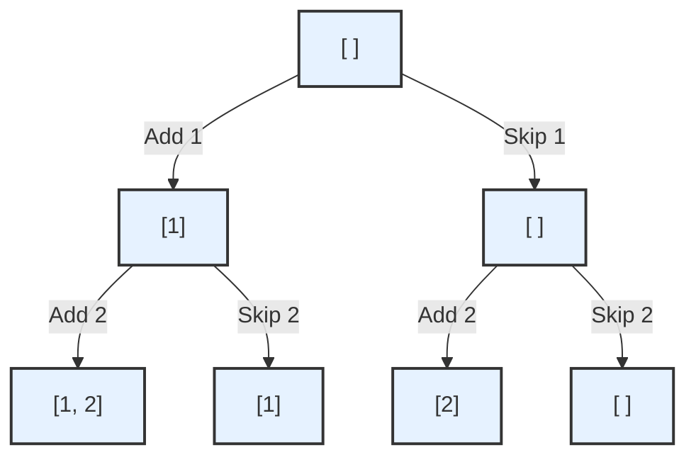

# Pattern 16: Subsets

## 👶 Explain Like I'm 5
Imagine you have an empty box `[]`, and you are walking past three toys on the floor: an Apple, a Bear, and a Car `[A, B, C]`.
You have to decide for every single toy: "Do I put it in the box, or leave it?"
Before you look at any toys, your only choice is an empty box: `[]`
You look at the Apple. You can either leave it, or add it to every box you currently have!
Now you have two boxes: `[]` and `[A]`.
You look at the Bear. You take your two current boxes, and make copies of them with the Bear added!
Now you have four boxes: `[]`, `[A]`, `[B]`, `[A, B]`.
You look at the Car. You make copies of all four boxes with the Car added!
Now you have eight boxes: `[]`, `[A]`, `[B]`, `[A, B]`, `[C]`, `[A, C]`, `[B, C]`, `[A, B, C]`.
You just found every possible Subset (combination) of those toys! 
This technique of taking what you already have, and copying it with the new item added, is called **Breadth-First Search (BFS) for Subsets**.

---

## 🧩 Core Idea & Pattern Detection

The Subsets pattern deals with Combinatorics: finding all possible combinations, permutations, or subsets of a given set of elements.
We usually solve this iteratively by maintaining a list of current subsets and expanding them one by one. (You can also solve this recursively using Backtracking, but the iterative BFS approach is often much easier to visualize and explain!)

### When to use it:
- The problem asks you to find "all combinations", "all subsets", or "all permutations".
- The size of the input is very small (usually `N <= 20`), because combinatorics problems grow exponentially ($2^N$ or $N!$).



---

## 🔧 Algorithmic Anatomy

### Recipe: Iterative BFS Subsets
1. **Initialize** the result list with an empty subset: `subsets = [[]]`
2. **Iterate** over every number in the input array.
3. **Take a Snapshot** of how many subsets you currently have. `n = len(subsets)`.
4. **Iterate through existing subsets** (from `0` to `n-1`), create a copy of each, add the new number to the copy, and append it back to the `subsets` list.

```python
def find_subsets(nums):
    subsets = [[]]
    for currentNumber in nums:
        # We must take the length before we start appending!
        n = len(subsets)
        for i in range(n):
            # Create a new subset from the existing one and add the current number
            set_copy = list(subsets[i])
            set_copy.append(currentNumber)
            subsets.append(set_copy)
    return subsets
```

### Dealing with Duplicates
If the input array has duplicates (e.g., `[1, 5, 3, 3]`), we need to avoid creating duplicate subsets like `[1, 3]` and `[1, 3]`.
**The Trick:** 
1. **Sort** the input array first! This puts duplicates next to each other.
2. If the current number is the same as the previous number, **DON'T** add it to ALL existing subsets! **ONLY** add it to the subsets that were created in the *immediately previous step*.

---

## 🛑 Per-Variant DOs and DON'Ts

| Variant | DO | DON'T |
|---------|----|-------|
| **Standard Subsets** | **DO** use an iterative approach (copying existing arrays). It's incredibly clean. | **DON'T** forget to `list()` copy the existing subset before appending. If you append to the original reference, you will destroy your previous answers! |
| **Duplicates** | **DO** sort the input array first so duplicates are adjacent. | **DON'T** use a Hash Set to blindly filter duplicates at the very end. Generating unnecessary $2^N$ duplicates will cause a Time Limit Exceeded (TLE) error. |
| **Permutations** | **DO** use a `deque` instead of a list. When processing `[1, 2, 3]`, `3` needs to be inserted at index `0`, index `1`, and index `2` of the existing `[1, 2]`. | **DON'T** just append to the end. Permutations require inserting the new character into *every possible position* of the existing string/array. |

---

## ⏱️ Complexity Analysis

| Aspect | Complexity | Why |
|--------|-----------|-----|
| **Time (Subsets)** | **O(N * 2^N)** | For N numbers, there are exactly $2^N$ subsets. In the last step, we are copying arrays of length N. |
| **Time (Permutations)** | **O(N * N!)** | For N numbers, there are exactly $N!$ permutations. |
| **Space** | **O(N * 2^N)** | The result list holds $2^N$ subsets, each taking up to $O(N)$ space. |

---

## ⚠️ Common Pitfalls

1. **Forgetting to take `n = len(subsets)` before the inner loop:** If you do `for subset in subsets:` and then append to `subsets` inside the loop, you will create an infinite loop because the list keeps growing while you iterate over it!
2. **Forgetting to copy:** `new_subset = subsets[i]` creates a pointer. You must do `new_subset = list(subsets[i])` to create a deep copy in memory.

---

## ✅ Problems in This Pattern

| # | Problem | Difficulty | Key Twist |
|---|---------|------------|-----------|
| 1 | Subsets | Easy | Iteratively doubling the list size. |
| 2 | Subsets With Duplicates | Easy | Sort first. Only add duplicates to the newly created subsets from the previous step. |
| 3 | Permutations | Medium | Use a queue. Insert the new number at every possible index `0` to `len(current)`. |
| 4 | String Permutations by changing case | Medium | If character is a letter, duplicate the strings: one with lowercase, one with uppercase. |
| 5 | Balanced Parentheses | Hard | Queue tracks the string AND the count of `open` and `close` parens used. |
| 6 | Unique Generalized Abbreviations | Hard | **Advanced**: Add character OR increment an abbreviation count. |
