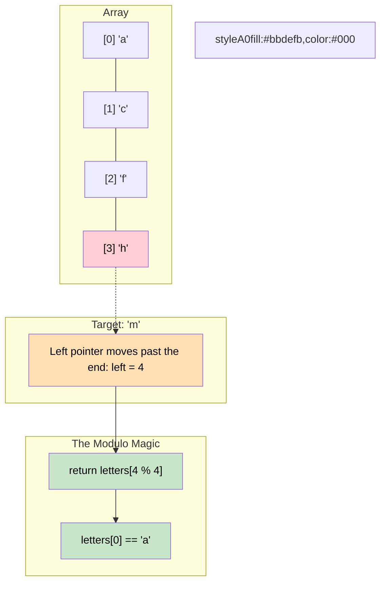

# 🚶‍♂️ Walkthrough: Next Letter

## 👶 Explain Like I'm 5
You are playing a game with the alphabet.
You have a list of letters: `['a', 'c', 'f', 'h']`.
I give you a key, let's say `'f'`, and you have to find the NEXT letter in the list that is STRICTLY greater than `'f'`.
If you look at the list, the letter after `'f'` is `'h'`.

What if I give you `'h'`? There are no letters greater than `'h'`!
In this game, the alphabet is a circle. If you go past the end, you just wrap around back to the very first letter!
So the next letter after `'h'` is `'a'`.

This is exactly like the "Ceiling" problem, with two small differences:
1. We want the **STRICTLY greater** letter. So if we see the exact letter in the list, we don't stop! We keep searching to its right.
2. If we fall off the edge of the array, we just wrap around to index 0.

## 🎯 Core Strategy
This uses the **Modified Binary Search** pattern.

1. **Initialization**: Initialize `left = 0` and `right = len(letters) - 1`.
2. **Binary Search Loop**: Loop while `left <= right`:
   - Calculate `mid = left + (right - left) // 2`.
   - If `key < letters[mid]`, the `mid` letter is greater. The answer could be `mid`, or it could be further left. So we throw away the right half: `right = mid - 1`.
   - If `key >= letters[mid]`, the `mid` letter is too small OR it is exactly equal. Since we want a letter *strictly* greater, we must throw away the left half and keep searching right: `left = mid + 1`.
3. **The Wrap Around**: When the loop breaks, `left` points exactly to the first letter strictly greater than the key. But if the key was larger than all letters, `left` will equal the length of the array (`len(letters)`). We use the modulo operator `% len(letters)` to safely wrap this back to index `0`!

## 🏃‍♂️ Step-by-Step Execution (Dry Run)
**Input**: `letters = ['a', 'c', 'f', 'h']`, `key = 'f'`

### Initialization
`left = 0`, `right = 3`. `n = 4`.

### Loop 1
- `left = 0, right = 3`.
- `mid = 0 + (3 - 0) // 2 = 1`.
- `letters[1]` is `'c'`.
- Is `'f' < 'c'`? NO. `'f' >= 'c'`.
- `left = mid + 1 = 2`.

### Loop 2
- `left = 2, right = 3`.
- `mid = 2 + (3 - 2) // 2 = 2`.
- `letters[2]` is `'f'`.
- Is `'f' < 'f'`? NO. `'f' >= 'f'`.
  - *(Even though they are equal, we must find a greater letter, so we move left!)*
- `left = mid + 1 = 3`.

### Loop 3
- `left = 3, right = 3`.
- `mid = 3 + (3 - 3) // 2 = 3`.
- `letters[3]` is `'h'`.
- Is `'f' < 'h'`? YES!
- `right = mid - 1 = 2`.

### Loop Ends
- `left = 3`, `right = 2`. Loop breaks because `3 > 2`.
- `left % n` $\rightarrow$ `3 % 4 = 3`.
- Return `letters[3]` which is `'h'`. Correct!

## 📊 Visual Diagram
Here is a visual showing how the Modulo operator gracefully handles the edge case of wrapping around:

## 🛑 Edge Cases & Complexity

### Complexity
- **Time Complexity:** $O(\log N)$ to halve the search space.
- **Space Complexity:** $O(1)$. We only use a few pointer variables.

### Edge Cases Handled Safely
- **Key is exactly the last letter:** `key = 'h'`. `left` will eventually sit at `3` and `right` at `3`. `'h' >= 'h'`, so `left = 3 + 1 = 4`. Modulo `4 % 4 = 0`. Returns `'a'`.
- **Key is larger than ALL letters:** `key = 'm'`. `left` pushes past the end to `4`. Modulo wraps it back to `0`. Returns `'a'`.
- **Key is smaller than ALL letters:** `key = 'A'`. `right` gets pushed to `-1`. `left` stays at `0`. Modulo `0 % 4 = 0`. Returns `'a'`. All edge cases seamlessly handled by `%`!
