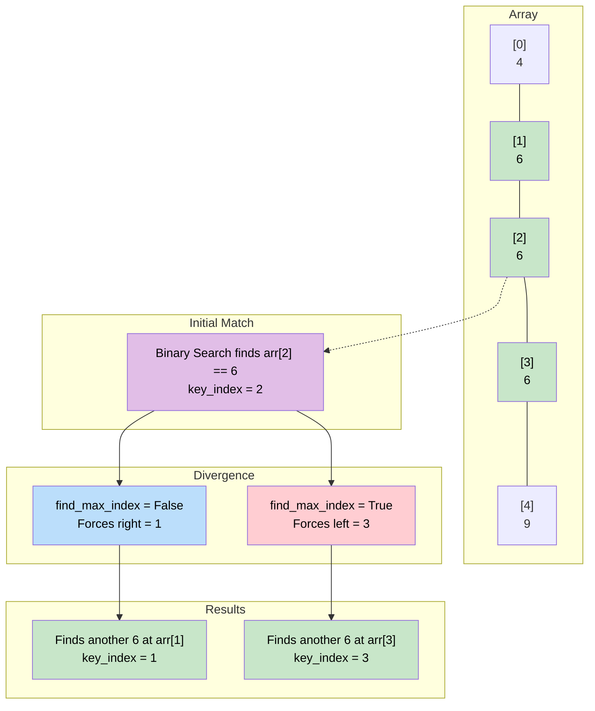

# 🚶‍♂️ Walkthrough: Number Range

## 👶 Explain Like I'm 5
You are looking at a sorted list of numbers: `[1, 3, 8, 8, 8, 8, 10, 15]`.
I ask you: "Where are all the 8s?"
Because they are sorted, all the 8s are clumped together in a single group.

If you just do a normal Binary Search for `8`, it might land directly on the middle `8` (at index 4) and return it. But that doesn't tell us where the group *starts* and *ends*!

To find the exact range, we do Binary Search TWICE.
1. **The Left Border Search**: We do a normal search, but when we find an `8`, we say "Cool, but are there more 8s to the left?" and we FORCE the search to keep looking in the left half!
2. **The Right Border Search**: We do a normal search, but when we find an `8`, we say "Cool, but are there more 8s to the right?" and we FORCE the search to keep looking in the right half!

## 🎯 Core Strategy
This uses the **Modified Binary Search** pattern. We tweak the exact match case (`arr[mid] == key`) to continue searching instead of stopping.

1. **Helper Function**: Define `search(find_max_index: bool)`.
2. **Initialization**: Inside the helper, `key_index = -1`, `left = 0`, `right = len(arr) - 1`.
3. **Binary Search Loop**: 
   - `mid = left + (right - left) // 2`
   - If `key < arr[mid]`, search left (`right = mid - 1`).
   - If `key > arr[mid]`, search right (`left = mid + 1`).
   - If `key == arr[mid]`:
     - **Record Match**: We found a match! Save it: `key_index = mid`.
     - **Keep Going**: We don't return! We keep going to find the boundary.
     - If `find_max_index` is True, we want the rightmost boundary. So we assume there might be another match to our right. We search the right (`left = mid + 1`).
     - If `find_max_index` is False, we want the leftmost boundary. We assume there might be another match to our left. We search the left (`right = mid - 1`).
4. **Execution**: Call `search(False)` to find the `start_idx`. If it's not `-1`, call `search(True)` to find the `end_idx`. Return both!

## 🏃‍♂️ Step-by-Step Execution (Dry Run)
**Input**: `arr = [4, 6, 6, 6, 9]`, `key = 6`

### Find Left Boundary (`find_max_index = False`)
- `left = 0, right = 4`.
- `mid = 2`. `arr[2]` is `6`.
- MATCH! `key_index = 2`.
- `find_max_index` is False $\rightarrow$ search left $\rightarrow$ `right = mid - 1 = 1`.
- `left = 0, right = 1`.
- `mid = 0`. `arr[0]` is `4`.
- `6 > 4` $\rightarrow$ search right $\rightarrow$ `left = mid + 1 = 1`.
- `left = 1, right = 1`.
- `mid = 1`. `arr[1]` is `6`.
- MATCH! `key_index` updates to `1`.
- Search left $\rightarrow$ `right = mid - 1 = 0`.
- Loop breaks (`left=1 > right=0`). Return `key_index = 1`.
- **`start_idx = 1`**

### Find Right Boundary (`find_max_index = True`)
- `left = 0, right = 4`.
- `mid = 2`. `arr[2]` is `6`.
- MATCH! `key_index = 2`.
- `find_max_index` is True $\rightarrow$ search right $\rightarrow$ `left = mid + 1 = 3`.
- `left = 3, right = 4`.
- `mid = 3`. `arr[3]` is `6`.
- MATCH! `key_index` updates to `3`.
- Search right $\rightarrow$ `left = mid + 1 = 4`.
- `left = 4, right = 4`.
- `mid = 4`. `arr[4]` is `9`.
- `6 < 9` $\rightarrow$ search left $\rightarrow$ `right = mid - 1 = 3`.
- Loop breaks (`left=4 > right=3`). Return `key_index = 3`.
- **`end_idx = 3`**

Return `[1, 3]`.

## 📊 Visual Diagram
Here is how the algorithm branches when it finds a match, depending on which boundary it's looking for:

## 🛑 Edge Cases & Complexity

### Complexity
- **Time Complexity:** $O(\log N)$. We perform exactly two standard binary searches. $O(\log N) + O(\log N) = O(\log N)$.
- **Space Complexity:** $O(1)$. Just storing pointers.

### Edge Cases Handled Safely
- **Key Does Not Exist:** The left search completes and returns `-1`. The main function has an optimization `if start_idx != -1:` that completely skips the second search, returning `[-1, -1]` instantly.
- **Single Instance (`[4, 6, 9]` target `6`):** Left search finds it at index 1 and pushes `right=0`. Next loop fails, returns 1. Right search finds it at index 1 and pushes `left=2`. Next loop fails, returns 1. Result `[1, 1]` represents a valid range of length 1!
