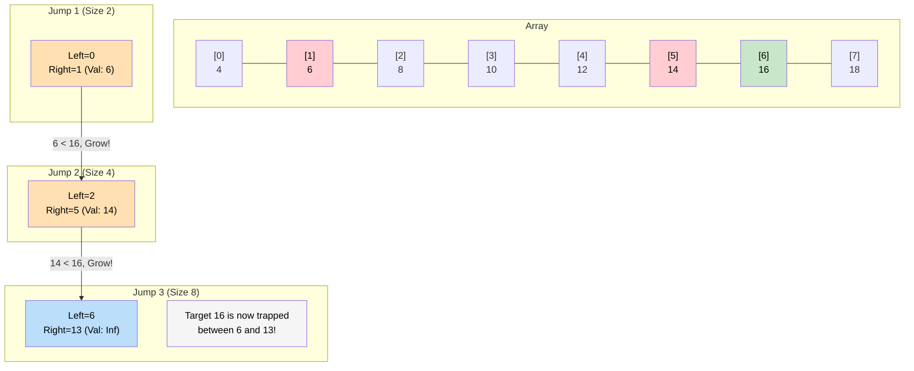

# 🚶‍♂️ Walkthrough: Search in a Sorted Infinite Array

## 👶 Explain Like I'm 5
You are standing on a road that stretches on forever. You are looking for house #50.
You can't do a normal Binary Search because you don't know where the road ends! (You can't set `right = infinity`).

Instead of starting from the edges and shrinking, we start from the beginning and **GROW** our search space exponentially!
- You look at house 0 and 1. Not there.
- You jump to house 3. (Range size 2). Not there.
- You jump to house 7. (Range size 4). Not there.
- You jump to house 15. (Range size 8). Not there.

You keep doubling the size of your range until you finally see a house number that is LARGER than 50. Let's say you see house 60 at index 31.
Aha! Now you have a start (index 15) and an end (index 31). 
Now you can do a perfectly normal Binary Search between those two indices!

## 🎯 Core Strategy
This uses the **Modified Binary Search** pattern. We add a preliminary step to dynamically find the `left` and `right` bounds before we search.

1. **Array Reader Interface**: We are given an `ArrayReader` object. Calling `reader.get(index)` gives the value. If the index is out of bounds, it returns Infinity.
2. **Find the Bounds**:
   - Initialize `left = 0`, `right = 1`.
   - Loop while the value at `right` is strictly less than the `key` (`reader.get(right) < key`):
     - Calculate the *new* size of the window we want to jump by. We want to double it: `new_size = (right - left + 1) * 2`.
     - Update our pointers for the next jump: `new_left = right + 1`.
     - `right = right + new_size`.
     - `left = new_left`.
3. **Binary Search**: Now that `key <= reader.get(right)`, we know the key MUST be trapped between `left` and `right`.
   - Perform a perfectly standard Binary Search between `left` and `right`.
4. Return `mid` if found, `-1` if not.

## 🏃‍♂️ Step-by-Step Execution (Dry Run)
**Input**: `arr = [4, 6, 8, 10, 12, 14, 16, 18, 20, 22, 24]`, `key = 16`

### Phase 1: Find Bounds
- `left = 0`, `right = 1`.
- `reader.get(1)` is `6`.
- `6 < 16`? YES.
  - `new_size = (1 - 0 + 1) * 2 = 4`.
  - `new_left = 2`.
  - `right = 1 + 4 = 5`.
  - `left = 2`.

- `reader.get(5)` is `14`.
- `14 < 16`? YES.
  - `new_size = (5 - 2 + 1) * 2 = 8`.
  - `new_left = 6`.
  - `right = 5 + 8 = 13`.
  - `left = 6`.

- `reader.get(13)` is out of bounds $\rightarrow$ returns Infinity.
- `Infinity < 16`? NO. Loop breaks.
- Our bounds are now: `left = 6`, `right = 13`.

### Phase 2: Binary Search
- `left = 6`, `right = 13`.
- `mid = 6 + (13 - 6) // 2 = 9`.
- `reader.get(9)` is `22`.
- `16 < 22`? YES. Search left.
- `right = 9 - 1 = 8`.

- `left = 6`, `right = 8`.
- `mid = 6 + (8 - 6) // 2 = 7`.
- `reader.get(7)` is `18`.
- `16 < 18`? YES. Search left.
- `right = 7 - 1 = 6`.

- `left = 6`, `right = 6`.
- `mid = 6`.
- `reader.get(6)` is `16`.
- MATCH! Return `6`.

## 📊 Visual Diagram
Here is how the search space grows exponentially until it "catches" the target:

## 🛑 Edge Cases & Complexity

### Complexity
- **Time Complexity:** $O(\log N)$. Finding the bounds takes $O(\log N)$ steps because we double the window size at each iteration. The binary search also takes $O(\log N)$ steps. Total time is $O(\log N)$.
- **Space Complexity:** $O(1)$ since we are only using a few pointers.

### Edge Cases Handled Safely
- **Key is at index 0 or 1:** The `while reader.get(right) < key` loop immediately fails on the very first check. The bounds are set to `left=0`, `right=1`, and the binary search effortlessly finds it.
- **Key is way out of bounds:** The `ArrayReader` returns `math.inf` for indices beyond the array's physical end. The loop stops growing the bounds when it hits `inf`. Then the Binary Search zeroes in on the `inf` space and safely returns `-1` because none of the `inf` values match the target.
