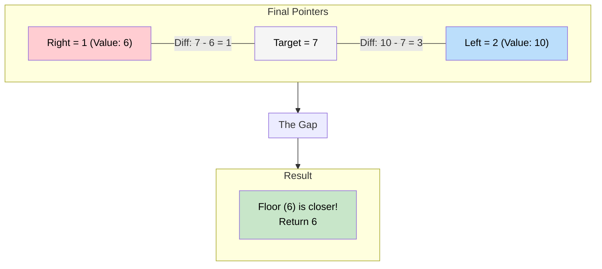

# 🚶‍♂️ Walkthrough: Minimum Difference Element

## 👶 Explain Like I'm 5
You are looking for the number `7` in a list: `[1, 3, 8, 10, 15]`.
But `7` isn't in the list!
So, you want to find the number that is CLOSEST to `7`.

If we do a normal Binary Search, what happens when we don't find the number?
The pointers `left` and `right` cross each other.
Specifically, `left` ends up pointing to the smallest number GREATER than `7` (the **ceiling**).
And `right` ends up pointing to the largest number SMALLER than `7` (the **floor**).

In our list, `left` will point to `8`, and `right` will point to `3`.
The closest number to `7` MUST be one of those two!
So we just check the math: `8 - 7 = 1`. `7 - 3 = 4`.
`8` is closer, so we return `8`!

## 🎯 Core Strategy
This uses the **Modified Binary Search** pattern. We utilize the natural end-state of a failed binary search where `right` stops right before `left`.

1. **Boundary Optimization**: If the key is smaller than the first element, the first element is definitely the closest. If the key is larger than the last element, the last element is definitely the closest. We handle these immediately.
2. **Initialization**: Initialize `left = 0`, `right = len(arr) - 1`.
3. **Binary Search Loop**: Loop while `left <= right`:
   - `mid = left + (right - left) // 2`.
   - If `key == arr[mid]`, we found an exact match. The difference is 0, which is perfectly optimal. Return `arr[mid]`.
   - If `key < arr[mid]`, target is on the left (`right = mid - 1`).
   - If `key > arr[mid]`, target is on the right (`left = mid + 1`).
4. **Evaluate Result**: If the loop breaks, it means `left > right`. 
   - `arr[left]` is now the ceiling.
   - `arr[right]` is now the floor.
   - We calculate which one is closer: `(arr[left] - key)` vs `(key - arr[right])`. Return the winner.

## 🏃‍♂️ Step-by-Step Execution (Dry Run)
**Input**: `arr = [4, 6, 10]`, `key = 7`

### Initialization
- Check bounds: `7 < 4`? No. `7 > 10`? No.
- `left = 0`, `right = 2`.

### Loop 1
- `mid = 1`. `arr[1]` is `6`.
- `6 == 7`? NO.
- `7 > 6`? YES. Target is larger, search right.
- `left = mid + 1 = 2`.

### Loop 2
- `left = 2, right = 2`.
- `mid = 2`. `arr[2]` is `10`.
- `10 == 7`? NO.
- `7 < 10`? YES. Target is smaller, search left.
- `right = mid - 1 = 1`.

### Loop Breaks
- `left = 2`, `right = 1`. Loop breaks (`2 > 1`).
- `arr[left]` (Ceiling) is `arr[2] = 10`. Difference is `10 - 7 = 3`.
- `arr[right]` (Floor) is `arr[1] = 6`. Difference is `7 - 6 = 1`.
- `1 < 3`, so `arr[right]` is the winner.

Return `6`. Correct!

## 📊 Visual Diagram
Here is a visual showing the final crossover state that traps the target:

## 🛑 Edge Cases & Complexity

### Complexity
- **Time Complexity:** $O(\log N)$. Standard binary search time. Evaluating the difference at the end takes $O(1)$.
- **Space Complexity:** $O(1)$. Just storing pointers.

### Edge Cases Handled Safely
- **Key is exactly in the array:** Loop triggers `if key == arr[mid]: return arr[mid]` and exits early perfectly.
- **Key is smaller than all elements:** E.g., `arr=[4, 6, 10], key = 1`. Caught immediately by `if key < arr[0]: return arr[0]`. Returns `4`.
- **Key is larger than all elements:** E.g., `arr=[4, 6, 10], key = 15`. Caught immediately by `if key > arr[-1]: return arr[-1]`. Returns `10`.
