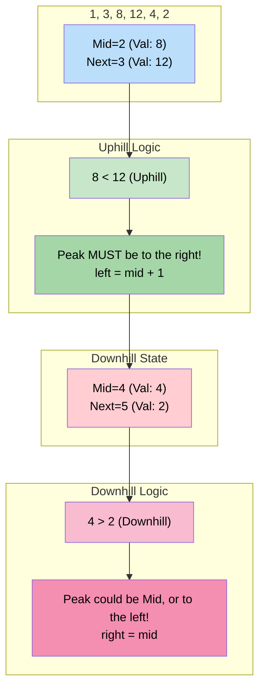

# 🚶‍♂️ Walkthrough: Bitonic Array Maximum

## 👶 Explain Like I'm 5
You are walking up a mountain. `[1, 3, 8, 12, 4, 2]`
At first, the numbers keep getting bigger (`1 -> 3 -> 8 -> 12`).
Then, they start getting smaller (`12 -> 4 -> 2`).

We want to find the very top of the mountain (the peak)!
Because the mountain only goes up once, and then goes down once, we can use Binary Search to find the peak!

We look at a number (like `8`), and we compare it to the next number (`12`).
Because `8 < 12`, we know we are still walking UPHILL. The peak must be to the right!
If we look at `4`, and compare it to the next number `2`, we see `4 > 2`.
We are walking DOWNHILL. The peak must be to the left (or it could be `4` itself)!

We keep shrinking our search space until `left` and `right` point to the exact same number. That number is the peak!

## 🎯 Core Strategy
This uses the **Modified Binary Search** pattern. Instead of looking for a specific target `key`, we compare `arr[mid]` against `arr[mid+1]` to determine the gradient (slope) of the array at that point.

1. **Initialization**: Set `left = 0`, `right = len(arr) - 1`.
2. **Loop Condition**: Loop while `left < right`. Note the strictly less than! We want `left` and `right` to converge onto a single element rather than crossing over.
3. **Gradient Check**:
   - `mid = left + (right - left) // 2`.
   - **Downhill**: If `arr[mid] > arr[mid + 1]`, the array is descending. This means the peak is somewhere to our left, OR `arr[mid]` is the peak itself! So, `right = mid`. (We do NOT use `mid - 1` because we can't rule `mid` out yet).
   - **Uphill**: If `arr[mid] <= arr[mid + 1]`, the array is ascending. The peak MUST be to the right of `mid`. It cannot be `mid` itself (because `mid+1` is larger). So, `left = mid + 1`.
4. **Convergence**: The loop terminates when `left == right`. Both pointers will be parked on the maximum element. Return `arr[left]`.

## 🏃‍♂️ Step-by-Step Execution (Dry Run)
**Input**: `arr = [1, 3, 8, 12, 4, 2]`

### Initialization
`left = 0`, `right = 5`.

### Loop 1
- `mid = 0 + (5 - 0) // 2 = 2`.
- `arr[2]` is `8`. `arr[3]` is `12`.
- `8 > 12`? NO. We are going uphill.
- `left = mid + 1 = 3`.

### Loop 2
- `left = 3`, `right = 5`.
- `mid = 3 + (5 - 3) // 2 = 4`.
- `arr[4]` is `4`. `arr[5]` is `2`.
- `4 > 2`? YES! We are going downhill.
- The peak could be index 4, or earlier. 
- `right = mid = 4`.

### Loop 3
- `left = 3`, `right = 4`.
- `mid = 3 + (4 - 3) // 2 = 3`.
- `arr[3]` is `12`. `arr[4]` is `4`.
- `12 > 4`? YES! We are going downhill.
- `right = mid = 3`.

### Loop Ends
- `left = 3`, `right = 3`. Loop breaks because `3 < 3` is False.
- Return `arr[3]` which is `12`. Correct!

## 📊 Visual Diagram
Here is how comparing `mid` to `mid+1` tells us which half of the mountain to search:

## 🛑 Edge Cases & Complexity

### Complexity
- **Time Complexity:** $O(\log N)$. We halve the search space at each step based on the gradient.
- **Space Complexity:** $O(1)$. Just storing pointers.

### Edge Cases Handled Safely
- **Array is entirely ascending:** `[1, 3, 8, 12]`. We will always be "Uphill". `left` will continually be pushed right (`mid + 1`) until it hits the final index `3`. `right` stays at `3`. They meet at `3`, and it returns `12`. Correct!
- **Array is entirely descending:** `[10, 9, 8]`. We will always be "Downhill". `right` will continually be pulled left (`mid`) until it hits `0`. `left` stays at `0`. They meet at `0`, and it returns `10`. Correct!
