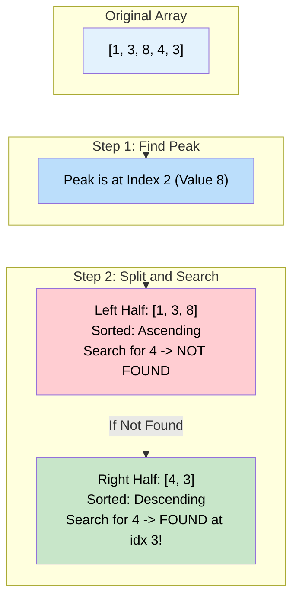

# 🚶‍♂️ Walkthrough: Search Bitonic Array

## 👶 Explain Like I'm 5
You are walking on a mountain again: `[1, 3, 8, 4, 3]`.
I ask you to find the number `3`.

You can't just do a normal Binary Search, because the mountain goes UP and then DOWN.
What if you first find the peak of the mountain? (Which is `8` at index 2).
Now, the mountain is split into two perfectly sorted halves!
- The **left half** `[1, 3, 8]` is sorted going **UP**.
- The **right half** `[4, 3]` is sorted going **DOWN**.

So, you just do an Order-Agnostic Binary Search on the left half. If you find `3`, great!
If not, you do an Order-Agnostic Binary Search on the right half.

## 🎯 Core Strategy
This uses the **Modified Binary Search** pattern. It combines the logic from two previous problems: "Bitonic Array Maximum" and "Order-Agnostic Binary Search".

1. **Find the Peak**: Use the logic from "Bitonic Array Maximum" to find the index of the largest element. This splits the array into an ascending half and a descending half.
2. **Search Left Half**: Perform a standard ascending binary search from `left = 0` to `right = max_index`. We want to search here first because if duplicates exist, they usually want the lowest index.
3. **Search Right Half**: If the key wasn't found in the left half, perform a descending binary search from `left = max_index + 1` to `right = len(arr) - 1`.
4. **Return**: Return the index if found, otherwise `-1`.

## 🏃‍♂️ Step-by-Step Execution (Dry Run)
**Input**: `arr = [1, 3, 8, 4, 3]`, `key = 4`

### Phase 1: Find the Peak
- Initial: `left = 0`, `right = 4`.
- `mid = 2`. `arr[2]` is `8`.
- `arr[mid] > arr[mid+1]` $\rightarrow$ `8 > 4` (Downhill). `right = 2`.
- `mid = 1`. `arr[1]` is `3`.
- `arr[mid] > arr[mid+1]` $\rightarrow$ `3 > 8` (Uphill). `left = 2`.
- `left == right == 2`. The peak is at `index 2` (`8`).

### Phase 2: Search Left Half (Ascending)
- Search range: `0` to `2`. (`[1, 3, 8]`).
- `mid = 1`. `arr[1]` is `3`.
- `key (4) > 3`. Search right.
- `left = 2`. `right = 2`.
- `mid = 2`. `arr[2]` is `8`.
- `key (4) < 8`. Search left.
- `right = 1`.
- `left > right`. Break. Left half returns `-1`.

### Phase 3: Search Right Half (Descending)
- Search range: `3` to `4`. (`[4, 3]`).
- `mid = 3`. `arr[3]` is `4`.
- `4 == key`!
- Match found! Return `3`.

## 📊 Visual Diagram
Here is how the array gets cleanly split into two distinct sub-problems:

## 🛑 Edge Cases & Complexity

### Complexity
- **Time Complexity:** $O(\log N)$. Finding the peak takes $O(\log N)$. Searching the left half takes $O(\log N)$. Searching the right half takes $O(\log N)$. Since they happen sequentially, $O(3 \log N)$ simplifies to $O(\log N)$.
- **Space Complexity:** $O(1)$. Just storing pointers.

### Edge Cases Handled Safely
- **Key doesn't exist:** E.g., `key = 9`. The left search returns `-1`, the right search executes and returns `-1`. The main function safely returns `-1`.
- **Peak IS the key:** The peak is included in the left half search space `(0 to max_index)`. The left search will immediately hit it and return the index. The right search is cleanly skipped!
- **Entirely Ascending Array:** Peak will be the very last index. The left search will check the whole array. The right search will be bounded from `max_index + 1` to `max_index`, which immediately fails the `left <= right` condition. Perfectly safe!
