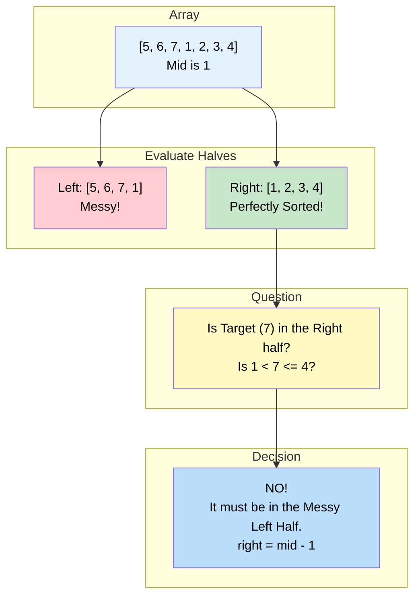

# 🚶‍♂️ Walkthrough: Search in Rotated Array

## 👶 Explain Like I'm 5
You have a sorted array: `[1, 2, 3, 4, 5, 6, 7]`.
Someone comes along, chops it into two pieces, and swaps the pieces!
Now it looks like this: `[5, 6, 7, 1, 2, 3, 4]`.
We call this a "Rotated Array".

Can we still use Binary Search? YES!
If you cut a rotated array in half, **AT LEAST ONE of those halves will be perfectly sorted**. Always. Guaranteed.
Let's look at `mid` (which is `1`).
Left half is `[5, 6, 7, 1]`. (Not sorted perfectly).
Right half is `[1, 2, 3, 4]`. (Perfectly sorted!).

So, to find our number:
1. Find which half is perfectly sorted.
2. Check if our number fits inside the perfectly sorted half.
3. If it fits, we throw away the messy half and search the perfect half!
4. If it doesn't fit, we throw away the perfect half and search the messy half!

## 🎯 Core Strategy
This uses the **Modified Binary Search** pattern. We determine which half of the array is strictly sorted, and check if the target falls in that half.

1. **Initialization**: Initialize `left = 0`, `right = len(arr) - 1`.
2. **Loop**: Loop while `left <= right`.
3. **Mid Check**: `mid = left + (right - left) // 2`. If `arr[mid] == key`, return `mid`.
4. **Is Left Sorted?** Check if `arr[left] <= arr[mid]`.
   - If YES, the left half is perfectly sorted.
   - Now check: Is the key inside this sorted half? `if arr[left] <= key < arr[mid]:`
     - If YES: The key is here. Search left (`right = mid - 1`).
     - If NO: The key MUST be in the messy right half. Search right (`left = mid + 1`).
5. **Is Right Sorted?** If the left isn't sorted, the right half MUST be sorted!
   - Now check: Is the key inside this sorted right half? `if arr[mid] < key <= arr[right]:`
     - If YES: The key is here. Search right (`left = mid + 1`).
     - If NO: The key MUST be in the messy left half. Search left (`right = mid - 1`).
6. If loop ends, return `-1`.

## 🏃‍♂️ Step-by-Step Execution (Dry Run)
**Input**: `arr = [10, 15, 1, 3, 8]`, `key = 15`

### Initialization
- `left = 0`, `right = 4`.

### Loop 1
- `mid = 0 + (4 - 0) // 2 = 2`.
- `arr[2]` is `1`.
- `1 == 15`? NO.
- **Check Left**: Is `arr[0] <= arr[2]`? `10 <= 1`? NO. Left is messy.
- **Right Must Be Sorted**: The right half `[1, 3, 8]` is sorted!
- **Check Key in Right**: Is `arr[mid] < key <= arr[right]`? `1 < 15 <= 8`? NO. The key `15` is not in this half.
- Conclusion: The key must be in the messy left half!
- Search left: `right = mid - 1 = 1`.

### Loop 2
- `left = 0`, `right = 1`.
- `mid = 0 + (1 - 0) // 2 = 0`.
- `arr[0]` is `10`.
- `10 == 15`? NO.
- **Check Left**: Is `arr[0] <= arr[0]`? `10 <= 10`? YES. Left is sorted.
- **Check Key in Left**: Is `arr[0] <= key < arr[0]`? `10 <= 15 < 10`? NO.
- Conclusion: The key must be in the right half!
- Search right: `left = mid + 1 = 1`.

### Loop 3
- `left = 1`, `right = 1`.
- `mid = 1`.
- `arr[1]` is `15`.
- `15 == 15`? YES!
- Match found! Return `mid = 1`.

## 📊 Visual Diagram
Here is how we use the sorted half to confidently eliminate half of the search space:

## 🛑 Edge Cases & Complexity

### Complexity
- **Time Complexity:** $O(\log N)$. We still eliminate half of the array at every step, so we retain the logarithmic time of Binary Search.
- **Space Complexity:** $O(1)$. Just storing pointers.

### Edge Cases Handled Safely
- **Array isn't rotated at all:** `[1, 2, 3, 4, 5]`. `arr[left] <= arr[mid]` will always evaluate to `True`. The algorithm will just perform a completely standard Binary Search!
- **Two elements:** `[5, 1]`, search for `1`.
  - `mid = 0`. `arr[0] = 5`. `5 != 1`.
  - `arr[0] <= arr[0]` is `True`. Left is "sorted".
  - Is `1` in `[5]`? No.
  - Search right: `left = 1`.
  - Next loop: `mid = 1`. `arr[1] = 1`. Match! Returns `1`. Safely handles small sizes.
