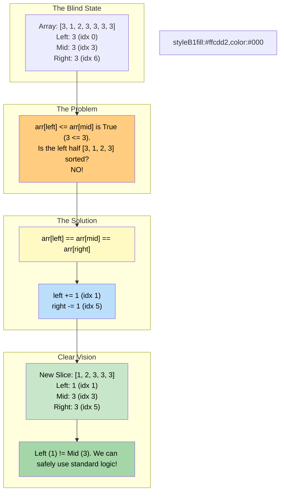

# 🚶‍♂️ Walkthrough: Search in Rotated Array II

## 👶 Explain Like I'm 5
This is EXACTLY the same as searching in a rotated array, but now there can be duplicate numbers.
Normally, we check if the left half is perfectly sorted by asking: *"Is the left number smaller than or equal to the middle number?"*

But what if the array is `[3, 1, 2, 3, 3, 3, 3]`?
- Left is `3`. Middle is `3`. Right is `3`.
- Is the left half sorted? NO. (It contains `[3, 1, 2, 3]`).
- Is the right half sorted? YES. (It contains `[3, 3, 3]`).

Because `left`, `mid`, and `right` are all the same number, we are BLIND. We can't tell which half is the clean, sorted half!
So, what do we do? We just take a tiny step inward!
We throw away the `left` number (`left += 1`) and we throw away the `right` number (`right -= 1`).
We can safely do this because we already know that `mid` is not our target (we check `arr[mid] == target` before anything else). Since `left` and `right` are equal to `mid`, they aren't our target either!

## 🎯 Core Strategy
This uses the **Modified Binary Search** pattern. We take the exact algorithm from "Search in Rotated Array" and add a single `if` statement to handle the duplicate edge case.

1. **Initialization**: Initialize `left = 0`, `right = len(arr) - 1`.
2. **Loop**: Loop while `left <= right`.
3. **Mid Check**: `mid = left + (right - left) // 2`. If `arr[mid] == key`, return `True` (or the index).
4. **The Blindness Check**: If `arr[left] == arr[mid] == arr[right]`:
   - We cannot definitively say which half is sorted.
   - So we just shrink the window: `left += 1`, `right -= 1`.
   - `continue` to jump to the next loop iteration.
5. **Standard Rotated Logic**:
   - If `arr[left] <= arr[mid]`: Left half is sorted. Check if key is inside it. If yes, search left, else search right.
   - Else: Right half is sorted. Check if key is inside it. If yes, search right, else search left.
6. Return `False` if loop ends.

## 🏃‍♂️ Step-by-Step Execution (Dry Run)
**Input**: `arr = [3, 1, 2, 3, 3, 3, 3]`, `key = 2`

### Loop 1
- `left = 0`, `right = 6`.
- `mid = 3`.
- `arr[0]` is `3`. `arr[3]` is `3`. `arr[6]` is `3`.
- Does `3 == 2`? NO.
- Does `arr[left] == arr[mid] == arr[right]`? YES! (`3 == 3 == 3`).
- We are blind! Shrink window.
- `left = 1`, `right = 5`.
- `continue`.

### Loop 2
- `left = 1`, `right = 5`. (Array slice: `[1, 2, 3, 3, 3]`).
- `mid = 1 + (5 - 1) // 2 = 3`.
- `arr[3]` is `3`.
- Does `3 == 2`? NO.
- Does `arr[left] == arr[mid] == arr[right]`? `arr[1]` is `1`. `1 == 3 == 3`? NO. We can see clearly now!
- **Check Left**: Is `arr[left] <= arr[mid]`? `1 <= 3`? YES. Left half is sorted!
- **Check Key in Left**: Is `arr[1] <= key < arr[3]`? `1 <= 2 < 3`? YES!
- The key is in the left half.
- Search left: `right = mid - 1 = 2`.

### Loop 3
- `left = 1`, `right = 2`.
- `mid = 1 + (2 - 1) // 2 = 1`.
- `arr[1]` is `1`.
- Does `1 == 2`? NO.
- Left is sorted (`1 <= 1`). Key in left (`1 <= 2 < 1`)? NO.
- Search right: `left = mid + 1 = 2`.

### Loop 4
- `left = 2`, `right = 2`.
- `mid = 2`.
- `arr[2]` is `2`.
- Does `2 == 2`? YES!
- Return `True`.

## 📊 Visual Diagram
Here is how the algorithm reacts when it is "blinded" by duplicates across all three pointers:

## 🛑 Edge Cases & Complexity

### Complexity
- **Time Complexity:** $O(\log N)$ on average. However, in the absolute worst-case scenario (e.g., `arr = [1, 1, 1, 1, 1]`, searching for `2`), `left` and `right` will just step inward by 1 every single loop until they meet in the middle. This degrades the time complexity to $O(N)$.
- **Space Complexity:** $O(1)$.

### Edge Cases Handled Safely
- **All duplicates:** `[1, 1, 1, 1, 1]`. Will continuously trigger `left += 1`, `right -= 1` until pointers cross, smoothly returning `False` in $O(N/2)$ steps.
- **Normal Rotated Array:** `[4, 5, 6, 1, 2, 3]`. The duplicate check will instantly fail every time, and it will run the standard $O(\log N)$ algorithm natively.
