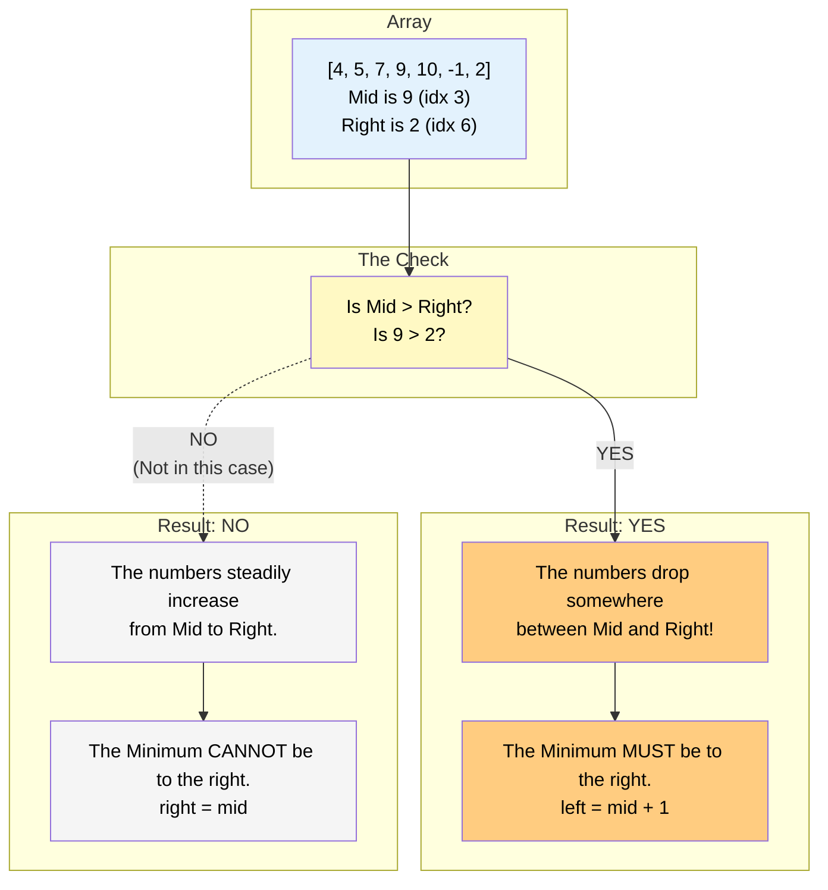

# 🚶‍♂️ Walkthrough: Rotation Count

## 👶 Explain Like I'm 5
You have a perfectly sorted list: `[1, 2, 3, 4, 5]`.
Someone rotated it twice! `[4, 5, 1, 2, 3]`.
Notice that the smallest number (`1`) is now at index `2`.
**The number of times the array was rotated is exactly equal to the INDEX of the smallest element!**
So this problem is just asking: *"Find the index of the minimum element!"*

How do we find the minimum element with Binary Search?
Look at `mid`. Compare it with `right`.
- If `arr[mid] > arr[right]`, it means the right side is wrapping around! Like `[4, 5, 1, 2]`. Mid is `5`, Right is `2`. The only way a number on the left is bigger than a number on the right is if the rotation happened between them! So the minimum MUST be to the right of `mid`.
- If `arr[mid] <= arr[right]`, it means the right side is perfectly sorted! Like `[1, 2, 3]`. Mid is `2`, Right is `3`. If the right side is perfectly sorted and increasing, the minimum CANNOT be there. It must be `mid` or somewhere to the left of `mid`.

## 🎯 Core Strategy
This uses the **Modified Binary Search** pattern. We want `left` and `right` to converge precisely on the minimum element.

1. **Initialization**: Initialize `left = 0`, `right = len(arr) - 1`.
2. **Loop Condition**: Loop while `left < right`. We use strictly less than because we want them to meet at the target, rather than cross over.
3. **Compare Mid and Right**:
   - `mid = left + (right - left) // 2`.
   - **Wrap-around Case**: If `arr[mid] > arr[right]`:
     - The array is unsorted between `mid` and `right`. This means the drop-off (the minimum element) MUST be in the right half.
     - `left = mid + 1`.
   - **Sorted Case**: Else (`arr[mid] <= arr[right]`):
     - The array is perfectly sorted between `mid` and `right`.
     - The minimum element CANNOT be strictly to the right of `mid`. It must be at `mid`, or to the left of `mid`.
     - `right = mid`. (Notice we don't use `mid - 1`, because `mid` itself could be the minimum!).
4. **Convergence**: The loop terminates when `left == right`. This single pointer is the index of the minimum element, which equals the number of rotations. Return `left`.

## 🏃‍♂️ Step-by-Step Execution (Dry Run)
**Input**: `arr = [4, 5, 7, 9, 10, -1, 2]`

### Initialization
- `left = 0`, `right = 6`.

### Loop 1
- `mid = 0 + (6 - 0) // 2 = 3`.
- `arr[3]` is `9`.
- `arr[6]` is `2`.
- Is `arr[mid] > arr[right]`? `9 > 2`? YES.
- The array wraps around between 9 and 2. Minimum is to the right.
- `left = mid + 1 = 4`.

### Loop 2
- `left = 4`, `right = 6`.
- `mid = 4 + (6 - 4) // 2 = 5`.
- `arr[5]` is `-1`.
- `arr[6]` is `2`.
- Is `arr[mid] > arr[right]`? `-1 > 2`? NO.
- The array is sorted between -1 and 2. Minimum is at `mid` or left.
- `right = mid = 5`.

### Loop 3
- `left = 4`, `right = 5`.
- `mid = 4 + (5 - 4) // 2 = 4`.
- `arr[4]` is `10`.
- `arr[5]` is `-1`.
- Is `arr[mid] > arr[right]`? `10 > -1`? YES.
- Minimum is to the right.
- `left = mid + 1 = 5`.

### Loop Ends
- `left = 5`, `right = 5`. Loop breaks because `5 < 5` is False.
- Return `left` which is `5`.
- The array was rotated 5 times! (And the minimum is indeed at index 5).

## 📊 Visual Diagram
Here is how comparing `mid` with `right` immediately reveals where the "cliff" (the minimum) is:

## 🛑 Edge Cases & Complexity

### Complexity
- **Time Complexity:** $O(\log N)$. Standard binary search halving process.
- **Space Complexity:** $O(1)$. Just storing pointers.

### Edge Cases Handled Safely
- **Array is NOT rotated:** `[1, 3, 8, 10]`.
  - Loop 1: `mid` is 3 (idx 1). `3 > 10` is False. `right = mid = 1`.
  - Loop 2: `mid` is 1 (idx 0). `1 > 3` is False. `right = mid = 0`.
  - Loop breaks. `left = 0`. Returns `0` rotations! Perfectly accurate.
- **Only two elements:** `[5, 1]`.
  - `mid = 0`. `arr[0]` is `5`.
  - `5 > 1` is True. `left = mid + 1 = 1`.
  - Loop breaks. Returns `1`. Accurate!
