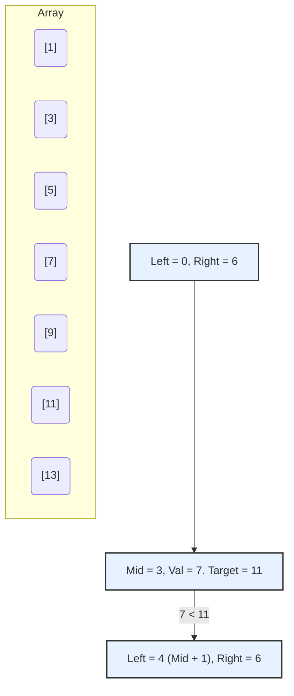

# Pattern 17: Modified Binary Search

## 👶 Explain Like I'm 5
Imagine you have a giant dictionary with 1,000 pages. 
You are looking for the word "Monkey".
Do you start at page 1 and read every single word until you find it? No!
You open the book exactly in the middle. Let's say you open to the letter "P".
You know that "M" comes before "P" in the alphabet.
So you can immediately rip the entire second half of the dictionary out and throw it in the trash! 
You just threw away 500 pages without reading a single word on them.
Now you open the remaining half exactly in the middle. You land on "J". 
You know "M" comes after "J", so you rip the first half out and throw it away!
You keep ripping the book in half until you are staring at the exact page with "Monkey".
This is **Binary Search**. It finds things in ordered lists incredibly fast.

---

## 🧩 Core Idea & Pattern Detection

Binary Search is used to find a target value within a sorted array in $O(\log N)$ time.
"Modified" Binary Search applies this core logic to arrays that are sorted in a weird way, such as arrays sorted in descending order, arrays that have been rotated, or arrays where elements increase then decrease (Bitonic).

### When to use it:
- The problem asks you to search, insert, or find a boundary in a **sorted array**.
- The algorithm is required to run in **O(log N)** time.
- You are searching in a "Rotated" array or a "Mountain/Bitonic" array.



---

## 🔧 Algorithmic Anatomy

### Recipe: Standard Binary Search
1. Initialize `left = 0` and `right = len(arr) - 1`.
2. Loop while `left <= right`:
3. Calculate the middle index: `mid = left + (right - left) // 2`. *(Doing it this way prevents integer overflow in languages like Java/C++, though Python handles it automatically).*
4. Check the middle value:
   - If `arr[mid] == target`, you found it! Return `mid`.
   - If `target < arr[mid]`, the target is in the left half. `right = mid - 1`.
   - If `target > arr[mid]`, the target is in the right half. `left = mid + 1`.
5. If the loop finishes and you didn't return, the target is not in the array. Return `-1`.

```python
def binary_search(arr, target):
    left, right = 0, len(arr) - 1
    
    while left <= right:
        mid = left + (right - left) // 2
        
        if arr[mid] == target:
            return mid
        elif arr[mid] < target:
            left = mid + 1 # Search Right
        else:
            right = mid - 1 # Search Left
            
    return -1
```

---

## 🛑 Per-Variant DOs and DON'Ts

| Variant | DO | DON'T |
|---------|----|-------|
| **Order-Agnostic** | **DO** check if the first element is larger than the last element to determine if the array is ascending or descending. | **DON'T** write two completely separate binary search while loops. Just change the `if target < arr[mid]` logic based on a boolean `is_ascending`. |
| **Ceiling / Next Letter** | **DO** return `left` at the end of the while loop. When `left > right`, `left` will naturally point to the smallest element greater than the target. | **DON'T** return `-1` at the end. The whole point is to find the closest fit, not an exact match. |
| **Rotated Arrays** | **DO** check which half of the array is perfectly sorted first (`arr[left] <= arr[mid]`). | **DON'T** try to check if the target is in the unsorted half. Only check if the target fits perfectly inside the *sorted* half! |

---

## ⏱️ Complexity Analysis

| Aspect | Complexity | Why |
|--------|-----------|-----|
| **Time** | **O(log N)** | We divide the search space in half at every step. $N \rightarrow N/2 \rightarrow N/4 \rightarrow 1$. |
| **Space** | **O(1)** | We only use a few pointers (`left`, `right`, `mid`), regardless of the size of the array. |

---

## ⚠️ Common Pitfalls

1. **Infinite Loops (`left < right` vs `left <= right`):** 
   - Standard Binary Search (finding an exact value) uses `left <= right`. If you just use `<`, you will miss checking the very last element when `left` and `right` converge on it!
   - Searching for boundaries or minimums often uses `left < right` and `right = mid` instead of `mid - 1`.
2. **Integer Overflow:** In many languages, `(left + right) / 2` can overflow if the indices are huge. Always use `left + (right - left) // 2`.
3. **Rotated Array Duplicates:** If `arr[left] == arr[mid] == arr[right]`, you cannot tell which half is sorted! You MUST safely shrink the boundaries by doing `left += 1` and `right -= 1` and continuing.

---

## ✅ Problems in This Pattern

| # | Problem | Difficulty | Key Twist |
|---|---------|------------|-----------|
| 1 | Order-agnostic | Easy | Array could be descending. Flip the `<` `>` operators! |
| 2 | Ceiling of a Number | Medium | Return `left` when the loop breaks to get the next largest number. |
| 3 | Next Letter | Medium | Like Ceiling, but loops around to the start if no larger letter exists. |
| 4 | Number Range | Medium | Run Binary Search twice! Once to find the leftmost boundary, once for rightmost. |
| 5 | Sorted Infinite Array | Medium | You don't have `len(arr)`. Start `left=0, right=1` and double `right` until `arr[right] > target`. |
| 6 | Minimum Difference | Medium | Return the element closest to the target. It will be either `arr[left]` or `arr[right]` after loop breaks. |
| 7 | Bitonic Maximum | Easy | Use `left < right`. If `arr[mid] > arr[mid+1]`, you are going downhill, so max is to the left (`right = mid`). |
| 8 | Search Bitonic | Medium | Find max, then binary search the ascending left half, then the descending right half. |
| 9 | Search Rotated | Medium | Identify which half is sorted, then check if target is inside it. |
| 10 | Rotated II (Dups) | Medium | **Advanced**: Handle `arr[l] == arr[mid] == arr[r]` by shrinking `l++` and `r--`. |
| 11 | Rotation Count | Medium | **Advanced**: Find the index of the minimum element! |
