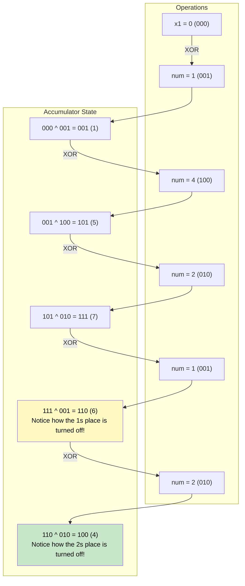

# 🚶‍♂️ Walkthrough: Single Number

## 👶 Explain Like I'm 5
You have a bag of numbers. 
Every number has an identical twin in the bag, EXCEPT for one lonely number.
For example: `[1, 4, 2, 1, 2]`.
- `1` has a twin.
- `2` has a twin.
- `4` is all alone!

We want to find the lonely number.
Normally, you'd make a list, check off the twins as you see them, and see who is left. But that requires extra memory (like using a scratchpad).
Instead, we use a magic math operator called XOR (`^`).

XOR is like a light switch. 
- If you flip it ONCE with a number, it turns ON. 
- If you flip it TWICE with the exact same number, it turns OFF and disappears (becomes `0`)!

If you just XOR every number in the bag together, all the twins will cancel each other out, and ONLY the lonely number will be left shining at the end!
`1 ^ 4 ^ 2 ^ 1 ^ 2` $\rightarrow$ `(1 ^ 1) ^ (2 ^ 2) ^ 4` $\rightarrow$ `0 ^ 0 ^ 4` $\rightarrow$ `4`.

## 🎯 Core Strategy
This uses the **Bitwise XOR** pattern. It relies on three fundamental properties of XOR:
1. **It returns 0 if we take XOR of two same numbers:** `A ^ A = 0`
2. **It returns the number itself if we take XOR with 0:** `A ^ 0 = A`
3. **It is commutative and associative:** `A ^ B ^ A = (A ^ A) ^ B = 0 ^ B = B`

Because of these properties, we don't need to sort the array or use a Hash Map. We just accumulate the XOR of every element.

1. **Initialize**: Create a variable `x1 = 0`.
2. **Iterate**: Loop through every number `num` in the array.
3. **XOR**: Update `x1 ^= num`.
4. **Return**: The final value of `x1` is the single number.

## 🏃‍♂️ Step-by-Step Execution (Dry Run)
**Input**: `arr = [1, 4, 2, 1, 2]`

### Initialization
- `x1 = 0`

### Loop Iterations
1. `num = 1`
   - `x1 = 0 ^ 1 = 1`
2. `num = 4`
   - `x1 = 1 ^ 4 = 5` (Binary `001 ^ 100 = 101`)
3. `num = 2`
   - `x1 = 5 ^ 2 = 7` (Binary `101 ^ 010 = 111`)
4. `num = 1`
   - `x1 = 7 ^ 1 = 6` (Binary `111 ^ 001 = 110`)
5. `num = 2`
   - `x1 = 6 ^ 2 = 4` (Binary `110 ^ 010 = 100`)

Return `4`.

## 📊 Visual Diagram
Here is how the binary bits flip on and off as they are XORed:

## 🛑 Edge Cases & Complexity

### Complexity
- **Time Complexity:** $O(N)$. We iterate through the array exactly once.
- **Space Complexity:** $O(1)$. We use a single variable, requiring no extra memory scaled to the input size.

### Edge Cases Handled Safely
- **Single Element Array:** E.g., `[42]`.
  - Initialize `x1 = 0`.
  - Loop runs once: `0 ^ 42 = 42`.
  - Returns `42`. Handles natively without any extra logic.
