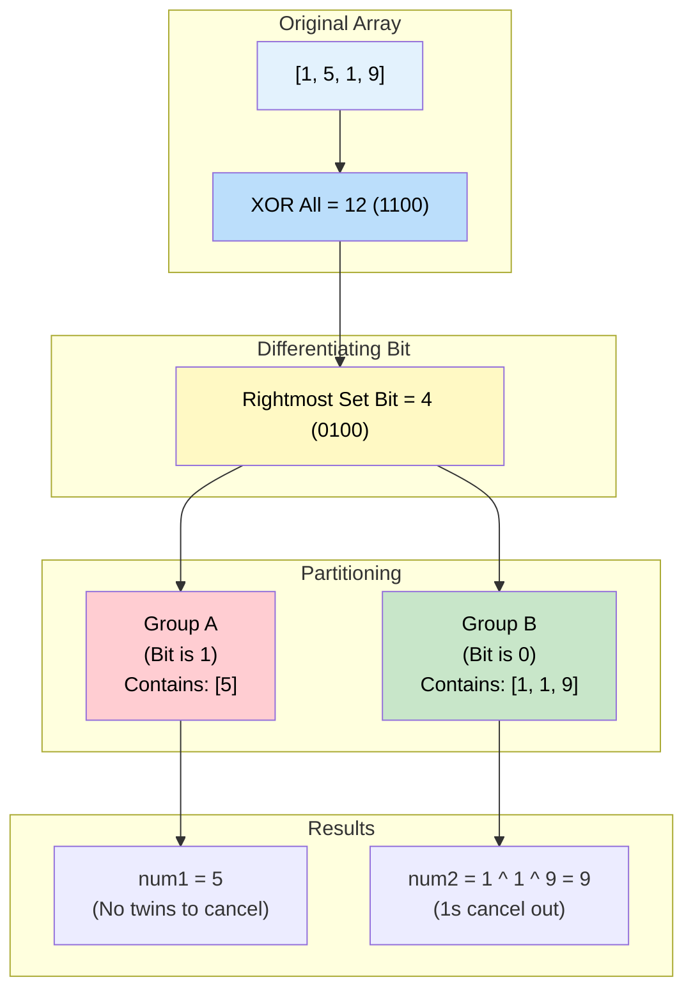

# 🚶‍♂️ Walkthrough: Two Single Numbers

## 👶 Explain Like I'm 5
You have a bag of numbers. Every number has a twin, except for TWO lonely numbers!
For example: `[1, 5, 1, 9]`.
The loners are `5` and `9`.

If you do our trick from the last problem (XORing everything together), all the twins cancel out!
But you are left with `5 ^ 9`, which equals `12`.
How do we separate `12` back into `5` and `9`?!

Look at the binary of the XOR result (`12` is `1100`).
If a bit is `1` in the XOR result, it means that `5` and `9` have **DIFFERENT** bits at that exact position! (One of them has a 1, the other has a 0).
Let's find just ONE bit that is different. We usually pick the rightmost `1`.
For `12` (`1100`), the rightmost `1` is the 4s place (`0100`).

Now, we look at the original bag of numbers, and we divide them into TWO groups:
- **Group A**: Numbers where the 4s place is a `1`.
- **Group B**: Numbers where the 4s place is a `0`.

Our two loners (`5` and `9`) are guaranteed to be in DIFFERENT groups!
And all the twins are guaranteed to be in the SAME group as each other!
So now we just run the basic "Single Number" XOR trick on Group A and Group B separately, and we find our two loners!

## 🎯 Core Strategy
This uses the **Bitwise XOR** pattern.

1. **XOR Everything**: Loop through the array and XOR all elements. The twins will cancel out, leaving `n1xn2` (which is `num1 ^ num2`).
2. **Find a Differentiating Bit**: Since `num1` and `num2` are different numbers, `n1xn2` will be non-zero. Find the rightmost bit that is set to `1` in `n1xn2`. We do this by shifting a `1` leftwards until `(rightmost_set_bit & n1xn2) != 0`.
3. **Partition & XOR**: 
   - Initialize `num1 = 0` and `num2 = 0`.
   - Iterate through the array again.
   - For each number, check if its bit at the `rightmost_set_bit` position is `1` or `0` by doing `(num & rightmost_set_bit)`.
   - If it's not 0, it goes to Group A, so we do `num1 ^= num`.
   - If it is 0, it goes to Group B, so we do `num2 ^= num`.
4. **Return**: The variables `num1` and `num2` now cleanly contain the two single numbers.

## 🏃‍♂️ Step-by-Step Execution (Dry Run)
**Input**: `arr = [1, 5, 1, 9]`

### Step 1: XOR Everything
- `n1xn2 = 1 ^ 5 ^ 1 ^ 9 = 5 ^ 9`
- `5` is `0101`
- `9` is `1001`
- `5 ^ 9 = 1100` (`12`)

### Step 2: Find Rightmost Set Bit
- `n1xn2 = 12` (Binary `1100`)
- `rightmost_set_bit = 1` (Binary `0001`)
- `1 & 12` (`0001 & 1100`) == `0`. Shift left: `rightmost_set_bit = 2` (`0010`)
- `2 & 12` (`0010 & 1100`) == `0`. Shift left: `rightmost_set_bit = 4` (`0100`)
- `4 & 12` (`0100 & 1100`) == `4` (Not zero!). Loop breaks.

### Step 3: Partition and XOR
- `num1 = 0`, `num2 = 0`
- **Number 1:** `0001`. `1 & 4` == 0. Goes to Group B. `num2 ^= 1` $\rightarrow$ `num2 = 1`
- **Number 5:** `0101`. `5 & 4` == 4. Goes to Group A. `num1 ^= 5` $\rightarrow$ `num1 = 5`
- **Number 1:** `0001`. `1 & 4` == 0. Goes to Group B. `num2 ^= 1` $\rightarrow$ `num2 = 1 ^ 1 = 0`
- **Number 9:** `1001`. `9 & 4` == 0. Goes to Group B. `num2 ^= 9` $\rightarrow$ `num2 = 0 ^ 9 = 9`

### Final Result
- `num1 = 5`
- `num2 = 9`
- Return `[5, 9]`.

## 📊 Visual Diagram
Here is how the numbers are sorted into two buckets based on the differentiating bit:

## 🛑 Edge Cases & Complexity

### Complexity
- **Time Complexity:** $O(N)$. We iterate through the array twice. First to find the total XOR, then to partition.
- **Space Complexity:** $O(1)$. We only use a few integer variables.

### Edge Cases Handled Safely
- **Only two elements:** E.g., `[42, 99]`.
  - The first pass finds `42 ^ 99`.
  - The differentiating bit separates them.
  - The second pass puts `42` in one bucket and `99` in the other.
  - The buckets have no twins, so they just return `42` and `99`. Perfect!
