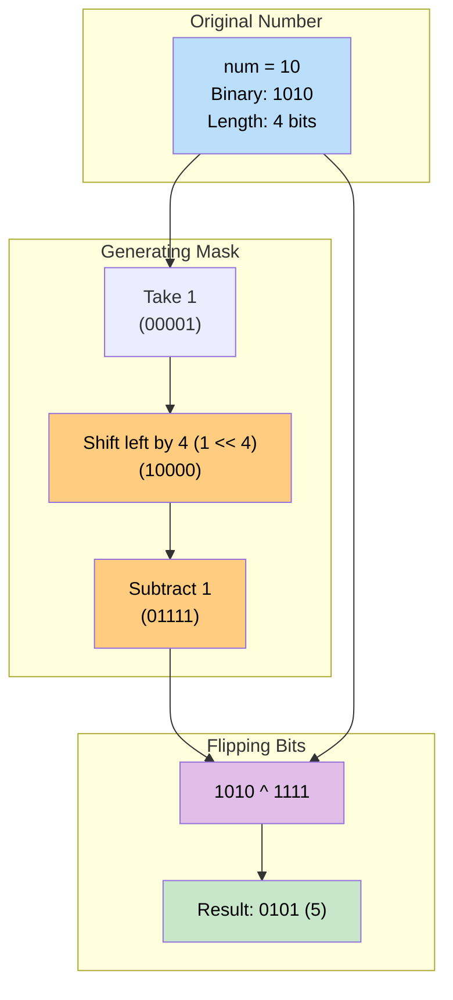

# 🚶‍♂️ Walkthrough: Complement of Base 10 Number

## 👶 Explain Like I'm 5
You are given a number, like `8`.
In binary (computer talk), `8` is written as `1000`.
To find the "complement", you just flip all the `0`s to `1`s and `1`s to `0`s!
So `1000` becomes `0111`. (Which is `7` in normal numbers).

You might think: *"I'll just use the `~` (NOT) operator in Python! `~8`!"*
But wait! Python numbers are weird. They don't have a fixed size.
If you type `~8` in Python, you get `-9`! That's not what we want.

Instead, we can use XOR (`^`).
If you XOR a bit with `1`, it flips! (`1 ^ 1 = 0`, and `0 ^ 1 = 1`).
So we just need to create a "mask" of all `1`s that is exactly the same length as our number.
For `1000` (length 4), we need a mask of `1111`.

How do we make `1111`?
We take `1`, shift it left 4 times (`10000`), and subtract 1!
`10000 - 1 = 1111`.
Then we just do `1000 ^ 1111`, and we get our perfectly flipped number!

## 🎯 Core Strategy
This uses the **Bitwise XOR** pattern. We leverage the property that XORing a bit with `1` toggles it.

1. **Zero Edge Case**: If the number is `0`, its binary representation is `0`. The complement of `0` is `1`. We must handle this explicitly because the counting loop would immediately fail.
2. **Count Bits**: We need to know how many binary digits the number has. We copy the number, and repeatedly right-shift it (`n = n >> 1`) while incrementing a counter until the number hits `0`.
3. **Create the Mask**: We need a binary number consisting entirely of `1`s, matching the length we just counted. We do this by taking `1`, left-shifting it by `bit_count`, and subtracting `1`. (e.g. `(1 << 3) - 1` $\rightarrow$ `8 - 1 = 7` $\rightarrow$ `111`).
4. **XOR**: XOR the original number with the mask. This toggles every single bit within the active range of the number, ignoring any leading infinite zeros.

## 🏃‍♂️ Step-by-Step Execution (Dry Run)
**Input**: `num = 10`

### Step 1: Handle Edge Cases
- `10 == 0`? No. Proceed.

### Step 2: Count Bits
- `bit_count = 0`, `n = 10`
- `n > 0` (10) $\rightarrow$ `bit_count = 1`, `n = 5` (101)
- `n > 0` (5) $\rightarrow$ `bit_count = 2`, `n = 2` (010)
- `n > 0` (2) $\rightarrow$ `bit_count = 3`, `n = 1` (001)
- `n > 0` (1) $\rightarrow$ `bit_count = 4`, `n = 0` (000)
- Loop ends. `bit_count = 4`. (Binary for 10 is `1010`, which has 4 bits).

### Step 3: Create Mask
- `all_bits_set = (1 << 4) - 1`
- `1 << 4` is `16` (Binary `10000`)
- `16 - 1 = 15` (Binary `1111`)

### Step 4: XOR
- `num ^ all_bits_set = 10 ^ 15`
- `10` is `1010`
- `15` is `1111`
- `1010 ^ 1111 = 0101` (Which is `5`)

Return `5`.

## 📊 Visual Diagram
Here is how the shift-and-subtract trick perfectly generates the mask we need:

## 🛑 Edge Cases & Complexity

### Complexity
- **Time Complexity:** $O(b)$, where $b$ is the number of bits required to store the number. Since typical integers are bounded by 32 or 64 bits, this is effectively $O(1)$ constant time.
- **Space Complexity:** $O(1)$. Just storing a few integers.

### Edge Cases Handled Safely
- **Zero Input:** `num = 0`. The counting loop `while n > 0:` would immediately evaluate to False. `bit_count` would be 0. Mask would be `(1 << 0) - 1 = 1 - 1 = 0`. The XOR would be `0 ^ 0 = 0`. This is incorrect, as the binary representation of 0 is `"0"`, and its complement should be `"1"` (`1`). That is why we added the explicit `if num == 0: return 1` check at the very beginning!
