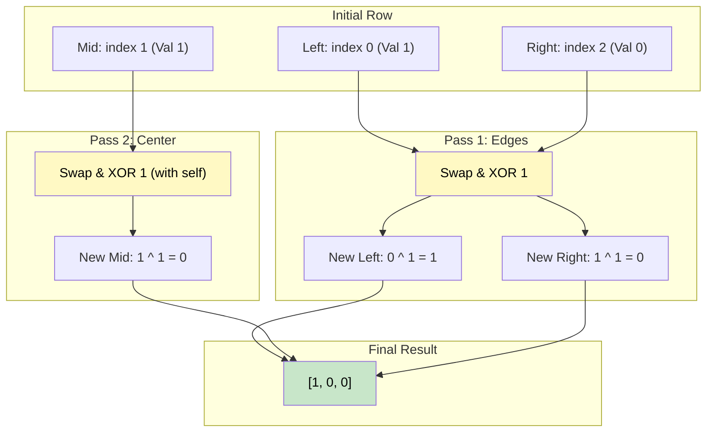

# 🚶‍♂️ Walkthrough: Flip and Invert an Image

## 👶 Explain Like I'm 5
You have a grid of numbers that are either `0` or `1`. (Like a black-and-white image).
For example, one row is `[1, 1, 0]`.

You need to do two things to it:
1. **FLIP IT**: Reverse the row. `[1, 1, 0]` becomes `[0, 1, 1]`.
2. **INVERT IT**: Change all `0`s to `1`s, and `1`s to `0`s. `[0, 1, 1]` becomes `[1, 0, 0]`.

We can do both of these steps at the EXACT SAME TIME using two pointers and XOR!
We put a pointer `left` at the start, and `right` at the end.
We want to swap the numbers they point to, but AS we swap them, we flip them!

To flip a bit, we just XOR it with `1`.
- `0 ^ 1 = 1`
- `1 ^ 1 = 0`

So we just do: `row[left], row[right] = row[right] ^ 1, row[left] ^ 1`.
Then we move `left` inward and `right` inward until they cross!

*Notice:* If the row has an odd number of elements (like 3), `left` and `right` will eventually point to the EXACT SAME middle element. That's fine! The math still works perfectly. It swaps it with itself, and inverts it!

## 🎯 Core Strategy
This uses the **Bitwise XOR** pattern combined with a classic **Two Pointers** array reversal.

1. **Iterate**: Loop through every `row` in the matrix.
2. **Two Pointers**: Initialize `left = 0` and `right = len(row) - 1`.
3. **Simultaneous Swap & Invert**: Loop while `left <= right`.
   - We must use `<=`, not `<`, because the exact middle element in an odd-length array must still be inverted!
   - In Python, we can do a simultaneous assignment: `row[left], row[right] = row[right] ^ 1, row[left] ^ 1`. This safely swaps the values while simultaneously toggling the bits using `^ 1`.
4. **Advance**: Move `left += 1` and `right -= 1`.
5. **Return**: The matrix is modified in-place, return it.

## 🏃‍♂️ Step-by-Step Execution (Dry Run)
**Input**: `matrix = [[1, 1, 0], [1, 0, 1]]`

### Row 1: `[1, 1, 0]`
- `left = 0`, `right = 2`.
- `row[0] = 1`, `row[2] = 0`.
- **Swap & Invert**: 
  - New `row[0]` becomes old `row[2] ^ 1` $\rightarrow$ `0 ^ 1 = 1`.
  - New `row[2]` becomes old `row[0] ^ 1` $\rightarrow$ `1 ^ 1 = 0`.
- Array is now `[1, 1, 0]`.
- `left = 1`, `right = 1`.
- `row[1] = 1`.
- **Swap & Invert**:
  - New `row[1]` becomes old `row[1] ^ 1` $\rightarrow$ `1 ^ 1 = 0`.
- Array is now `[1, 0, 0]`.
- `left = 2`, `right = 0`. Loop breaks.

### Row 2: `[1, 0, 1]`
- `left = 0`, `right = 2`.
- `row[0] = 1`, `row[2] = 1`.
- **Swap & Invert**: 
  - New `row[0]` becomes old `row[2] ^ 1` $\rightarrow$ `1 ^ 1 = 0`.
  - New `row[2]` becomes old `row[0] ^ 1` $\rightarrow$ `1 ^ 1 = 0`.
- Array is now `[0, 0, 0]`.
- `left = 1`, `right = 1`.
- `row[1] = 0`.
- **Swap & Invert**:
  - New `row[1]` becomes old `row[1] ^ 1` $\rightarrow$ `0 ^ 1 = 1`.
- Array is now `[0, 1, 0]`.
- `left = 2`, `right = 0`. Loop breaks.

**Output**: `[[1, 0, 0], [0, 1, 0]]`

## 📊 Visual Diagram
Here is how a single row is transformed in one smooth pass using two pointers and XOR logic:

## 🛑 Edge Cases & Complexity

### Complexity
- **Time Complexity:** $O(N)$ where $N$ is the total number of elements in the matrix (rows $\times$ cols). We process each element exactly once.
- **Space Complexity:** $O(1)$. We are modifying the matrix directly in-place, requiring no extra memory buffers.

### Edge Cases Handled Safely
- **Single Element Rows:** `[[1]]` or `[[0]]`. `left` and `right` both equal `0`. The loop executes exactly once, swapping the element with itself while XORing it. `[[0]]` perfectly natively!
- **Even Length Rows:** E.g. length 4. `left` and `right` will swap indices `0, 3` then `1, 2`. Then `left` becomes 2, `right` becomes 1. The loop cleanly breaks without hitting a central overlapping point.
