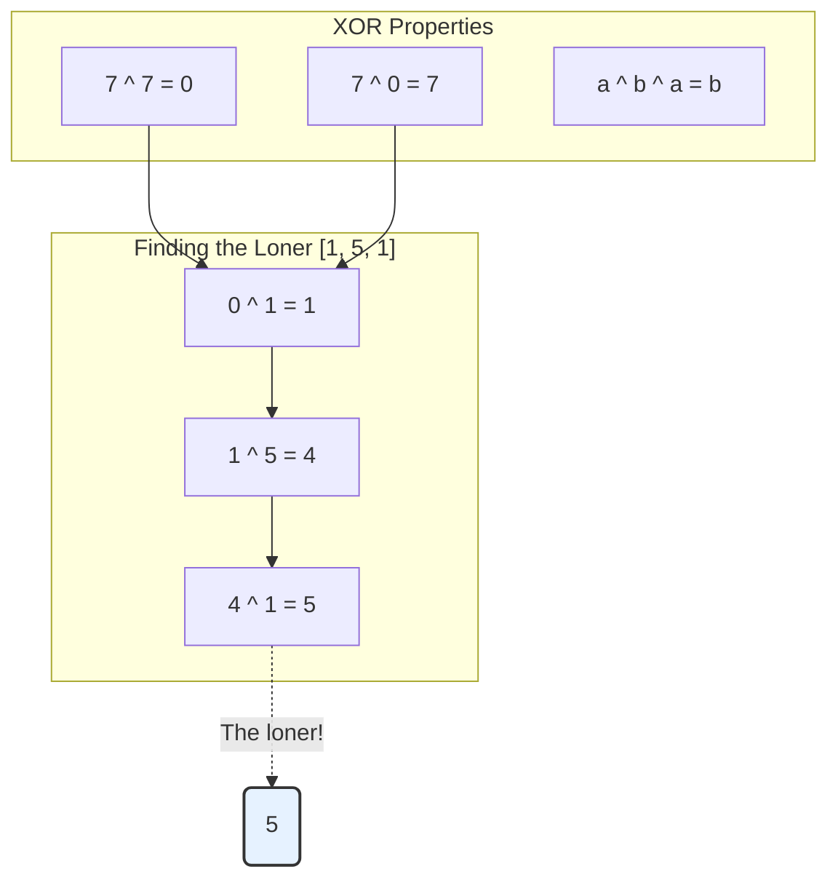

# Pattern 18: Bitwise XOR

## 👶 Explain Like I'm 5
Imagine you have a magic light switch. 
If you flip it ONCE, the light turns ON.
If you flip it TWICE, the light turns OFF.
If you flip it THREE times, it turns ON again.
This is exactly how **XOR** (Exclusive OR, written as `^`) works!
If you XOR a number with itself, they cancel each other out completely and leave `0`. (Like flipping a switch twice).
If you XOR a number with `0`, the number stays exactly the same. (Like doing nothing to the switch).
If you have a giant bag of numbers where *almost* every number has a twin, but ONE number is all alone... you can just XOR all the numbers together!
All the twins will perfectly cancel each other out, leaving behind only the loner!

---

## 🧩 Core Idea & Pattern Detection

The XOR operator `^` compares two numbers bit by bit. If the bits are the same, it returns `0`. If they are different, it returns `1`.
It has three incredibly useful mathematical properties:
1. **Self-Inverse:** $A \oplus A = 0$
2. **Identity:** $A \oplus 0 = A$
3. **Commutativity/Associativity:** $A \oplus B \oplus C = C \oplus A \oplus B$

### When to use it:
- The problem asks you to find missing or single numbers in an array where elements appear in pairs.
- You need to perform operations in $O(1)$ space, making Hash Maps illegal.
- You need to quickly flip bits (finding complements).



---

## 🔧 Algorithmic Anatomy

### Recipe: Finding the Single Number
1. Initialize `x1 = 0`.
2. Loop through every number in the array.
3. `x1 ^= num`.
4. Return `x1`.

```python
def find_single_number(arr):
    x1 = 0
    for num in arr:
        x1 ^= num
    return x1
```

### Recipe: Finding Two Single Numbers
What if there are TWO loners? (e.g., `[1, 5, 1, 9]`)
If you XOR everything, the twins cancel out, and you are left with `5 ^ 9`. Let's call this `n1xn2`.
How do we separate them?
1. Find a bit that is `1` in `n1xn2`. If a bit is `1` in the XOR result, it means `5` and `9` have DIFFERENT bits at that position!
2. You can find the rightmost set bit using `rightmost_set_bit = n1xn2 & -n1xn2` (or `n1xn2 & ~(n1xn2 - 1)`).
3. Split the original array into two groups: numbers that have this bit set to `1`, and numbers that have it set to `0`.
4. The two loners are now separated into different groups!
5. Just run the basic "Single Number" XOR on each group.

---

## 🛑 Per-Variant DOs and DON'Ts

| Variant | DO | DON'T |
|---------|----|-------|
| **Single Number** | **DO** just XOR everything together in a single loop. | **DON'T** use a Hash Map to count frequencies if the problem asks for O(1) space! |
| **Two Single Numbers** | **DO** use `bit = n1xn2 & -n1xn2` to quickly isolate the rightmost differing bit. | **DON'T** try to isolate the bit using string manipulation (`bin()`). Stick to bitwise operators for speed. |
| **Complements** | **DO** create an all-1s mask (e.g., `1111`) by using `mask = (1 << bit_count) - 1`. | **DON'T** just do `~num` in Python. Python integers have infinite precision, so `~` results in negative numbers (Two's Complement) instead of just flipping the bits of the positive value. |

---

## ⏱️ Complexity Analysis

| Aspect | Complexity | Why |
|--------|-----------|-----|
| **Time** | **O(N)** | We usually only need to pass through the array 1 or 2 times. |
| **Space** | **O(1)** | We only store a few integer variables (`x1`, `mask`, etc.). |

---

## ⚠️ Common Pitfalls

1. **Python Bitwise NOT (`~`):** In languages with fixed 32-bit integers (Java, C++), `~5` will flip the bits. In Python, integers have arbitrary precision. `~5` evaluates to `-6`. To correctly flip bits of a positive number in Python, you MUST XOR it with an all-1s mask! `5 ^ 7` (where 7 is `111`).
2. **Operator Precedence:** Bitwise operators (`&`, `^`, `|`) have very low precedence in Python. Always wrap them in parentheses when combining with comparisons! 
   - WRONG: `if num & mask == 0:` (Evaluates as `num & (mask == 0)`)
   - RIGHT: `if (num & mask) == 0:`

---

## ✅ Problems in This Pattern

| # | Problem | Difficulty | Key Twist |
|---|---------|------------|-----------|
| 1 | Single Number | Easy | Cancel out all duplicates by XORing everything with 0. |
| 2 | Two Single Numbers | Medium | Find the XOR sum of both. Isolate 1 bit. Split the array into two groups based on that bit! |
| 3 | Complement of Base 10 | Medium | Count the bits. Make an all-1s mask: `(1 << count) - 1`. XOR the number with the mask. |
| 4 | Flip and Invert Image | Hard (Actually Easy) | Reverse the row with two pointers. Invert the bits by doing `bit ^ 1`. |
