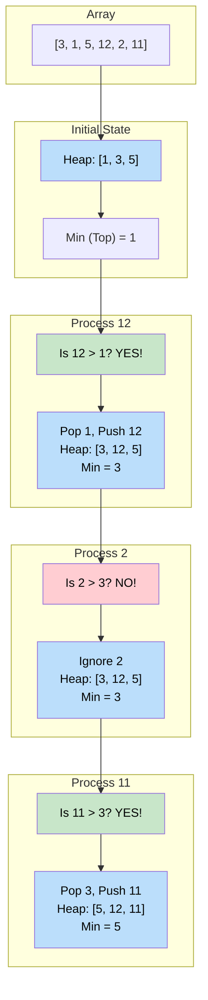

# 🚶‍♂️ Walkthrough: Top 'K' Numbers

## 👶 Explain Like I'm 5
You have a bag of numbers: `[3, 1, 5, 12, 2, 11]`.
I want you to give me the 3 LARGEST numbers.

You could sort the whole bag and give me the last 3, but sorting is slow!
Instead, you make a special VIP club that only fits 3 people.
You use a **"Min Heap"** as the bouncer for this club.
A Min Heap always puts the WEAKEST (smallest) person right at the front door.

1. You put the first 3 numbers in the club: `[3, 1, 5]`.
   - The Min Heap arranges them so the weakest (`1`) is at the door.
2. You look at the next number: `12`.
   - You ask: *"Is 12 stronger than the weakest guy in the club (`1`)?"*
   - YES! So you kick out `1` and let `12` in.
   - Now the club has `[3, 5, 12]`. The weakest is now `3`.
3. You look at `2`.
   - *"Is 2 stronger than 3?"* NO! Go away.
4. You look at `11`.
   - *"Is 11 stronger than 3?"* YES! Kick out `3`, let `11` in.
   - Club: `[5, 11, 12]`.

When you run out of numbers, the club only contains the Top 3 Largest numbers!

## 🎯 Core Strategy
This uses the **Top K Elements** pattern. We use a **Min-Heap** of size $K$ to keep track of the $K$ largest elements seen so far.
Because the smallest element in a Min-Heap is always easily accessible at the root (`heap[0]`), we can quickly compare it with new numbers. 

1. **Initialization**: Create an empty `min_heap`.
2. **Fill Initial Heap**: Push the first $K$ numbers from the array into the heap. (The heap automatically keeps the smallest element at index 0).
3. **Process Remaining Elements**: Iterate through the rest of the array (from index $K$ to the end).
   - If the current number `nums[i]` is GREATER than the top of the heap (`min_heap[0]`), it means the current number belongs in the top $K$ more than the current minimum does.
   - Pop the minimum element, and push the new `nums[i]`. (In Python, `heapq.heappushpop()` does this in one highly optimized step).
4. **Result**: The heap now contains exactly the top $K$ largest numbers. Return it!

## 🏃‍♂️ Step-by-Step Execution (Dry Run)
**Input**: `nums = [3, 1, 5, 12, 2, 11]`, `K = 3`

### Step 1: Initial Heap Fill
- Push `3`: Heap = `[3]`
- Push `1`: Heap = `[1, 3]`
- Push `5`: Heap = `[1, 3, 5]` (Smallest is `1`).

### Step 2: Iterate Remaining Elements
- **Current Number: `12`**
  - Is `12 > 1`? YES.
  - Pop `1`, Push `12`.
  - Heap becomes `[3, 12, 5]` (Smallest is `3`).
- **Current Number: `2`**
  - Is `2 > 3`? NO. Do nothing.
- **Current Number: `11`**
  - Is `11 > 3`? YES.
  - Pop `3`, Push `11`.
  - Heap becomes `[5, 12, 11]` (Smallest is `5`).

### Final Result
- Return `[5, 12, 11]`. (Note: The items in the heap might not be perfectly sorted among themselves, but they are guaranteed to be the 3 largest numbers).

## 📊 Visual Diagram
Here is how the Min-Heap acts as a filter, keeping only the largest numbers inside:

## 🛑 Edge Cases & Complexity

### Complexity
- **Time Complexity:** $O(N \log K)$. 
  - Inserting the first $K$ elements takes $O(K \log K)$.
  - Iterating through the remaining $N-K$ elements and doing a heap replace takes $O((N-K) \log K)$.
  - Total is $O(N \log K)$. This is significantly better than sorting the whole array which is $O(N \log N)$!
- **Space Complexity:** $O(K)$. The heap never grows larger than $K$ elements.

### Edge Cases Handled Safely
- **K is larger than array length:** E.g., `nums = [1, 2]`, `K = 3`. 
  - We safely use `range(min(k, len(nums)))` to just push the entire array into the heap.
  - The second loop `range(k, len(nums))` will not execute.
  - Returns `[1, 2]`. Perfectly handled.
