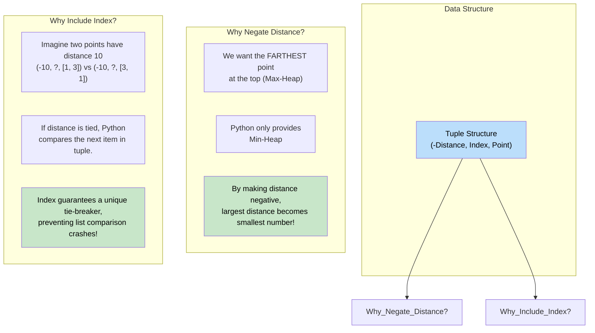

# 🚶‍♂️ Walkthrough: 'K' Closest Points to the Origin

## 👶 Explain Like I'm 5
Imagine you have a map of a city, and you are standing at the very center (the origin).
There are many coffee shops scattered around the city (these are the "points").
You want to find the 3 coffee shops that are CLOSEST to you.

To find the closest ones, we want to kick out the ones that are FARTHEST away!
So, we use a Max-Heap again!
The Max-Heap will keep the FARTHEST of the K coffee shops right at the front door.

When we find a new coffee shop, we ask: *"Is this new shop CLOSER than the farthest shop in our VIP club?"*
If yes, we kick the far one out and let the close one in!

How do we calculate distance? Math says it's $\sqrt{x^2 + y^2}$.
But since we are just comparing them, we don't even need the square root! $x^2 + y^2$ works perfectly fine for comparison and is much faster for computers to calculate.

## 🎯 Core Strategy
This uses the **Top K Elements** pattern. We want to find the $K$ elements with the minimum distance. To maintain a running list of the $K$ minimums, we use a **Max-Heap**.
Since Python only has a Min-Heap, we negate the distances before pushing them to simulate a Max-Heap.

1. **Distance Function**: Create a helper to calculate the squared Euclidean distance from the origin: `x*x + y*y`.
2. **Initialization**: Create an empty `max_heap = []`.
3. **Fill Initial Heap**: Push the first $K$ points into the heap. 
   - We must push a tuple: `(-distance, i, point)`.
   - *Why the `i` (index)?* Python's `heapq` sorts tuples by their first element. If there's a tie, it checks the second element. If we don't include the index, it will try to compare the `point` lists (e.g., `[1, 2] < [3, 4]`). If the lists are identical, or if we used custom objects that don't support comparison, Python would crash! The index acts as a unique, comparable tie-breaker.
4. **Process Remaining Points**: Iterate through the rest of the array.
   - Calculate `curr_dist`.
   - The farthest point currently in our VIP club has distance `-max_heap[0][0]`.
   - If `curr_dist < -max_heap[0][0]`, pop the top of the heap and push the new point `(-curr_dist, i, points[i])`.
5. **Return**: Extract the points from the tuples in the heap and return them.

## 🏃‍♂️ Step-by-Step Execution (Dry Run)
**Input**: `points = [[1, 3], [3, 4], [2, -1]]`, `K = 2`

### Step 1: Initial Heap Fill (First 2 elements)
- **Point `[1, 3]`**: Distance is $1^2 + 3^2 = 10$.
  - Push `(-10, 0, [1, 3])`. Heap = `[(-10, 0, [1, 3])]`
- **Point `[3, 4]`**: Distance is $3^2 + 4^2 = 25$.
  - Push `(-25, 1, [3, 4])`. Heap = `[(-25, 1, [3, 4]), (-10, 0, [1, 3])]`
  - Max distance (root of negated min-heap) is `25`.

### Step 2: Iterate Remaining Elements
- **Current Point `[2, -1]`** (index 2):
  - Calculate Distance: $2^2 + (-1)^2 = 4 + 1 = 5$.
  - Is `curr_dist` (5) < Max Distance in Heap (25)? YES.
  - Pop `(-25, 1, [3, 4])`.
  - Push `(-5, 2, [2, -1])`.
  - Heap becomes `[(-10, 0, [1, 3]), (-5, 2, [2, -1])]`.

### Final Result
- Extract the 3rd element (`point`) from each tuple in the heap.
- Result: `[[1, 3], [2, -1]]`.

## 📊 Visual Diagram
Here is how the tuples are structured to trick Python into treating a Min-Heap as a Max-Heap based on distance, without crashing on ties:

## 🛑 Edge Cases & Complexity

### Complexity
- **Time Complexity:** $O(N \log K)$. Calculating distance takes $O(1)$. Inserting into a heap of size $K$ takes $O(\log K)$. We do this for $N$ points.
- **Space Complexity:** $O(K)$. We store exactly $K$ tuples in our heap.

### Edge Cases Handled Safely
- **Points have identical distances:** E.g., `[[1, 1], [-1, -1]]`. Both have squared distance `2`. Because we insert the unique iteration index `i` into the tuple `(-2, i, point)`, Python uses `i` as the tie-breaker and never attempts to compare the arrays directly.
- **K is larger than array length:** Safe! `range(min(k, len(points)))` ensures we just push all elements, skip the second loop, and return the entire array contents perfectly.
