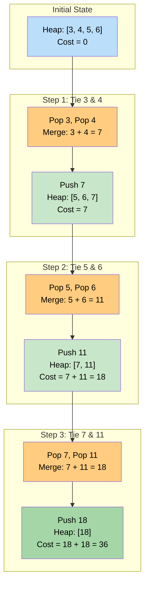

# 🚶‍♂️ Walkthrough: Connect Ropes

## 👶 Explain Like I'm 5
You have a bunch of short ropes: `[1, 3, 11, 5]`.
You need to tie them all together to make one giant rope.
But tying ropes takes energy! The energy it takes to tie two ropes together is equal to the length of the ropes you are holding.
For example, if you tie the `11` and the `5`, it costs you `16` energy. And now you have a new combined rope of length `16`!

To save as much energy as possible, you always want to tie the **TWO SHORTEST** ropes together first.
Let's trace it:
1. Find the two shortest: `1` and `3`. Tie them. Cost = `4`.
   - New ropes pile: `[4, 11, 5]`.
2. Find the two shortest: `4` and `5`. Tie them. Cost = `9`.
   - New ropes pile: `[9, 11]`.
3. Find the two shortest: `9` and `11`. Tie them. Cost = `20`.
   - New ropes pile: `[20]`. (Only 1 rope left, we are done!)

Total energy spent = `4 + 9 + 20 = 33`.
Because we ALWAYS need to quickly find the two smallest items from a changing list, this is the perfect job for a **Min-Heap**!

## 🎯 Core Strategy
This uses the **Top K Elements** pattern (specifically utilizing a Heap for dynamic sorting). 
A Min-Heap is perfect here because it automatically keeps the smallest elements at the top, even as we add and remove elements.

1. **Heapify**: Take the initial list of ropes and turn it into a Min-Heap. In Python, `heapq.heapify()` does this efficiently in-place.
2. **Initialize Cost**: Create a variable `total_cost = 0`.
3. **Loop**: While the heap contains more than 1 rope, repeat:
   - **Pop Two**: Pop the heap twice to get `rope1` and `rope2`. Because it's a Min-Heap, these are guaranteed to be the two shortest ropes available.
   - **Calculate Cost**: The cost to connect them is `current_cost = rope1 + rope2`.
   - **Accumulate**: Add `current_cost` to `total_cost`.
   - **Push Back**: Push the new combined rope (`current_cost`) back into the Min-Heap.
4. **Return**: Once the heap has only 1 element (the final giant rope), the loop ends, and we return `total_cost`.

## 🏃‍♂️ Step-by-Step Execution (Dry Run)
**Input**: `rope_lengths = [3, 4, 5, 6]`

### Step 1: Heapify
- `min_heap = [3, 4, 5, 6]` (It's already a valid Min-Heap by chance).
- `total_cost = 0`.

### Step 2: Loop 1
- Pop smallest: `rope1 = 3`. Heap = `[4, 6, 5]`.
- Pop next smallest: `rope2 = 4`. Heap = `[5, 6]`.
- `current_cost = 3 + 4 = 7`.
- `total_cost += 7` $\rightarrow$ `0 + 7 = 7`.
- Push `7` back to heap. Heap = `[5, 6, 7]`.

### Step 3: Loop 2
- Pop smallest: `rope1 = 5`. Heap = `[6, 7]`.
- Pop next smallest: `rope2 = 6`. Heap = `[7]`.
- `current_cost = 5 + 6 = 11`.
- `total_cost += 11` $\rightarrow$ `7 + 11 = 18`.
- Push `11` back to heap. Heap = `[7, 11]`.

### Step 4: Loop 3
- Pop smallest: `rope1 = 7`. Heap = `[11]`.
- Pop next smallest: `rope2 = 11`. Heap = `[]`.
- `current_cost = 7 + 11 = 18`.
- `total_cost += 18` $\rightarrow$ `18 + 18 = 36`.
- Push `18` back to heap. Heap = `[18]`.

### Step 5: End
- `len(min_heap) == 1`. Loop ends.
- Return `total_cost = 36`.

## 📊 Visual Diagram
Here is how the Min-Heap effortlessly serves us the two smallest pieces, then accepts the newly merged piece and self-sorts:

## 🛑 Edge Cases & Complexity

### Complexity
- **Time Complexity:** $O(N \log N)$. Turning the initial list into a heap takes $O(N)$. Then, we perform $N-1$ merges. Each merge requires two pops and one push, which take $O(\log N)$ each.
- **Space Complexity:** $O(N)$ to store the array elements in the heap data structure.

### Edge Cases Handled Safely
- **Only one rope:** `[10]`. The `while len(min_heap) > 1:` loop immediately evaluates to False. It returns `total_cost = 0`. This is perfectly correct, because no energy is required to tie a single rope to nothing!
