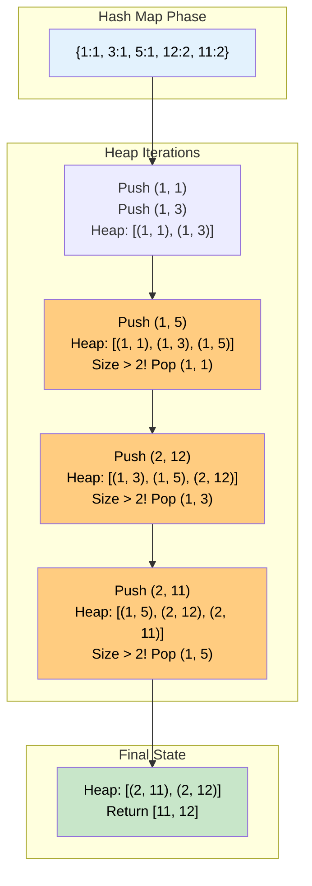

# 🚶‍♂️ Walkthrough: Top 'K' Frequent Numbers

## 👶 Explain Like I'm 5
You have a bag of numbers: `[1, 3, 5, 12, 11, 12, 11, 12, 5]`.
I want to know the **2 numbers** that appear the **MOST** often!

Before we can know who appears the most, we have to actually count them!
So, step 1 is always: Go through the bag and make a tally sheet (a Hash Map).
- `1` appears 1 time.
- `3` appears 1 time.
- `5` appears 2 times.
- `11` appears 2 times.
- `12` appears 3 times.

Now, we have a list of frequencies. We want the Top 2 LARGEST frequencies!
Just like Problem 1, when we want the LARGEST of something, we use a **Min-Heap**.
We put the frequencies into a Min-Heap, but we only let it hold 2 items at a time (`K=2`).
Whenever we add a 3rd item, the heap kicks out the number with the *smallest* frequency, leaving only the $K$ numbers with the largest frequencies!

## 🎯 Core Strategy
This uses the **Top K Elements** pattern combined with a **Hash Map**. 

1. **Frequency Map**: Iterate through the array and use a Hash Map (like `collections.Counter` in Python) to count the frequency of each distinct element.
2. **Min-Heap Initialization**: Create an empty `min_heap = []`.
3. **Iterate and Push**: Loop through the `(number, frequency)` pairs in the Hash Map.
   - Push a tuple into the heap: `(frequency, number)`. It is CRITICAL that frequency is the first element, because `heapq` sorts tuples by their first element!
   - If the size of `min_heap` exceeds $K$, immediately `heappop()` from it. Because it's a Min-Heap sorted by frequency, this pops the element with the lowest frequency out of the VIP club.
4. **Extract Result**: Once the loop finishes, the heap will contain exactly the $K$ elements with the highest frequencies. Extract the `number` from each tuple and return the list.

## 🏃‍♂️ Step-by-Step Execution (Dry Run)
**Input**: `nums = [1, 3, 5, 12, 11, 12, 11], K = 2`

### Step 1: Frequency Map
`freq_map = {1: 1, 3: 1, 5: 1, 12: 2, 11: 2}`

### Step 2: Push to Heap
- **Item `1: 1`**: Push `(1, 1)`. Heap = `[(1, 1)]`
- **Item `3: 1`**: Push `(1, 3)`. Heap = `[(1, 1), (1, 3)]`
- **Item `5: 1`**: Push `(1, 5)`. Heap = `[(1, 1), (1, 3), (1, 5)]`. 
  - Size > 2! Pop lowest. (Python uses the second element `number` as a tie-breaker. It pops `(1, 1)`). Heap = `[(1, 3), (1, 5)]`.
- **Item `12: 2`**: Push `(2, 12)`. Heap = `[(1, 3), (1, 5), (2, 12)]`.
  - Size > 2! Pop lowest. Pops `(1, 3)`. Heap = `[(1, 5), (2, 12)]`.
- **Item `11: 2`**: Push `(2, 11)`. Heap = `[(1, 5), (2, 12), (2, 11)]`.
  - Size > 2! Pop lowest. Pops `(1, 5)`. Heap = `[(2, 11), (2, 12)]`.

### Step 3: Result
- Heap contains `[(2, 11), (2, 12)]`.
- Extract numbers: `[11, 12]`.

## 📊 Visual Diagram
Here is how the Min-Heap acts as an active filter, constantly throwing away the lowest-frequency candidates:

## 🛑 Edge Cases & Complexity

### Complexity
- **Time Complexity:** $O(N + U \log K)$ where $N$ is the total number of elements and $U$ is the number of **unique** elements. Creating the Hash Map takes $O(N)$. Pushing into a heap of size $K$ takes $O(\log K)$, and we do this $U$ times.
- **Space Complexity:** $O(U)$ to store the Hash Map of unique elements. The heap takes $O(K)$ space.

### Edge Cases Handled Safely
- **K equals number of unique elements:** E.g., `nums = [1, 2, 3]`, `K = 3`. 
  - The heap simply grows to size 3. The `if len(min_heap) > k:` condition never triggers.
  - Returns `[1, 2, 3]`. Works flawlessly.
- **All elements are identical:** E.g., `nums = [1, 1, 1]`, `K = 1`.
  - Hash map has 1 entry: `{1: 3}`.
  - Pushes `(3, 1)`. Loop ends. Returns `[1]`.
