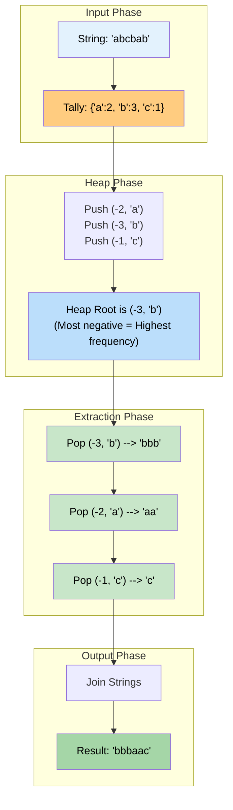

# 🚶‍♂️ Walkthrough: Frequency Sort

## 👶 Explain Like I'm 5
You have a word: `"Programming"`.
You want to rebuild the word so that the most popular letters come FIRST.

First, we count the letters!
- P: 1
- r: 2
- o: 1
- g: 2
- a: 1
- m: 2
- i: 1
- n: 1

Now, we want to grab the MOST popular letters. Who gives us the largest things first? A **Max-Heap**!
We throw all these counts into a Max-Heap.
Then, we just pop them out one by one. The Max-Heap guarantees that the letters with the biggest counts will come out first.

- When 'r' comes out (count 2), we add `"rr"` to our new string.
- When 'g' comes out (count 2), we add `"gg"`.
- When 'm' comes out (count 2), we add `"mm"`.
- When 'P' comes out (count 1), we add `"P"`.
...and so on!

Result: `"rrggmmPioan"` (or some variation depending on tie-breakers).

## 🎯 Core Strategy
This uses the **Top K Elements** pattern, where $K$ is actually the total number of distinct elements. We use a **Max-Heap** to effortlessly sort characters by their frequencies.

1. **Frequency Map**: Iterate through the string and use a Hash Map (like `collections.Counter`) to count the occurrences of each character.
2. **Max-Heap Initialization**: Create an empty `max_heap = []`.
3. **Push to Heap**: Loop through the `(character, frequency)` pairs in the Hash Map.
   - Push a tuple to simulate a Max-Heap: `(-frequency, character)`.
   - Python's `heapq` sorts tuples by their first element. By negating the frequency, the highest frequency becomes the most negative number, moving it to the top of the Min-Heap.
   - If frequencies are identical, Python compares the second element (`character`). Since characters are alphabetically comparable (e.g., `'a' < 'b'`), this works natively without crashing.
4. **Build Result**: Loop while the heap has elements:
   - Pop `(freq, char)`.
   - Restore the positive frequency: `count = -freq`.
   - Append `char * count` to a result list. (In Python, `"a" * 3` evaluates to `"aaa"`).
5. **Return**: Join the result list into a final string and return it.

## 🏃‍♂️ Step-by-Step Execution (Dry Run)
**Input**: `s = "abcbab"`

### Step 1: Frequency Map
`freq_map = {'a': 2, 'b': 3, 'c': 1}`

### Step 2: Push to Heap
- **'a': 2**: Push `(-2, 'a')`. Heap = `[(-2, 'a')]`
- **'b': 3**: Push `(-3, 'b')`. Heap = `[(-3, 'b'), (-2, 'a')]`
- **'c': 1**: Push `(-1, 'c')`. Heap = `[(-3, 'b'), (-2, 'a'), (-1, 'c')]`

### Step 3: Build Result
- **Pop 1**: Pops `(-3, 'b')`. 
  - `count = 3`. 
  - `result.append("b" * 3)` $\rightarrow$ `["bbb"]`.
- **Pop 2**: Pops `(-2, 'a')`. 
  - `count = 2`. 
  - `result.append("a" * 2)` $\rightarrow$ `["bbb", "aa"]`.
- **Pop 3**: Pops `(-1, 'c')`. 
  - `count = 1`. 
  - `result.append("c" * 1)` $\rightarrow$ `["bbb", "aa", "c"]`.

### Final Result
- `"".join(["bbb", "aa", "c"])` $\rightarrow$ `"bbbaac"`.

## 📊 Visual Diagram
Here is how the data flows from raw string, to frequency counts, into the sorting heap, and finally back to a string:

## 🛑 Edge Cases & Complexity

### Complexity
- **Time Complexity:** $O(D \log D)$ where $D$ is the number of distinct characters in the string. 
  - Creating the frequency map takes $O(N)$ where $N$ is the length of the string.
  - Inserting $D$ characters into the heap takes $O(D \log D)$.
  - In the worst case $D = N$, making it $O(N \log N)$. However, if the string only contains lowercase English letters, $D$ is bounded by 26, making the heap operations $O(1)$ and the total time $O(N)$.
- **Space Complexity:** $O(D)$ to store the Hash Map and the Heap.

### Edge Cases Handled Safely
- **All characters are unique:** `"abc"`. All frequencies are 1. The heap uses the characters themselves as a tie-breaker, resulting in alphabetical sorting: `"abc"` (since `-1, 'a'` is considered smaller/higher priority than `-1, 'b'`).
- **Empty string:** `""`. The frequency map is empty, the heap loop is skipped, and it returns `""` seamlessly.
