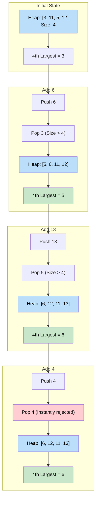

# 🚶‍♂️ Walkthrough: Kth Largest Number in a Stream

## 👶 Explain Like I'm 5
Imagine you are the scorekeeper for a video game that never ends.
Players are constantly submitting new scores (a "stream" of numbers).
At any given moment, someone might ask you: *"What is the 3rd highest score so far?"*

You can't pause the game, sort all 1,000,000 scores, and pick the 3rd one. That takes too long!
Instead, you keep a tiny notebook that only holds EXACTLY 3 scores.
You use a **Min-Heap** to manage this notebook.
The Min-Heap keeps the SMALLEST of your Top 3 scores at the top of the page.

When a new score comes in, you check the top of the page.
- *"Is this new score BIGGER than the smallest score in my Top 3?"*
- If **yes**, you erase the smallest score, and write down the new one!
- If **no**, you just ignore the new score.

When someone asks for the 3rd highest score, you just read them the score at the top of your page! It takes 0 extra seconds!

## 🎯 Core Strategy
This is a classic Object-Oriented Design application of the **Top K Elements** pattern. We use a **Min-Heap** of size $K$ to maintain a running window of the $K$ largest elements seen so far in an infinite stream.

1. **Class Initialization (`__init__`)**: 
   - Store $K$.
   - Initialize an empty `min_heap`.
   - Iterate through the initial array of numbers provided and pass them into the `add()` method.
2. **Add Method (`add`)**: 
   - Push the new number onto the `min_heap`.
   - If the heap grows larger than size $K$ (i.e. `len(self.min_heap) > self.k`), immediately pop the top element. Because it's a Min-Heap, this ejects the smallest element out of the Top $K$ group.
   - The Kth largest element is always sitting right at the root of the heap (`self.min_heap[0]`). Return it.

## 🏃‍♂️ Step-by-Step Execution (Dry Run)
**Initialization**: `KthLargestNumberInStream([3, 1, 5, 12, 2, 11], 4)`

### Phase 1: Setup (Internal Calls to `add`)
- `add(3)` $\rightarrow$ Heap: `[3]`. Return `3`.
- `add(1)` $\rightarrow$ Heap: `[1, 3]`. Return `1`.
- `add(5)` $\rightarrow$ Heap: `[1, 3, 5]`. Return `1`.
- `add(12)` $\rightarrow$ Heap: `[1, 3, 5, 12]`. Return `1`. (Heap size is now 4).
- `add(2)` $\rightarrow$ Push `2`. Heap size 5. Pop smallest (`1`). Heap: `[2, 3, 5, 12]`. Return `2`.
- `add(11)` $\rightarrow$ Push `11`. Heap size 5. Pop smallest (`2`). Heap: `[3, 11, 5, 12]`. Return `3`.

Initial state finished. Heap holds the Top 4 largest elements so far: `[3, 11, 5, 12]`. The 4th largest is `3`.

### Phase 2: Stream Operations
- **Call `add(6)`**
  - Push `6`. Heap: `[3, 6, 5, 12, 11]`.
  - Size > 4! Pop smallest (`3`).
  - Heap becomes `[5, 6, 11, 12]`.
  - Return `min_heap[0]`, which is `5`. (Top 4 are 12, 11, 6, 5. The 4th largest is indeed 5).

- **Call `add(13)`**
  - Push `13`. Size > 4. Pop smallest (`5`).
  - Heap becomes `[6, 12, 11, 13]`.
  - Return `6`. (Top 4 are 13, 12, 11, 6).

- **Call `add(4)`**
  - Push `4`. Size > 4. Pop smallest (`4` gets instantly popped right back out!).
  - Heap stays `[6, 12, 11, 13]`.
  - Return `6`.

## 📊 Visual Diagram
Here is how the Min-Heap maintains the threshold for the VIP club:

## 🛑 Edge Cases & Complexity

### Complexity
- **Time Complexity:** 
  - Initialization: $O(N \log K)$ where $N$ is the number of initial elements.
  - `add()` operation: $O(\log K)$ to push to the heap and potentially pop. Returning `min_heap[0]` is $O(1)$.
- **Space Complexity:** $O(K)$ to store exactly $K$ elements in the Min-Heap at any given time.

### Edge Cases Handled Safely
- **Smaller than K items initially:** If the class is initialized with fewer than $K$ items (e.g., `nums = [1]`, `K = 3`), the `add` method safely handles it because `len(self.min_heap) > self.k` won't trigger. The heap will just grow until it hits size $K$. (Note: Calling `add` might return the minimum of the elements seen so far, which conceptually isn't the true Kth largest until at least $K$ elements are seen).
- **Incoming number is smaller than the threshold:** `add(4)` when the threshold is `6`. The number gets pushed and immediately popped. The state of the Top $K$ elements remains completely intact.
