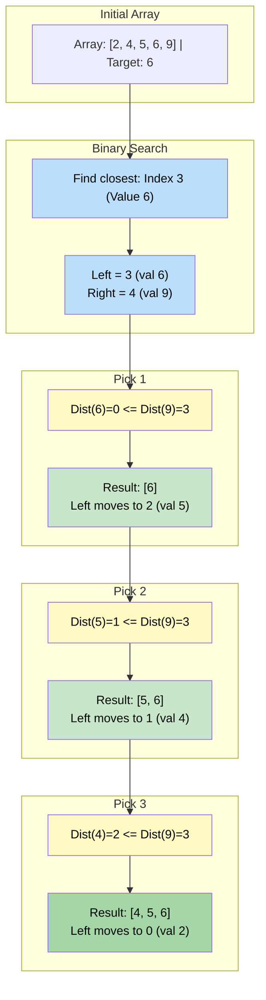

# 🚶‍♂️ Walkthrough: 'K' Closest Numbers

## 👶 Explain Like I'm 5
You have a sorted list of numbers: `[5, 6, 7, 8, 9]`.
You are looking for the `3` numbers that are CLOSEST to the target `7`.

Since the array is already sorted, the numbers closest to `7` will be right next to it!
So, step 1 is to FIND where `7` (or the number closest to it) is in the array. Because the array is sorted, we can find it super fast using **Binary Search**!

Once we find the closest number, we put two pointers right next to it:
- `left` pointing at the closest number (or the one before it).
- `right` pointing at the one after it.

Then, we just compare the two pointers!
*"Is the number at `left` closer to `7` than the number at `right`?"*
- If `left` is closer, we add the `left` number to our list and move `left` backwards.
- If `right` is closer, we add the `right` number to our list and move `right` forwards.

We repeat this until we have exactly `3` numbers!

*(Note: You could also solve this with a Max-Heap by dumping the closest numbers into it, but Two Pointers is faster because the array is already sorted!).*

## 🎯 Core Strategy
This optimally combines **Modified Binary Search** with the **Two Pointers** pattern.

1. **Binary Search**: Use Binary Search to find the index of the element closest to $X$. If $X$ is present, it returns its index. If $X$ is not present, it compares the floor and ceiling elements and returns the index of the closest one.
2. **Initialize Pointers**: Place `left = closest_idx` and `right = closest_idx + 1`.
3. **Expand Window**: Iterate $K$ times. In each iteration, compare `abs(arr[left] - X)` with `abs(arr[right] - X)`.
   - If `arr[left]` is closer (or tied, to prefer smaller values), append it to the front of a `deque` (to keep the final result sorted), and decrement `left`.
   - If `arr[right]` is closer, append it to the back of the `deque`, and increment `right`.
4. **Boundary Checks**: Safely handle when `left < 0` or `right >= len(arr)` by blindly taking the other valid pointer.

## 🏃‍♂️ Step-by-Step Execution (Dry Run)
**Input**: `arr = [2, 4, 5, 6, 9]`, `K = 3`, `X = 6`

### Step 1: Binary Search
- Target `6` is found exactly at index `3` (`arr[3] = 6`).
- `closest_idx = 3`.

### Step 2: Initialize
- `left = 3` (Points to `6`).
- `right = 4` (Points to `9`).
- `result = deque()`.

### Step 3: Expand Window (K=3 times)
**Iteration 1:**
- `dist_left = abs(6 - 6) = 0`.
- `dist_right = abs(9 - 6) = 3`.
- `0 <= 3` is True! Pick `left`.
- `result.appendleft(arr[left])` $\rightarrow$ `deque([6])`.
- `left -= 1` $\rightarrow$ `left = 2` (Points to `5`).

**Iteration 2:**
- `dist_left = abs(5 - 6) = 1`.
- `dist_right = abs(9 - 6) = 3`.
- `1 <= 3` is True! Pick `left`.
- `result.appendleft(arr[left])` $\rightarrow$ `deque([5, 6])`.
- `left -= 1` $\rightarrow$ `left = 1` (Points to `4`).

**Iteration 3:**
- `dist_left = abs(4 - 6) = 2`.
- `dist_right = abs(9 - 6) = 3`.
- `2 <= 3` is True! Pick `left`.
- `result.appendleft(arr[left])` $\rightarrow$ `deque([4, 5, 6])`.
- `left -= 1` $\rightarrow$ `left = 0`.

### Step 4: End
- Convert to list and return `[4, 5, 6]`.

## 📊 Visual Diagram
Here is how the pointers slide outwards from the closest match:

## 🛑 Edge Cases & Complexity

### Complexity
- **Time Complexity:** $O(\log N + K)$. 
  - $O(\log N)$ to run the binary search.
  - $O(K)$ to extract the $K$ closest elements using the two pointers.
  - (Note: Using a Min-Heap instead of Two Pointers would take $O(K \log K)$ to extract elements, making Two Pointers strictly better here).
- **Space Complexity:** $O(K)$ for the output array (or `deque`).

### Edge Cases Handled Safely
- **Target is entirely outside the array bounds:** E.g., `arr = [2, 4], X = 10`. Binary search naturally narrows down and returns the last valid index. `left` will hit out of bounds first, and the logic seamlessly falls back to safely appending elements from `right` (if they existed) or properly just taking all elements down from `left`.
- **Using `deque` for O(1) prepend:** Python lists take $O(K)$ time to `insert(0, val)`. Using `collections.deque` and `.appendleft()` ensures prepending is an $O(1)$ operation, maintaining our strict time bounds.
