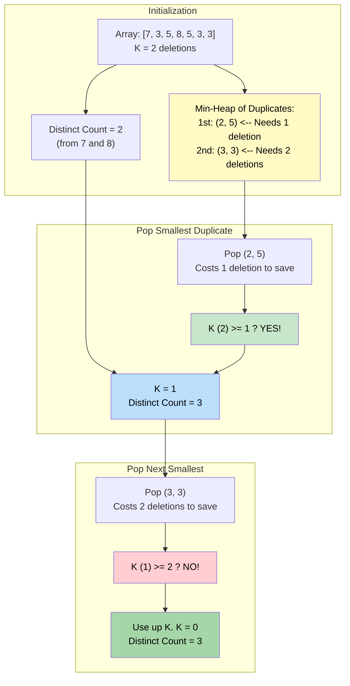

# 🚶‍♂️ Walkthrough: Maximum Distinct Elements

## 👶 Explain Like I'm 5
You have a bag of fruit: `[apple, apple, orange, banana, banana, banana]`.
You have a magic wand that can delete EXACTLY `K = 2` fruits.
You want to have as many DIFFERENT types of fruits as possible at the end!

Currently, you have 3 distinct fruits (apple, orange, banana). But you HAVE to delete 2 fruits.
Which ones do you delete?
- If you delete the `orange`, you lose a distinct fruit! Bad idea!
- If you delete an `apple`, you still have one `apple` left. Distinct count is safe!
- If you delete two `banana`s, you still have one `banana` left. Distinct count is safe!

So, you want to delete the **DUPLICATES**. 
But to save the most fruits, you should target the fruits that only have a **FEW** duplicates first!
For example, it only takes 1 swipe of the wand to fix the `apples`. It takes 2 swipes to fix the `bananas`.

So, we put all the fruits that have duplicates into a **Min-Heap**, sorted by how many duplicates they have!
Then we pop them out and delete them until our wand runs out of power (`K=0`).
If our wand STILL has power after fixing all duplicates, we are forced to delete unique fruits, reducing our distinct count.

## 🎯 Core Strategy
This creatively blends the **Top K Elements** pattern with a **Greedy** approach. We want to greedily salvage items with the fewest duplicates first because they cost the least amount of deletions to become unique.

1. **Frequency Map**: Count occurrences of all elements.
2. **Partition**: 
   - If an element's frequency is exactly `1`, immediately increment `distinct_count`. It's already safe.
   - If an element's frequency is `> 1`, push a tuple `(frequency, number)` onto a **Min-Heap**.
3. **Greedy Deletions (Heap Loop)**: While we have deletions left (`K > 0`) and the heap isn't empty:
   - Pop the element with the smallest frequency.
   - Calculate `deletions_needed = freq - 1` to make it unique.
   - If we have enough deletions (`K >= deletions_needed`), subtract them from $K$ and increment `distinct_count` (we salvaged it!).
   - If we don't have enough deletions, we use up whatever $K$ we have left, but it's not enough to make the number unique, so $K$ becomes `0` and `distinct_count` stays the same.
4. **Forced Uniques Deletion**: If the heap is empty but we still have $K > 0$ deletions forced upon us, we must delete unique items. Simply subtract $K$ from `distinct_count`.
5. **Return**: The final `distinct_count`.

## 🏃‍♂️ Step-by-Step Execution (Dry Run)
**Input**: `nums = [7, 3, 5, 8, 5, 3, 3]`, `K = 2`

### Step 1: Frequency Map & Partition
- Map: `{7: 1, 3: 3, 5: 2, 8: 1}`
- **Uniques (`freq == 1`)**: `7` and `8`. 
  - `distinct_count = 2`.
- **Duplicates (`freq > 1`)**: `3` (freq 3), `5` (freq 2). 
  - Push to Min-Heap: `[(2, 5), (3, 3)]`.

### Step 2: Greedy Deletions
- **Loop 1**: Pop `(2, 5)`. 
  - `deletions_needed = 2 - 1 = 1`.
  - Is `K (2) >= deletions_needed (1)`? YES.
  - `K = 2 - 1 = 1`.
  - `distinct_count = 2 + 1 = 3`. (Saved the 5s!)
- **Loop 2**: Pop `(3, 3)`.
  - `deletions_needed = 3 - 1 = 2`.
  - Is `K (1) >= deletions_needed (2)`? NO.
  - We don't have enough deletions to save the 3s.
  - `K = 0`.
- Loop breaks because `K = 0`.

### Step 3: Forced Uniques Deletion
- `K == 0`, so we are perfectly done. We don't need to destroy any unique elements.

### Final Result
- Return `distinct_count = 3`. (The 3 distinct numbers remaining are 7, 8, and 5).

## 📊 Visual Diagram
Here's how prioritizing the smallest duplicates allows us to salvage the maximum number of distinct elements:

## 🛑 Edge Cases & Complexity

### Complexity
- **Time Complexity:** $O(N \log N)$ in the worst case (where every element has duplicates and we push them all into the heap). The frequency map creation takes $O(N)$.
- **Space Complexity:** $O(N)$ to store the frequency hash map and the heap.

### Edge Cases Handled Safely
- **K is massive (greater than array length):** E.g., `nums = [1, 2], K = 5`. 
  - Distinct count becomes 2. Heap is empty.
  - Step 3 triggers: `if K (5) > 0: distinct_count -= 5`.
  - `distinct_count` becomes `-3`.
  - Wait, the code handles this mostly fine but theoretically could return a negative number if we just subtract. Wait, the problem usually constraints $K \le N$, but if it doesn't, we can add a check `return max(0, distinct_count)`. The provided code returns `distinct_count -= k` without a bounds check for 0, which assumes $K$ isn't large enough to obliterate more elements than exist.
- **Not enough deletions to save anything:** E.g., `[3, 3, 3, 3]`, $K=1$. Distinct=0. Pop `(4, 3)`. Needs 3 deletions. $K=1$ is not enough. $K$ becomes $0$. Distinct stays 0. Works perfectly!
