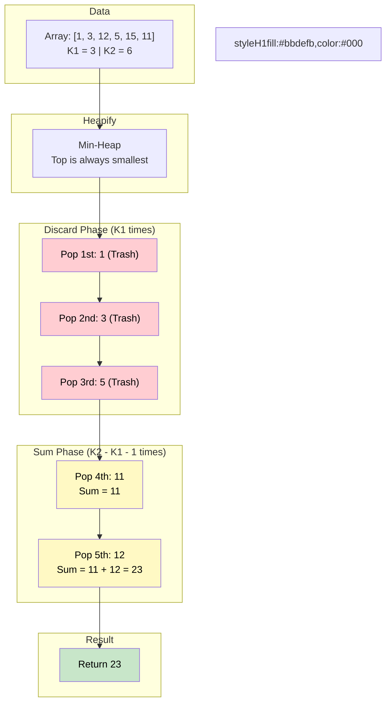

# 🚶‍♂️ Walkthrough: Sum of Elements

## 👶 Explain Like I'm 5
You have an array of numbers: `[1, 3, 12, 5, 15, 11]`.
I want you to find the sum of all numbers that are BIGGER than the 3rd smallest number (which is `5`) but SMALLER than the 6th smallest number (which is `15`).
Basically, sum all the numbers that rank strictly between `K1` (3) and `K2` (6).

The numbers between `5` and `15` in our list are `12` and `11`. Their sum is `23`.

To find these numbers easily, we can use a **Min-Heap**.
If we dump all the numbers into a Min-Heap, they are magically organized so that the smallest numbers come out first.

So, here's the trick:
1. Pop `K1` numbers out of the heap. (We throw them in the trash, we don't need them).
   - Pops `1`, `3`, `5`.
2. Now, the heap is perfectly queued up with the exact numbers we DO want!
3. Pop the heap exactly `(K2 - K1 - 1)` times, and add those numbers together!
   - Pops `11`, `12`. Sum = `23`.
   - We stop before hitting K2.

## 🎯 Core Strategy
This is a straightforward application of the **Top K Elements** pattern using a **Min-Heap**. A Min-Heap allows us to pull elements out in globally sorted order dynamically.

1. **Heapify**: Convert the array into a Min-Heap. Python's `heapq.heapify()` does this in highly efficient $O(N)$ time in-place.
2. **Discard Lower Bound**: Loop exactly $K_1$ times and `heappop()` from the Min-Heap. This discards all elements up to and including the $K_1$-th smallest element.
3. **Accumulate Range**: Initialize `element_sum = 0`. Calculate how many elements lie strictly between $K_1$ and $K_2$: `count = K2 - K1 - 1`.
4. **Sum Loop**: Loop `count` times, `heappop()` the next smallest element, and add it to `element_sum`.
5. **Return**: The accumulated `element_sum`.

*(Alternative Approach: You could also sort the array in $O(N \log N)$ and just sum the slice `arr[k1 : k2-1]`, but using a heap takes $O(N + K_2 \log N)$ which is faster when $K_2$ is much smaller than $N$).*

## 🏃‍♂️ Step-by-Step Execution (Dry Run)
**Input**: `nums = [1, 3, 12, 5, 15, 11]`, `K1 = 3`, `K2 = 6`

### Step 1: Heapify
- Create a copy to avoid mutating input: `min_heap = [1, 3, 12, 5, 15, 11]`.
- `heapify(min_heap)` reorganizes it. The exact internal array varies, but extracting elements will yield: `1, 3, 5, 11, 12, 15`.

### Step 2: Discard $K_1$ Elements
- We need to discard 3 elements (`K1 = 3`).
- **Pop 1**: `1`.
- **Pop 2**: `3`.
- **Pop 3**: `5`.
- Heap now holds `11, 12, 15`.

### Step 3: Accumulate Elements Between $K_1$ and $K_2$
- Elements to pop: `K2 - K1 - 1` $\rightarrow$ `6 - 3 - 1 = 2`.
- `element_sum = 0`.
- **Pop 1**: `11`. `element_sum += 11` $\rightarrow$ `11`.
- **Pop 2**: `12`. `element_sum += 12` $\rightarrow$ `23`.

### Final Result
- Return `element_sum = 23`.

## 📊 Visual Diagram
Here's a timeline of the heap operations showing how we skip the unwanted elements to reach our target range:

## 🛑 Edge Cases & Complexity

### Complexity
- **Time Complexity:** $O(N + K_2 \log N)$. 
  - Building the heap takes $O(N)$.
  - We execute $K_1 + (K_2 - K_1 - 1)$ pops, which simplifies to $K_2 - 1$ pops.
  - Each pop takes $O(\log N)$.
- **Space Complexity:** $O(N)$ to store the array elements in the heap data structure.

### Edge Cases Handled Safely
- **No elements between K1 and K2:** E.g., `nums = [1, 2, 3, 4]`, `K1 = 2, K2 = 3`. 
  - Discard phase loops 2 times (pops `1, 2`). 
  - Sum phase count evaluates to `3 - 2 - 1 = 0`. 
  - The sum loop never executes.
  - Returns `0`. Works perfectly!
