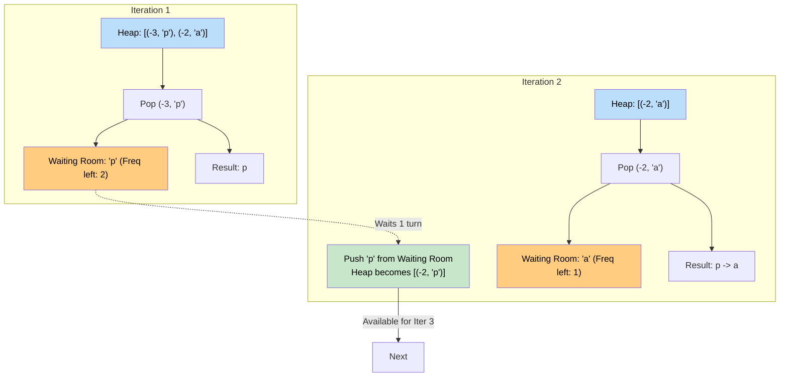

# 🚶‍♂️ Walkthrough: Rearrange String

## 👶 Explain Like I'm 5
You have a word: `"aappp"`.
You want to scramble the letters so that NO TWO IDENTICAL LETTERS are next to each other!

If you just randomly pick letters, you might get `"papap"`, which is good!
But how do we do it reliably?
We should ALWAYS try to place the letter we have the **MOST** of first! Because if we save all our `'p'`s for the end, we'll be forced to put them next to each other.
So, we use a **Max-Heap** to keep track of letter counts.

1. Pop the most frequent letter. (Let's say `'p'`).
2. Add `'p'` to our new string.
3. We have fewer `'p'`s now. Should we put it back in the Max-Heap?
   **WAIT!** If we put it back right away, it might STILL be the most frequent letter! And the Max-Heap will give it to us again on the very next turn, causing two `'p'`s to be next to each other!
4. So, we hold the `'p'` in a "Waiting Room" (a variable).
5. On the NEXT turn, we pop a different letter (say, `'a'`). We add `'a'` to the string.
6. NOW it is safe to take `'p'` out of the waiting room and put it back in the heap! Because we just placed an `'a'`, placing another `'p'` next time is perfectly fine!

## 🎯 Core Strategy
This uses the **Top K Elements** pattern with a clever "Waiting Room" (or queue) delay mechanism.

1. **Frequency Map**: Count the frequencies of all characters in the string.
2. **Max-Heap Initialization**: Push all `(-frequency, char)` pairs into a `max_heap`.
3. **State Variables**: 
   - `previous_char = None`
   - `previous_freq = 0`
   - `result = []`
4. **Greedy Placement**: Loop while the `max_heap` is not empty:
   - Pop `(freq, char)` from the heap.
   - Append `char` to `result`.
   - **Re-queue Previous**: If `previous_char` is not `None` and its frequency is still valid (i.e., $< 0$), push it back into the heap. It has waited for exactly one cycle, meaning it's now safe to use again.
   - **Update Waiting Room**: Set `previous_char = char`, and `previous_freq = freq + 1` (since freq is negative, adding 1 brings it closer to 0, effectively decrementing the count).
5. **Validation**: If the length of `result` matches the original string length, return it! If it doesn't match, it means we couldn't place all letters without having them touch (the heap emptied while a character was still stuck in the waiting room). Return `""`.

## 🏃‍♂️ Step-by-Step Execution (Dry Run)
**Input**: `"aappp"`

### Step 1: Frequency & Heap
- Frequencies: `{'a': 2, 'p': 3}`
- Max-Heap (Negated): `[(-3, 'p'), (-2, 'a')]`

### Step 2: Loop Execution
- **Turn 1**:
  - Pop: `(-3, 'p')`.
  - Result: `["p"]`.
  - `prev` is `None`. Nothing to push.
  - Waiting Room: `prev_char = 'p'`, `prev_freq = -3 + 1 = -2`.
- **Turn 2**:
  - Heap has `[(-2, 'a')]`. Pop `(-2, 'a')`.
  - Result: `["p", "a"]`.
  - Waiting Room has `(-2, 'p')`. Push it back to Heap! Heap = `[(-2, 'p')]`.
  - New Waiting Room: `prev_char = 'a'`, `prev_freq = -2 + 1 = -1`.
- **Turn 3**:
  - Heap has `[(-2, 'p')]`. Pop `(-2, 'p')`.
  - Result: `["p", "a", "p"]`.
  - Waiting Room has `(-1, 'a')`. Push to Heap! Heap = `[(-1, 'a')]`.
  - New Waiting Room: `prev_char = 'p'`, `prev_freq = -2 + 1 = -1`.
- **Turn 4**:
  - Heap has `[(-1, 'a')]`. Pop `(-1, 'a')`.
  - Result: `["p", "a", "p", "a"]`.
  - Waiting Room has `(-1, 'p')`. Push to Heap! Heap = `[(-1, 'p')]`.
  - New Waiting Room: `prev_char = 'a'`, `prev_freq = -1 + 1 = 0`.
- **Turn 5**:
  - Heap has `[(-1, 'p')]`. Pop `(-1, 'p')`.
  - Result: `["p", "a", "p", "a", "p"]`.
  - Waiting Room has `(0, 'a')`. Freq is 0, DO NOT push.
  - New Waiting Room: `prev_char = 'p'`, `prev_freq = 0`.
- **Heap is empty. Loop ends.**

### Step 3: Result Validation
- Result length = 5. Original string length = 5. Match!
- Return `"papap"`.

## 📊 Visual Diagram
Here is how the "Waiting Room" mechanism prevents the same character from being drawn twice in a row:

## 🛑 Edge Cases & Complexity

### Complexity
- **Time Complexity:** $O(N \log D)$. We process $N$ characters total. Pushing/popping from the heap takes $O(\log D)$, where $D$ is the number of distinct characters (at most 26 for English alphabets).
- **Space Complexity:** $O(D)$ for the frequency map and the Max-Heap.

### Edge Cases Handled Safely
- **Impossible to arrange:** `"aapa"`. 
  - Freq: `{'a': 3, 'p': 1}`.
  - Turn 1: Pop `a`. Waiting: `a` (2). Result: `a`.
  - Turn 2: Pop `p`. Push `a`. Waiting: `p` (0). Result: `ap`. Heap: `[a (2)]`.
  - Turn 3: Pop `a`. Push nothing. Waiting: `a` (1). Result: `apa`. Heap: `[]`.
  - Heap is empty! Loop breaks.
  - Result length is 3 (`apa`), but original string is 4. They don't match, so it correctly returns `""`.
