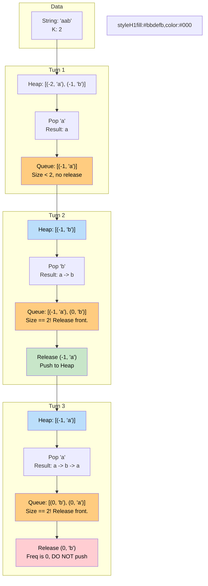

# 🚶‍♂️ Walkthrough: Rearrange String K Distance Apart

## 👶 Explain Like I'm 5
This is EXACTLY the same as the last problem! 
In the last problem, you wanted NO two identical characters to be next to each other. That means they had to be at least `2` distance apart! (Example: `"pap"`. The `'p'`s are at index 0 and 2. Distance = $2-0 = 2$).

Now, someone gives you a specific number `K`. They want the identical characters to be at least `K` distance apart!
In the last problem, our "Waiting Room" was just a single variable, which meant the character had to wait exactly ONE turn before being allowed back in the heap.
Now, the character needs to wait `K - 1` turns!
So, instead of a single variable, we make our Waiting Room a **Queue**.

1. We pop the most frequent character.
2. We add it to our string.
3. We put it in the Queue (the Waiting Room).
4. As soon as the Queue gets to size `K`, it means the person at the front of the line has been waiting exactly long enough!
5. We let the person at the front out of the Queue and put them back in the Max-Heap so they can be picked again!

## 🎯 Core Strategy
This builds on the **Top K Elements** pattern with a robust **Queue-based Cooldown** mechanism.

1. **Edge Case**: If $K \le 1$, identical characters are allowed to be adjacent, so just return the original string.
2. **Frequency Map**: Count the frequencies of all characters.
3. **Max-Heap Initialization**: Push `(-frequency, char)` into a `max_heap`.
4. **Queue Initialization**: Create an empty `queue` (using `collections.deque`).
5. **Greedy Placement**: Loop while `max_heap` is not empty:
   - Pop `(freq, char)` from the heap.
   - Append `char` to `result`.
   - Push `(freq + 1, char)` into the `queue` (Adding 1 to negative freq brings it closer to 0).
   - **Queue Release**: If `len(queue) == k`, it's time to release the character that has been waiting the longest.
     - `past_freq, past_char = queue.popleft()`.
     - If `past_freq < 0`, it still needs to be placed more times, so push it back into the `max_heap`.
6. **Validation**: Check if the resulting string length equals the original string length. If it does, return it. If it doesn't, the heap emptied prematurely because too many characters were stuck in the waiting room due to impossible constraints. Return `""`.

## 🏃‍♂️ Step-by-Step Execution (Dry Run)
**Input**: `"aab"`, `K = 2`

### Step 1: Initial Setup
- Frequencies: `{'a': 2, 'b': 1}`
- Max-Heap (Negated): `[(-2, 'a'), (-1, 'b')]`
- Queue: `[]`

### Step 2: Loop Execution
- **Turn 1**:
  - Pop from Heap: `(-2, 'a')`.
  - Result: `["a"]`.
  - Push to Queue: `(-1, 'a')`. Queue = `[(-1, 'a')]`.
  - `len(Queue)` is 1, not 2. Do nothing.
- **Turn 2**:
  - Heap has `[(-1, 'b')]`. Pop `(-1, 'b')`.
  - Result: `["a", "b"]`.
  - Push to Queue: `(0, 'b')`. Queue = `[(-1, 'a'), (0, 'b')]`.
  - `len(Queue) == 2`! 
    - `popleft()` gives `(-1, 'a')`.
    - `-1 < 0`, so push it back to Heap! Heap = `[(-1, 'a')]`.
- **Turn 3**:
  - Heap has `[(-1, 'a')]`. Pop `(-1, 'a')`.
  - Result: `["a", "b", "a"]`.
  - Push to Queue: `(0, 'a')`. Queue = `[(0, 'b'), (0, 'a')]`.
  - `len(Queue) == 2`!
    - `popleft()` gives `(0, 'b')`.
    - `0` is not `< 0`, so do NOT push to Heap. Heap = `[]`.
- **Turn 4**:
  - Heap is empty. Loop breaks.

### Step 3: Result Validation
- Result length = 3. Original string length = 3. Match!
- Return `"aba"`.

## 📊 Visual Diagram
Here is how the Queue acts as a rolling window, locking characters out of the heap for exactly $K$ turns:

## 🛑 Edge Cases & Complexity

### Complexity
- **Time Complexity:** $O(N \log D)$. We iterate over the string of length $N$. Each heap push/pop takes $O(\log D)$, where $D$ is the number of distinct characters.
- **Space Complexity:** $O(D)$ for the HashMap, Max-Heap, and the Queue.

### Edge Cases Handled Safely
- **Impossible to arrange:** `"aab", K = 3`. 
  - Turn 1: Pop `a`. Queue: `[(-1, 'a')]`. Result: `a`.
  - Turn 2: Pop `b`. Queue: `[(-1, 'a'), (0, 'b')]`. Result: `ab`.
  - Turn 3: Heap is empty! Loop ends. (Queue size never reached 3, so `a` was never released).
  - Result length is 2. Original length is 3. They don't match, returns `""`. Perfectly correct!
- **K = 0 or 1:** Fast-tracked by the `if k <= 1: return s` condition. No need to waste CPU cycles.
