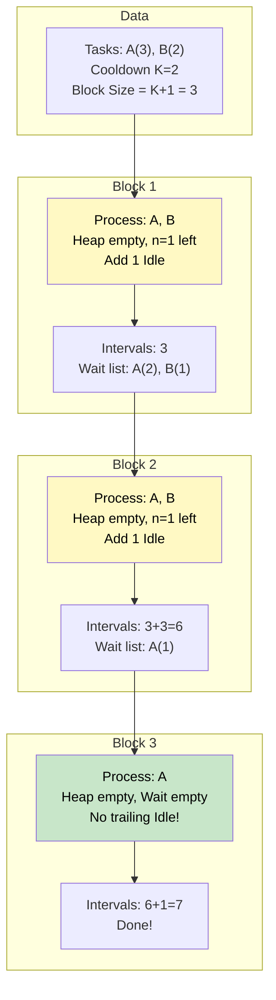

# 🚶‍♂️ Walkthrough: Scheduling Tasks

## 👶 Explain Like I'm 5
You are a boss, and you have tasks for your workers: `["A", "A", "B", "C"]`.
But there's a union rule: If a worker does task `"A"`, they MUST take `K=2` coffee breaks (intervals) before they are allowed to do task `"A"` again!
During those coffee breaks, they CAN do other tasks, or they can just sit idle.

You want to finish all the tasks in the minimum amount of time. What should you do?
Always assign the **MOST common task first!** If `"A"` has to be done 10 times, you want to start chipping away at `"A"` immediately, because every time you do it, you trigger a long coffee break for `"A"`.

So, we put our tasks in a **Max-Heap** based on how many times we need to do them.
We pull out tasks and assign them. 
Since the coffee break is `K`, a "block" of time where `"A"` cannot repeat is actually `K + 1` intervals long! (The time `"A"` takes, plus `K` breaks).
So we try to pull `K + 1` different tasks from the Max-Heap.

If we run out of different tasks in the heap before the block is full, the workers must sit **IDLE**. We still count those idle hours towards the total time!
Then, we put the tasks we just did (with their counts reduced by 1) back into the Max-Heap for the next block.

## 🎯 Core Strategy
This uses the **Top K Elements** pattern with a "block processing" strategy to simulate CPU scheduling.

1. **Frequency Map**: Count the frequencies of all tasks.
2. **Max-Heap**: Push `(-frequency, task)` into a `max_heap` so the most frequent tasks rise to the top.
3. **Block Processing**: Loop while the `max_heap` is not empty.
   - We define a block size as `n = K + 1`. This is the minimum window required before a task can repeat.
   - We create a temporary `wait_list` for tasks processed in this block.
   - Loop up to `n` times:
     - If the heap has tasks, pop the most frequent task. Increment `total_intervals`. Decrease its frequency. If it still needs to be run again (freq is negative), append it to the `wait_list`.
     - Decrement `n`.
4. **Re-queue**: Once the inner loop ends (either we processed `n` tasks or the heap ran empty), push all tasks from the `wait_list` back into the `max_heap`.
5. **Idle Time Calculation**: If the `max_heap` is NOT empty, it means we have more blocks to process. However, if our inner loop finished early (because we ran out of unique tasks for this block), `n` will be $> 0$. These remaining `n` slots *must* be filled with idle time to satisfy the cooldown for the next block. We add `n` to `total_intervals`. (If the heap IS empty, we don't add trailing idle time because all tasks are finished!)
6. **Return**: The accumulated `total_intervals`.

## 🏃‍♂️ Step-by-Step Execution (Dry Run)
**Input**: `tasks = ["A", "A", "A", "B", "B"]`, `K = 2`

### Step 1: Initialization
- Freq: `{'A': 3, 'B': 2}`
- Max-Heap (Negated): `[(-3, 'A'), (-2, 'B')]`
- `total_intervals = 0`

### Step 2: Block 1 (`n = K + 1 = 3`)
- `wait_list = []`
- **Pop 1 (`n=3`)**: Pop `(-3, 'A')`. `total_intervals = 1`. Freq becomes `-2`. Add to `wait_list`.
- **Pop 2 (`n=2`)**: Pop `(-2, 'B')`. `total_intervals = 2`. Freq becomes `-1`. Add to `wait_list`.
- **Pop 3 (`n=1`)**: Heap is empty! Inner loop breaks. `n` remains `1`.
- **Re-queue**: Push `wait_list` back to Heap. Heap = `[(-2, 'A'), (-1, 'B')]`.
- **Idle Time**: Heap is not empty. We have `1` idle slot left (`n=1`). `total_intervals += 1` $\rightarrow$ `3`.
*(Visual block: A, B, Idle)*

### Step 3: Block 2 (`n = 3`)
- `wait_list = []`
- **Pop 1 (`n=3`)**: Pop `(-2, 'A')`. `total_intervals = 4`. Freq becomes `-1`. Add to `wait_list`.
- **Pop 2 (`n=2`)**: Pop `(-1, 'B')`. `total_intervals = 5`. Freq becomes `0`. (Don't add to wait list!).
- **Pop 3 (`n=1`)**: Heap is empty! Inner loop breaks. `n` remains `1`.
- **Re-queue**: Push `wait_list` to Heap. Heap = `[(-1, 'A')]`.
- **Idle Time**: Heap is not empty. Add `n=1`. `total_intervals += 1` $\rightarrow$ `6`.
*(Visual block: A, B, Idle)*

### Step 4: Block 3 (`n = 3`)
- `wait_list = []`
- **Pop 1 (`n=3`)**: Pop `(-1, 'A')`. `total_intervals = 7`. Freq becomes `0`.
- **Pop 2 (`n=2`)**: Heap is empty. Break.
- **Re-queue**: `wait_list` is empty. Heap remains `[]`.
- **Idle Time**: Heap IS empty! We are done! Do NOT add trailing idle time.
*(Visual block: A)*

### Final Result
- Return `total_intervals = 7`.

## 📊 Visual Diagram
Here is how the tasks are scheduled into blocks, inserting idle time only when forced to:

## 🛑 Edge Cases & Complexity

### Complexity
- **Time Complexity:** $O(N \log D)$. Finding frequencies is $O(N)$. The heap contains at most $D$ elements (26 if only uppercase English letters). We push/pop at most $N$ times. So it simplifies to $O(N)$.
- **Space Complexity:** $O(D)$ for the HashMap, Max-Heap, and wait list.

### Edge Cases Handled Safely
- **Trailing Idle Time Ignored:** The check `if max_heap: total_intervals += n` elegantly prevents adding unnecessary idle time at the very end of the schedule when all tasks are complete.
- **K = 0:** The block size `n` becomes `1`. The inner loop processes exactly 1 task, pushes it to the wait list, re-queues it, and moves to the next. No idle time is ever generated because `n` hits `0` perfectly every time. Returns exactly $N$.
