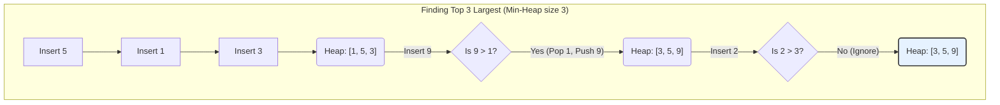

# Pattern 19: Top 'K' Elements

## 👶 Explain Like I'm 5
Imagine you are at an arcade and you want to see the Top 3 High Scores for a game.
Thousands of people have played, but the screen only shows 3 names.
Every time someone finishes a game, the machine checks: "Is this score higher than the lowest score currently on the screen?"
If it is, the machine kicks the lowest score off the screen and puts the new score on!
The machine doesn't need to sort all 1,000 scores! It only ever cares about keeping the best 3 at any given time.
This is exactly how a **Min Heap** works for finding Top K elements!
A Min Heap is like a VIP bouncer that always keeps the WEAKEST person right at the front door.
If you only have room for 3 people (K=3), you fill the room. When a 4th person shows up, the bouncer looks at the weakest person at the door. If the new person is stronger, the weakest person gets kicked out, and the new person goes in!
At the end of the day, your room will ONLY contain the Top 3 strongest people!

---

## 🧩 Core Idea & Pattern Detection

The "Top K Elements" pattern is used when you are asked to find the largest, smallest, most frequent, or closest 'K' elements in an unsorted array or stream.
While sorting the entire array takes $O(N \log N)$ time, using a Heap allows you to solve these problems in $O(N \log K)$ time. If $K$ is small, this is incredibly fast!

### When to use it:
- The problem asks for the "Top K", "Kth Smallest/Largest", or "K Most Frequent".
- The input is an unsorted array or an infinite stream of data.



---

## 🔧 Algorithmic Anatomy

### Recipe: Top K Largest Elements (Using a Min Heap)
To find the Top K LARGEST elements, we use a MIN Heap of size K!
Why a Min Heap? Because we want the *smallest of the large numbers* to be at the top of the heap, so we can easily compare new numbers to it and kick it out if the new number is larger.

1. Insert the first `K` elements into a Min Heap.
2. Iterate through the remaining elements.
3. For each element, if it is LARGER than the top of the heap (the smallest element currently in our Top K), pop the heap and push the new element.
4. The heap now contains the Top K largest elements!

```python
import heapq

def find_k_largest_numbers(nums, k):
    min_heap = []
    
    # 1. Put first 'K' numbers in the min heap
    for i in range(k):
        heapq.heappush(min_heap, nums[i])
        
    # 2. Go through the remaining numbers
    for i in range(k, len(nums)):
        # If the number is bigger than the smallest number in the heap, swap it!
        if nums[i] > min_heap[0]:
            heapq.heappop(min_heap)
            heapq.heappush(min_heap, nums[i])
            
    # 3. The heap has the top 'K' numbers
    return list(min_heap)
```

### Recipe: Kth Smallest Element (Using a Max Heap)
To find the K SMALLest elements, use a MAX Heap!
We want the *largest of the small numbers* at the top, so we can kick it out if we find an even smaller number.

*(Note: Python's `heapq` is a Min Heap. To make it a Max Heap, we multiply numbers by `-1` before pushing, and multiply by `-1` again when popping).*

---

## 🛑 Per-Variant DOs and DON'Ts

| Variant | DO | DON'T |
|---------|----|-------|
| **Top K Largest** | **DO** use a **Min-Heap**. It keeps the smallest of the "elite" group easily accessible for comparison. | **DON'T** use a Max-Heap. If you put all elements in a Max-Heap and pop K times, that takes $O(N + K \log N)$. Our method takes $O(K + (N-K) \log K)$, which is better for small K. |
| **Kth Smallest** | **DO** use a **Max-Heap**. Negate the numbers in Python to simulate it. | **DON'T** sort the array if they ask for O(N log K) time. |
| **Top K Frequent** | **DO** use a Hash Map to count frequencies first, THEN push `(frequency, number)` tuples into the heap. | **DON'T** push just the number into the heap. The heap needs to sort by frequency! |
| **Rearrange String** | **DO** use a Max-Heap of character frequencies. Pop the most frequent, append to result, but WAIT to push it back until the *next* iteration (to avoid adjacent duplicates). | **DON'T** forget to keep track of a "previous" character that you popped, so you don't push it back too early! |

---

## ⏱️ Complexity Analysis

| Aspect | Complexity | Why |
|--------|-----------|-----|
| **Time** | **O(N * log K)** | Inserting into a heap of size K takes $O(\log K)$. We do this for at most N elements. |
| **Space** | **O(K)** | We strictly maintain the heap size to be exactly K. |

---

## ⚠️ Common Pitfalls

1. **Min Heap vs Max Heap Confusion:**
   - Looking for the **Largest**? Use a **Min-Heap**.
   - Looking for the **Smallest**? Use a **Max-Heap**.
   - Looking for the **Most Frequent**? Use a **Min-Heap** (kick out the least frequent).
   - Looking for the **Closest**? Use a **Max-Heap** (kick out the farthest).
2. **Tuple Sorting in Python:** If you push a tuple like `(freq, char)` into a Python `heapq`, it will sort by `freq`. If two items have the SAME `freq`, it will try to sort by `char`. If `char` is an un-comparable object, it will crash! To fix this, you can push `(freq, id(obj), obj)`.
3. **Popping before Pushing:** Use `heapq.heappushpop(heap, item)` for better performance if you need to push and pop in the same step. It's more efficient than doing them separately!

---

## ✅ Problems in This Pattern

| # | Problem | Difficulty | Key Twist |
|---|---------|------------|-----------|
| 1 | Top 'K' Numbers | Easy | Classic Min-Heap of size K. |
| 2 | Kth Smallest Number | Easy | Classic Max-Heap of size K. |
| 3 | 'K' Closest Points | Easy | Max-Heap comparing distance (Euclidean formula). |
| 4 | Connect Ropes | Easy | Put ALL ropes in Min-Heap. Pop 2, add them, push result. |
| 5 | Top 'K' Frequent | Medium | Hash Map for counts, Min-Heap of `(count, num)`. |
| 6 | Frequency Sort | Medium | Hash Map for counts, Max-Heap of `(count, char)`. |
| 7 | Kth Largest in Stream | Medium | Keep a permanent Min-Heap of size K in the class state. |
| 8 | 'K' Closest Numbers | Medium | Binary Search to find target, then two pointers OR a Max-Heap. |
| 9 | Max Distinct Elements | Medium | Greedy approach. Min-Heap of duplicate frequencies, spend `K` to reduce them to 1. |
| 10 | Sum of Elements | Medium | Put in Min-Heap. Pop K1 times (discard). Pop until K2 (accumulate sum). |
| 11 | Rearrange String | Hard | Max-Heap of frequencies. Hold the popped char in a `prev` variable to delay re-insertion. |
| 12 | Rearrange String K Dist | Hard | Same as 11, but hold chars in a `queue` of size K to delay re-insertion. |
| 13 | Scheduling Tasks | Hard | Max-Heap for tasks, Queue for cooldown period. |
| 14 | Frequency Stack | Hard | Class state with a Hash Map of counts, and a Max-Heap comparing `(count, sequence_number)`. |
