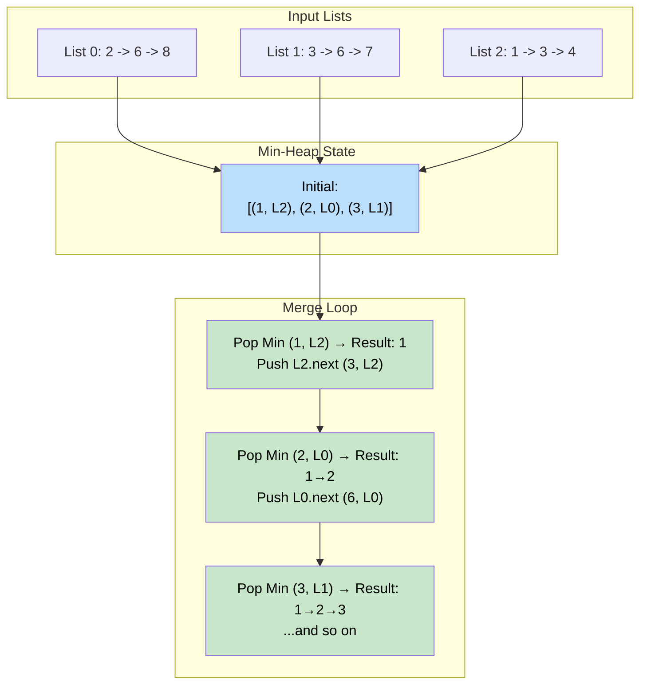

# 🚶‍♂️ Walkthrough: Merge K Sorted Lists

## 👶 Explain Like I'm 5
Imagine you have 3 chains of paperclips. Each chain is sorted by size.
You want to combine all 3 chains into ONE giant chain that is also sorted by size.

Since the chains are already sorted, the smallest paperclip in the ENTIRE world MUST be at the very front of one of the 3 chains!
So, you just look at the 3 front paperclips. You pick the smallest one, take it off its chain, and put it on your new giant chain.
When you take it off, the next paperclip in that chain becomes the new front!

You repeat this, always looking at the front of the 3 chains, picking the smallest.
To make finding the smallest super fast, we use a **Min-Heap**!
The Min-Heap will hold exactly 3 paperclips (the fronts of the 3 chains).
When we pull one out, we look at the chain it came from, grab the next paperclip, and throw it into the Min-Heap!

## 🎯 Core Strategy
This is the canonical **K-way Merge** pattern. We use a **Min-Heap** of size $K$ to efficiently find the globally smallest element among $K$ sorted sequences at any given time.

1. **Initialize Heap**: Push the head node of each of the $K$ non-null LinkedLists into the `min_heap`.
   - We push tuples: `(node.value, index, node)`.
   - *Why the `index`?* Python's `heapq` sorts tuples lexicographically. If two nodes have the same value, it tries to compare the second element. If the second element is a `ListNode` object (which doesn't support `<`), Python **crashes**. The `index` (the list's position in the input array) is a unique, comparable integer that acts as a safe tie-breaker.
2. **Result List**: Initialize `result_head` and `result_tail` to `None` for building the merged output.
3. **Merge Loop**: Loop while the heap is not empty.
   - Pop the smallest node: `value, i, node = heappop(min_heap)`.
   - Append `node` to the result linked list.
   - If `node.next` exists (the chain has more paperclips), push the next node into the heap: `(node.next.value, i, node.next)`.
4. **Return**: `result_head`, the head of the fully merged sorted linked list.

## 🏃‍♂️ Step-by-Step Execution (Dry Run)
**Input**: `[2 -> 6 -> 8]`, `[3 -> 6 -> 7]`, `[1 -> 3 -> 4]`

### Step 1: Initialize Heap
- Push heads of all 3 lists:
  - `(2, 0, Node(2))` — from List 0
  - `(3, 1, Node(3))` — from List 1
  - `(1, 2, Node(1))` — from List 2
- Heap state: `[(1, 2, Node1), (3, 1, Node3), (2, 0, Node2)]`

### Step 2: Merge Iterations
| Pop Node | Result Chain | Next Node Pushed |
|---|---|---|
| `(1, 2, Node(1))` | `1` | `(3, 2, Node(3))` |
| `(2, 0, Node(2))` | `1 → 2` | `(6, 0, Node(6))` |
| `(3, 1, Node(3))` | `1 → 2 → 3` | `(6, 1, Node(6))` |
| `(3, 2, Node(3))` | `1 → 2 → 3 → 3` | `(4, 2, Node(4))` |
| `(4, 2, Node(4))` | `1 → 2 → 3 → 3 → 4` | `None` |
| `(6, 0, Node(6))` | `… → 4 → 6` | `(8, 0, Node(8))` |
| `(6, 1, Node(6))` | `… → 6 → 6` | `(7, 1, Node(7))` |
| `(7, 1, Node(7))` | `… → 6 → 7` | `None` |
| `(8, 0, Node(8))` | `… → 7 → 8` | `None` |

### Final Result
`1 → 2 → 3 → 3 → 4 → 6 → 6 → 7 → 8` ✅

## 📊 Visual Diagram
Here is how the Min-Heap acts as the master conductor, always choosing the globally smallest head from all $K$ lists simultaneously:

## 🛑 Edge Cases & Complexity

### Complexity
- **Time Complexity:** $O(N \log K)$ where $N$ is the total number of nodes across all lists and $K$ is the number of lists. Each node is pushed and popped from the heap exactly once, and each heap operation takes $O(\log K)$.
- **Space Complexity:** $O(K)$ for the Min-Heap which holds at most one node from each of the $K$ lists.

### Edge Cases Handled Safely
- **Empty input list:** `merge_lists([])` — The `for` loop doesn't execute. The heap is empty. The `while` loop doesn't run. Returns `None`, which correctly represents an empty linked list.
- **Lists containing `None`:** `merge_lists([None, None])` — The `if root is not None:` guard inside the initialization loop skips null lists. The heap remains empty and we return `None`.
