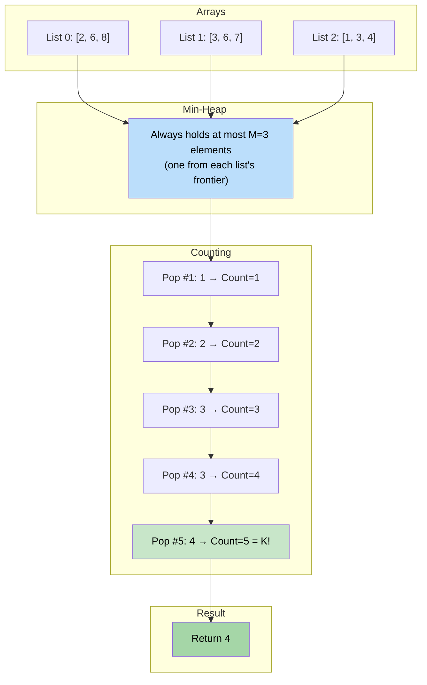

# 🚶‍♂️ Walkthrough: Kth Smallest Number in M Sorted Lists

## 👶 Explain Like I'm 5
You have `M` separate arrays, and each one is sorted.
You want to find the **5th smallest number** among ALL of them combined.

Instead of actually combining them into one giant list (like we did in the last problem) and then picking the 5th one, we can just do the exact same thing, but **count**!
1. Pop the smallest number from the heap. (Count = 1).
2. Pop the next smallest. (Count = 2).
3. Pop again. (Count = 3).
...
Once `Count == K`, the number you just popped is your answer!
You don't need to build a new list. You just throw away the first `K-1` numbers, and keep the `K`th one!

## 🎯 Core Strategy
This directly applies the **K-way Merge** pattern. Instead of collecting all popped elements (like merging), we simply stop as soon as we've popped $K$ times.

1. **Initialize Heap**: Push a tuple `(value, array_index, element_index)` for the first element of each non-empty array.
   - We include both `array_index` (to know which array to advance) and `element_index` (to know exactly where in that array we are).
2. **Count-driven Pop**: Loop while the heap is not empty.
   - Pop the smallest element. Increment `count`.
   - If `count == k`, immediately return the popped `value`. We're done!
   - If the popped element's array has more elements (i.e., `el_idx + 1 < len(lists[arr_idx])`), push the next element from that same array into the heap.
3. **Safety Valve**: If the loop ends without reaching count $K$, we had fewer than $K$ elements total. Return `-1`.

## 🏃‍♂️ Step-by-Step Execution (Dry Run)
**Input**: `lists = [[2, 6, 8], [3, 6, 7], [1, 3, 4]]`, `K = 5`

### Step 1: Initialize Heap
- Push first element of each list:
  - `(2, 0, 0)` — value 2, List 0, Index 0
  - `(3, 1, 0)` — value 3, List 1, Index 0
  - `(1, 2, 0)` — value 1, List 2, Index 0

### Step 2: Merge & Count

| Count | Pop | Push Next | Answer? |
|---|---|---|---|
| 1 | `(1, L2, idx0)` | `(3, L2, idx1)` | count=1, no |
| 2 | `(2, L0, idx0)` | `(6, L0, idx1)` | count=2, no |
| 3 | `(3, L1, idx0)` | `(6, L1, idx1)` | count=3, no |
| 4 | `(3, L2, idx1)` | `(4, L2, idx2)` | count=4, no |
| 5 | `(4, L2, idx2)` | — | **count=5 == K! Return 4** |

### Final Result
Return `4`. (The 5th smallest across all three lists is `4`).

## 📊 Visual Diagram
Here is how the three sorted arrays are treated as a single virtual sorted sequence by the Min-Heap:

## 🛑 Edge Cases & Complexity

### Complexity
- **Time Complexity:** $O(K \log M)$ where $M$ is the number of input lists. We initialize the heap with $M$ elements ($O(M \log M)$). Then we perform at most $K$ pops and pushes, each $O(\log M)$. Total is $O((M + K) \log M)$ which simplifies to $O(K \log M)$ when $K >> M$.
- **Space Complexity:** $O(M)$ for the Min-Heap, which holds at most one pointer per list.

### Edge Cases Handled Safely
- **K is larger than all elements total:** E.g., `[[1, 2], [3]], K=5`. Only 3 elements exist. The loop runs 3 times (count = 3). Heap becomes empty. We exit the loop. Return `-1`. Perfectly handled.
- **Empty arrays in input:** The `if len(lists[i]) > 0:` guard prevents pushing from empty arrays, avoiding index errors.
