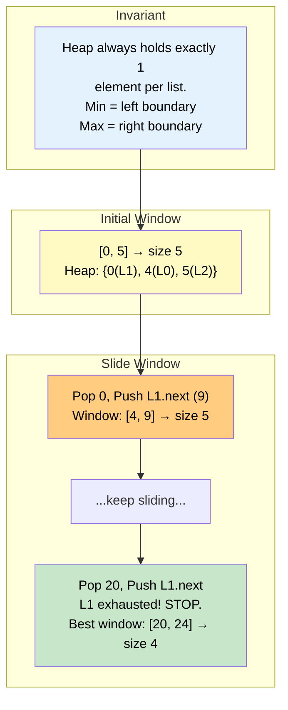

# 🚶‍♂️ Walkthrough: Smallest Number Range

## 👶 Explain Like I'm 5
You have several sorted lists of numbers. You want to draw a *tiny* interval on the number line such that **every single list** contributes at least one number that falls inside that interval. The goal is to make this interval as short as possible.

Think of each list as a different colour of beads on a rope. You want to pick one bead of each colour and slide a ruler so that all those beads fit inside the ruler. Then you try to shrink the ruler as much as you can.

## 🎯 Core Strategy
This is an advanced **K-way Merge** problem. The key insight is:

> A valid range `[left, right]` must contain at least one element from each list. The **minimum** element currently in the heap defines the left end, and we track the **maximum** element currently in the heap to define the right end.

1. **Initialize Heap & Max**: Push the first element of every list into the `min_heap`. Also track `current_max` — the maximum value among all elements currently in the heap.
2. **Sliding Window**:
   - Pop the smallest element `(current_min, list_idx, elem_idx)`. The current window is `[current_min, current_max]`.
   - If this window is smaller than the best window seen so far, update `best_start, best_end`.
   - **Advance the exhausted list**: Move to the next element in the same list. If no next element exists, **stop**. We can't expand coverage for that list anymore, so no smaller valid range is possible.
   - Otherwise, push the next element and update `current_max` if needed.
3. **Why stop when a list is exhausted?** Because the heap always holds exactly one element per list. If a list runs dry, the next pop would remove coverage for that list entirely, meaning the window would no longer be valid.

## 🏃‍♂️ Step-by-Step Execution (Dry Run)
**Input**: `lists = [[4, 10, 15, 24, 26], [0, 9, 12, 20], [5, 18, 22, 30]]`

### Step 1: Initialize Heap
- Push first elements: `(4, 0, 0)`, `(0, 1, 0)`, `(5, 2, 0)`.
- `current_max = max(4, 0, 5) = 5`.
- Heap (ordered): `[(0, 1, 0), (4, 0, 0), (5, 2, 0)]`.

### Step 2: Iterations

| Pop (min) | Window | Best so far | Next Pushed | New Max |
|---|---|---|---|---|
| `(0, L1, 0)` | `[0, 5]` | `[0, 5]` (size 5) | `(9, L1, 1)` | 9 |
| `(4, L0, 0)` | `[4, 9]` | `[0, 5]` (4<5, no update) | `(10, L0, 1)` | 10 |
| `(5, L2, 0)` | `[5, 10]` | `[0, 5]` (5<5, no update) | `(18, L2, 1)` | 18 |
| `(9, L1, 1)` | `[9, 18]` | `[0, 5]` (9>5, no update) | `(12, L1, 2)` | 18 |
| `(10, L0, 1)` | `[10, 18]` | `[0, 5]` (8>5, no) | `(15, L0, 2)` | 18 |
| `(12, L1, 2)` | `[12, 18]` | `[0, 5]` (6>5, no) | `(20, L1, 3)` | 20 |
| `(15, L0, 2)` | `[15, 20]` | `[0, 5]` (5=5, no) | `(24, L0, 3)` | 24 |
| `(18, L2, 1)` | `[18, 24]` | `[0, 5]` (6>5, no) | `(22, L2, 2)` | 24 |
| `(20, L1, 3)` | `[20, 24]` | **`[20, 24]`** (4<5 ✅) | `(L1 exhausted!)` | — |
| **STOP** | — | **`[20, 24]`** | — | — |

### Final Result
Return `[20, 24]`.

## 📊 Visual Diagram
Here is how the heap always maintains exactly one representative from each list, forming a valid sliding window:

## 🛑 Edge Cases & Complexity

### Complexity
- **Time Complexity:** $O(N \log K)$ where $N$ is the total number of elements across all lists and $K$ is the number of lists. The heap stays at size $K$; we push/pop at most $N$ times total.
- **Space Complexity:** $O(K)$ for the heap.

### Edge Cases Handled Safely
- **Empty input:** `smallest_range([])` — Guarded by `if not lists`. Returns `[]`.
- **Any inner list is empty:** `any(len(lst) == 0 for lst in lists)` guard catches this. Returns `[]` because we can never satisfy the constraint that every list contributes at least one number.
