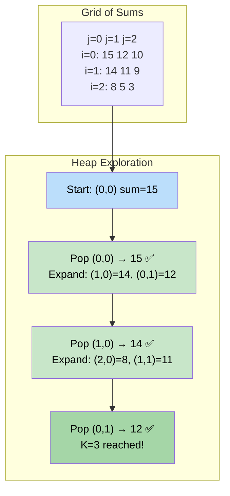

# 🚶‍♂️ Walkthrough: K Pairs with Largest Sums

## 👶 Explain Like I'm 5
You have two sorted lists of numbers (from biggest to smallest).
You want to pick **K pairs**, where each pair is one number from List 1 and one from List 2. You want the pairs whose sums are the **LARGEST**.

Think of it like two piles of gold coins. You need to pick K ways to grab one coin from each pile, and you want each grab to bring the most gold possible.

Since both piles are sorted (biggest first), the absolute best pair is always `(pile1[0], pile2[0])`. After picking that, the next best candidates are:
- `(pile1[1], pile2[0])` — step forward in List 1, keep List 2.
- `(pile1[0], pile2[1])` — keep List 1, step forward in List 2.

We use a **Max-Heap** to always pick the next best candidate!

## 🎯 Core Strategy
This applies **K-way Merge** to a 2D implicit grid of sums. If we imagine a matrix where `mat[i][j] = nums1[i] + nums2[j]`, each row and each column is sorted (in descending order). We want the Top $K$ cells.

1. **Sort Descending**: Ensure both arrays are sorted in descending order.
2. **Seed Heap**: Push the globally best pair `(-sum, 0, 0)` into a Max-Heap (simulated by negating the sum).
3. **Visited Set**: Create a `visited` set to avoid pushing the same `(i, j)` coordinate twice.
4. **Pop and Expand**: While the heap isn't empty and we haven't collected $K$ pairs:
   - Pop `(-neg_sum, i, j)`. Append `(nums1[i], nums2[j])` to result.
   - If `(i+1, j)` is in bounds and not visited, push it and mark visited.
   - If `(i, j+1)` is in bounds and not visited, push it and mark visited.
5. **Return**: The result list of $K$ pairs in descending sum order.

## 🏃‍♂️ Step-by-Step Execution (Dry Run)
**Input**: `nums1 = [9, 8, 2]`, `nums2 = [6, 3, 1]`, `K = 3`

*After sorting descending:* `nums1 = [9, 8, 2]`, `nums2 = [6, 3, 1]`

### The Implicit Sum Grid:
```
       j=0(6)  j=1(3)  j=2(1)
i=0(9):  15      12      10
i=1(8):  14      11       9
i=2(2):   8       5       3
```
We want the top 3 cells.

### Step 1: Initialize
- Push `(-15, 0, 0)`. Visited = `{(0,0)}`.

### Step 2: Iterations

| Pop | Result | Push Neighbors |
|---|---|---|
| `(-15, 0, 0)` → sum=15 | `[(9, 6)]` | `(-14, 1, 0)` and `(-12, 0, 1)` |
| `(-14, 1, 0)` → sum=14 | `[(9,6), (8,6)]` | `(-8, 2, 0)` and `(-11, 1, 1)` |
| `(-12, 0, 1)` → sum=12 | `[(9,6), (8,6), (9,3)]` | — |

### Final Result
`[(9, 6), (8, 6), (9, 3)]` ✅

## 📊 Visual Diagram
Here is how the algorithm walks the implicit sum grid, always expanding from the locally best popped position:



## 🛑 Edge Cases & Complexity

### Complexity
- **Time Complexity:** $O(K \log K)$. Each pop produces at most 2 pushes. The heap stays bounded at size $O(K)$. We perform $K$ pop operations.
- **Space Complexity:** $O(K)$ for the Max-Heap and the visited set.

### Edge Cases Handled Safely
- **Empty input array:** `if not nums1 or not nums2: return []` guards both cases.
- **K larger than total pairs:** E.g., `k_largest_pairs([1], [2], 5)`. There is only 1 possible pair `(1, 2)`. The loop would try to expand but all neighbors are out of bounds. The heap empties after 1 pop. We just return `[(1, 2)]`.
- **Duplicate values causing double-push:** The `visited` set based on `(i, j)` coordinates prevents any cell from being pushed to the heap more than once, regardless of whether values are equal.
