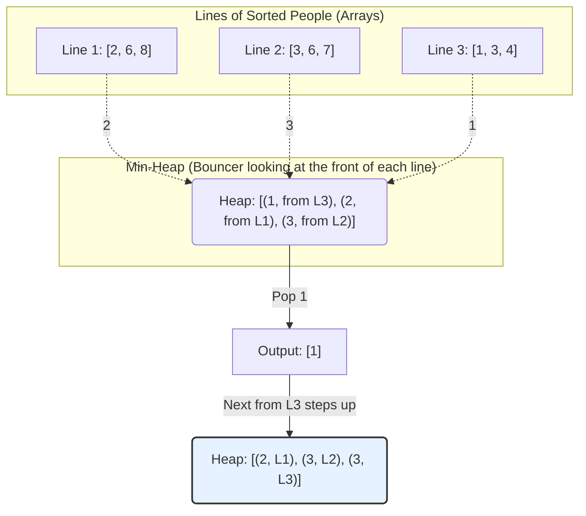

# Pattern 20: K-way Merge

## 👶 Explain Like I'm 5
Imagine you are at a grocery store, and there are 3 checkout lines. 
In each line, the people are standing in order of their age (youngest at the front, oldest at the back).
You have a special job: you need to create ONE single line of people from all 3 lines, still perfectly sorted by age!
How do you do it?
You don't need to look at everyone in all 3 lines! You only need to look at the 3 people at the VERY FRONT of each line.
You compare those 3 people, take the youngest one, and put them in your new line.
When that person leaves their original line, the next person in that line steps up to the front.
Now you compare the 3 people currently at the front again!
Since we always need to quickly find the "youngest" out of a small group of people, we can use a **Min-Heap**!
The Min-Heap will hold exactly 1 person from each line. As soon as someone leaves the Heap, we grab the next person from their specific line and put them in the Heap!

---

## 🧩 Core Idea & Pattern Detection

The "K-way Merge" pattern helps you solve problems that involve a set of sorted arrays (or Linked Lists).
Whenever you have `K` sorted arrays and you need to merge them, find a specific element among them, or find ranges, you can use a Min-Heap to keep track of the smallest current element from each array.

### When to use it:
- The problem features multiple arrays, lists, or a matrix.
- The arrays/lists/matrix rows are ALREADY SORTED.
- You need to merge them, find the Kth smallest/largest, or find pairs between them.



---

## 🔧 Algorithmic Anatomy

### Recipe: Merging K Sorted Arrays
1. Put the FIRST element of each of the `K` arrays into a Min-Heap.
   - We must push a tuple: `(value, array_index, element_index)`.
   - `array_index` tells us which array this number came from.
   - `element_index` tells us where this number was inside that array.
2. Initialize an empty result list.
3. While the Min-Heap is not empty:
   - Pop the smallest element. Add its `value` to the result list.
   - Look at the `array_index` and `element_index` of the popped element.
   - If that array has more elements (i.e., `element_index + 1 < len(array)`), grab the next element from that exact array and push it into the Heap!

```python
import heapq

def merge_arrays(lists):
    min_heap = []
    
    # 1. Put the first element of each list into the heap
    for i in range(len(lists)):
        if len(lists[i]) > 0:
            heapq.heappush(min_heap, (lists[i][0], i, 0))
            
    result = []
    
    # 2. Keep popping the smallest and pushing the next element from the same list
    while min_heap:
        value, list_idx, element_idx = heapq.heappop(min_heap)
        result.append(value)
        
        # Is there a next element in that list?
        if element_idx + 1 < len(lists[list_idx]):
            next_value = lists[list_idx][element_idx + 1]
            heapq.heappush(min_heap, (next_value, list_idx, element_idx + 1))
            
    return result
```

---

## 🛑 Per-Variant DOs and DON'Ts

| Variant | DO | DON'T |
|---------|----|-------|
| **Merging Linked Lists** | **DO** push `(node.val, id(node), node)` into the heap to avoid Python comparing the node objects directly if values tie. | **DON'T** try to turn the Linked Lists into arrays first unless specifically allowed. Try to merge them in-place by changing pointers! |
| **Kth Smallest in Matrix** | **DO** treat each row in the matrix as its own sorted array. Put the first element of each row into the heap. | **DON'T** put all elements of the matrix into the heap! That takes $O(N^2 \log N^2)$. Keep the heap size to $N$ (the number of rows). |
| **Smallest Number Range** | **DO** keep a running `current_max` variable as you push things into the Min-Heap! The range size is just `current_max - min_heap[0]`. | **DON'T** search the heap to find the maximum value. Just update `current_max = max(current_max, new_value)` whenever you push! |

---

## ⏱️ Complexity Analysis

| Aspect | Complexity | Why |
|--------|-----------|-----|
| **Time** | **O(N * log K)** | Where N is the total number of elements across all lists, and K is the number of lists. The heap never grows larger than K. |
| **Space** | **O(K)** | We only store K elements in the heap at any given time. |

---

## ⚠️ Common Pitfalls

1. **Python Tuple Comparison Crash:** When pushing to a Min-Heap, Python compares tuples element by element. If you push `(value, node)` and two nodes have the exact same `value`, Python will try to compare `node1 < node2`. If your Node class doesn't have a `__lt__` method, it will crash! 
   - **Fix 1:** Add a `__lt__` method to your Node class.
   - **Fix 2:** Push a tie-breaker index: `(value, array_index, node)` or `(value, id(node), node)`.
2. **Empty Sub-arrays:** Always check if an array is empty before trying to push its first element into the heap during initialization! `if len(arr) > 0:`

---

## ✅ Problems in This Pattern

| # | Problem | Difficulty | Key Twist |
|---|---------|------------|-----------|
| 1 | Merge K Sorted Lists | Medium | Merging linked lists by modifying `next` pointers. |
| 2 | Kth Smallest in M Lists | Medium | Don't need a result array; just pop K times and return the last popped value! |
| 3 | Kth Smallest in Sorted Matrix | Hard | A Matrix is just K sorted lists (the rows). Same as Problem 2! |
| 4 | Smallest Number Range | Hard | Keep track of `current_max` while pushing to the Min-Heap. The range is `[min_heap[0], current_max]`. |
| 5 | K Pairs with Largest Sums | Hard | Max-Heap to track the largest sums. Pop K times. |
