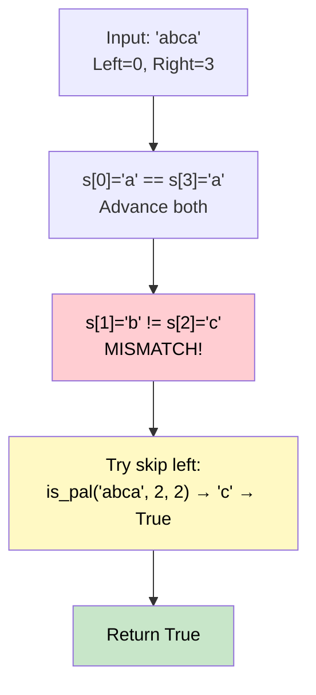

# 🚶‍♂️ Walkthrough: Valid Palindrome II

## 👶 Explain Like I'm 5
You have a string. Can you delete **at most ONE** character and make it a palindrome?

Think of it like reading a word forwards and backwards. If you get to a mismatch, you are allowed to erase one letter — either the left one or the right one — and then check if the rest is now a palindrome.

## 🎯 Core Strategy
This uses a **Greedy Two Pointers** approach.

1. **Two Pointers**: Start `left = 0`, `right = len(s) - 1`.
2. **Walk Inward**: Move both pointers toward the center.
   - If `s[left] == s[right]`, advance both and continue.
3. **On First Mismatch**: We MUST use our one deletion here. Try both options:
   - Delete the left character: check if `s[left+1 ... right]` is a palindrome.
   - Delete the right character: check if `s[left ... right-1]` is a palindrome.
   - If **either** sub-check is a palindrome, return `True`.
   - If **neither** works, return `False`.
4. **No Mismatch Reached**: The string is already a palindrome → `True`.

**Greedy Insight**: When we first encounter a mismatch, that's the only spot we should ever consider making a deletion. We never need to "look ahead" or backtrack.

## 🏃‍♂️ Step-by-Step Execution (Dry Run)
**Input**: `s = "abca"`

| Left | Right | s[L] | s[R] | Match? |
|---|---|---|---|---|
| 0 | 3 | `a` | `a` | ✅ match, advance |
| 1 | 2 | `b` | `c` | ❌ mismatch! |

**Mismatch at (1, 2)**. Try:
- `is_pal(2, 2)` → `"c"` ← palindrome! ✅
- Return `True`.

## 📊 Visual Diagram

## 🛑 Edge Cases & Complexity

### Complexity
- **Time Complexity:** $O(N)$. We do one pass through the string, and the helper `is_pal` does at most one more $O(N)$ pass.
- **Space Complexity:** $O(1)$.

### Edge Cases
- **Already a palindrome:** The main loop completes without a mismatch. Returns `True`.
- **Single character:** `"a"` — `left >= right` immediately. Returns `True`.
- **Needs 2+ deletions:** `"abc"` — `b != c`, neither `"c"` nor `"b"` is a full palindrome at that position. Returns `False`.
