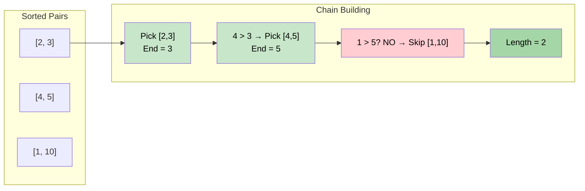

# 🚶‍♂️ Walkthrough: Maximum Length of Pair Chain

## 👶 Explain Like I'm 5
You have a bunch of links (pairs). Each link is `[a, b]` where `a < b`. Link `[c, d]` can snap onto the end of `[a, b]` only if `c > b` (the new link must START after the previous one ENDS).

Find the longest chain you can make.

Think of it like scheduling meetings. Each pair is a meeting with a start and end time. You want to attend as many non-overlapping meetings as possible.

## 🎯 Core Strategy
This is the classic **Activity Selection** greedy problem.

**Key Greedy Insight**: Always pick the pair with the **smallest end value** first. This leaves the maximum "room" on the number line for future pairs to follow.

1. **Sort by End**: Sort all pairs by their second (end) value.
2. **Greedy Scan**: Initialize `current_end = -∞`, `chain_length = 0`.
3. **For each `[start, end]`**:
   - If `start > current_end`: this pair can extend the chain! Increment `chain_length`, set `current_end = end`.
   - Otherwise: skip this pair (it overlaps with the best chain we've built so far).
4. **Return** `chain_length`.

**Why sorting by end works**: If we pick a pair with a smaller end, it never blocks more future pairs than a pair with a larger end. It's always an equally good or better choice.

## 🏃‍♂️ Step-by-Step Execution (Dry Run)
**Input**: `[[1, 10], [2, 3], [4, 5]]`

### Sort by End
`[[2, 3], [4, 5], [1, 10]]`

### Greedy Scan
- `current_end = -∞`, `chain_length = 0`
- **`[2, 3]`**: Is `2 > -∞`? YES. Chain: 1. `current_end = 3`.
- **`[4, 5]`**: Is `4 > 3`? YES. Chain: 2. `current_end = 5`.
- **`[1, 10]`**: Is `1 > 5`? NO. Skip.

**Return `2`**.

## 📊 Visual Diagram

## 🛑 Edge Cases & Complexity

### Complexity
- **Time Complexity:** $O(N \log N)$ — sorting dominates.
- **Space Complexity:** $O(1)$ (excluding sort's stack space).

### Edge Cases
- **Single pair:** Returns `1`.
- **All pairs overlap:** Only the first (smallest end) pair can be picked. Returns `1`.
- **No overlaps:** Every pair can be chained. Returns `N`.
