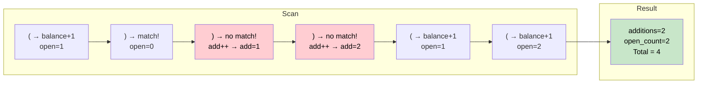

# 🚶‍♂️ Walkthrough: Minimum Add to Make Parentheses Valid

## 👶 Explain Like I'm 5
You have a string of `(` and `)`. Some are unmatched. Find the minimum number of parentheses to ADD to make the whole thing valid.

Think of it like a bank account:
- `(` deposits $1 (opens a bracket, it expects a future close).
- `)` withdraws $1 (closes a pending open bracket).
- If the balance goes **negative**, it means you used a `)` without any matching `(`. You must add a `(` before it. Count it!
- At the end, any remaining **positive balance** = unmatched `(` that each need a `)` added.

## 🎯 Core Strategy
A pure **Greedy Scan** using two counters.

1. **`open_count`**: Number of unmatched `(` seen so far.
2. **`additions`**: Number of unmatched `)` we encountered (each required adding a `(`).
3. **Scan**: For each character:
   - `(` → `open_count += 1`
   - `)` → If `open_count > 0`, it has a match: `open_count -= 1`. Else, we need to insert a `(`: `additions += 1`.
4. **Return** `additions + open_count`. The remaining `open_count` unmatched `(` each need a `)`.

## 🏃‍♂️ Step-by-Step Execution (Dry Run)
**Input**: `"()))(("` 

| Char | open_count | additions |
|---|---|---|
| `(` | 1 | 0 |
| `)` | 0 (matched!) | 0 |
| `)` | 0 (no match!) | 1 |
| `)` | 0 (no match!) | 2 |
| `(` | 1 | 2 |
| `(` | 2 | 2 |

Return `additions + open_count = 2 + 2 = 4`.

## 📊 Visual Diagram

## 🛑 Edge Cases & Complexity

### Complexity
- **Time Complexity:** $O(N)$ — single scan.
- **Space Complexity:** $O(1)$.

### Edge Cases
- **Already valid `"()"` → `0`**: `(` increments `open`, `)` decrements it back. Both counters stay at 0.
- **All `"((("` → `3`**: `open_count` reaches 3. `additions = 0`. Return `0 + 3 = 3`.
- **All `")))"` → `3`**: Each `)` finds no match, so `additions` climbs to 3. Return `3 + 0 = 3`.
