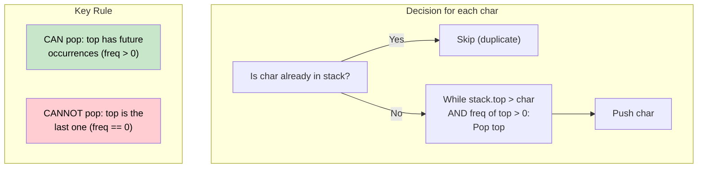

# 🚶‍♂️ Walkthrough: Remove Duplicate Letters

## 👶 Explain Like I'm 5
Given a string, remove duplicate letters so each letter appears exactly once. Among all possible results, return the **lexicographically smallest** one.

Think of building the result letter by letter. At each step you want to pick the smallest possible letter, but ONLY if you can still include every other required letter later.

## 🎯 Core Strategy
This uses a **Greedy Monotonic Stack** approach.

1. **Frequency Map**: Count remaining occurrences of each character.
2. **`in_stack` Set**: Track which characters are currently in our result stack (so we don't add duplicates).
3. **For each character `ch`**:
   - Decrement `freq[ch]` (we're consuming this occurrence).
   - If `ch` is already `in_stack`, skip — we already have a representative.
   - **Greedy Pop**: While the stack's top is **greater than `ch`** AND the top still has future occurrences (`freq[top] > 0`), pop the top. We can do better by placing `ch` before the top.
   - Push `ch` and add to `in_stack`.
4. **Return** `"".join(stack)`.

**Why this greedy works**: If the stack top is larger than the current char AND we'll see the top again later, we can safely evict it now and get a smaller result. If the top has no future occurrences (`freq[top] == 0`), we CANNOT pop it — we'd lose it forever.

## 🏃‍♂️ Step-by-Step Execution (Dry Run)
**Input**: `"cbacdcbc"`

Initial freq: `{c:4, b:2, a:1, d:1}`

| Char | freq remaining | Stack before | Action | Stack after |
|---|---|---|---|---|
| `c` | c:3 | `[]` | Push `c` | `[c]` |
| `b` | b:1 | `[c]` | `c > b` and freq[c]=3>0 → pop `c`, push `b` | `[b]` |
| `a` | a:0 | `[b]` | `b > a` and freq[b]=1>0 → pop `b`, push `a` | `[a]` |
| `c` | c:2 | `[a]` | push `c` | `[a, c]` |
| `d` | d:0 | `[a,c]` | push `d` | `[a, c, d]` |
| `c` | c:1 | `[a,c,d]` | `c` in_stack → skip | `[a, c, d]` |
| `b` | b:0 | `[a,c,d]` | `d > b` but freq[d]=0 → can't pop! Push `b` | `[a, c, d, b]` |
| `c` | c:0 | `[a,c,d,b]` | `c` in_stack → skip | `[a, c, d, b]` |

**Return `"acdb"`** ✅

## 📊 Visual Diagram

## 🛑 Edge Cases & Complexity

### Complexity
- **Time Complexity:** $O(N)$ — each character is pushed and popped from the stack at most once.
- **Space Complexity:** $O(K)$ where $K$ ≤ 26 is the number of distinct characters (stack and set are bounded by alphabet size).

### Edge Cases
- **Single character:** `"a"` → `"a"`. No pops, just one push.
- **All same character:** `"aaa"` → `"a"`. First `a` pushed, subsequent `a`s are skipped (in_stack).
- **Already lexicographically sorted:** `"abcd"` → `"abcd"`. No pops ever occur since the stack top is always smaller than the incoming character.
