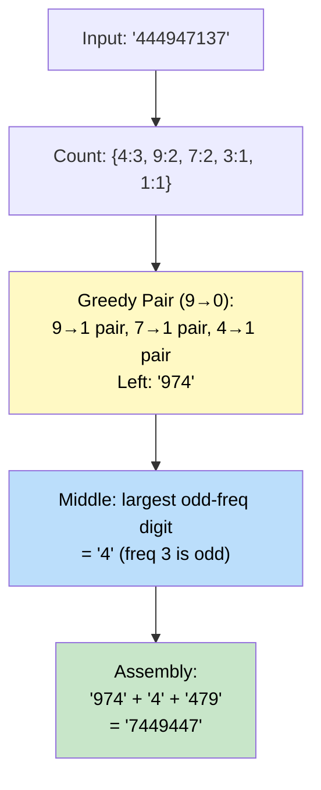

# 🚶‍♂️ Walkthrough: Largest Palindromic Number

## 👶 Explain Like I'm 5
You have a string of digits (like `"444947137"`). Arrange SOME of those digits to form the **LARGEST palindromic number** possible. A palindrome reads the same forwards and backwards, like `"9119"` or `"5"`.

Strategy:
- **Pair up digits**: Two `9`s → put one on the left half and one on the right half.
- **Pick LARGEST pairs first** (greedy!) to maximize the number.
- **Pick ONE middle digit** (the biggest digit with an odd count).
- **No leading zeros!**

## 🎯 Core Strategy
A greedy digit-pairing algorithm.

1. **Count Frequency**: Count occurrences of each digit (`0-9`).
2. **Build Left Half (Greedy, 9 down to 0)**: For each digit `d` from `9` down to `0`, take `freq[d] // 2` pairs. Append `d * pairs` to the left half. (Going from 9 down ensures biggest digits go first, making the number largest).
3. **Find Middle**: Track the largest digit `d` where `freq[d] % 2 == 1`. That's the middle character.
4. **Handle Leading Zeros**: If the left half starts with `"0"`, then all pairs used are zeros (e.g., input `"00009"`). The left half is meaningless — the result is just the `middle` digit (or `"0"` if no middle exists).
5. **Return**: `left_half + middle + reversed(left_half)`.

## 🏃‍♂️ Step-by-Step Execution (Dry Run)
**Input**: `"444947137"`

### Step 1: Count Frequencies
`{4:3, 9:2, 7:2, 1:1, 3:1}`

### Step 2: Build Left Half (9 → 0)
- `9`: pairs = 2//2 = 1 → add `"9"`. Left: `["9"]`
- `8`: pairs = 0 → skip
- `7`: pairs = 2//2 = 1 → add `"7"`. Left: `["9", "7"]`
- `4`: pairs = 3//2 = 1 → add `"4"`. Left: `["9", "7", "4"]`
- `3`: freq = 1, odd → middle candidate
- `1`: freq = 1, odd → middle candidate (`1 < 3`, so `3` stays as middle)
- `4` also has freq 3 (odd) → is `4 > 3`? YES. Middle = `4`

Actually, middle tracks the largest digit with odd count. Here `4` (freq 3, odd) and `3` (freq 1, odd) and `1` (freq 1, odd). Largest is `4`. Middle = `"4"`.

### Step 3: Assemble
- `left_str = "974"`
- Does it start with `"0"`? No.
- `right_str = "479"` (reversed)
- Return `"974" + "4" + "479"` = `"7449447"`.

## 📊 Visual Diagram

## 🛑 Edge Cases & Complexity

### Complexity
- **Time Complexity:** $O(N)$ to count digits, then $O(10) = O(1)$ to build the result (only 10 possible digits).
- **Space Complexity:** $O(1)$ (digit counts bounded by 10).

### Edge Cases
- **Only zeros `"000"` → `"0"`**: Left half = `"000"`. It starts with `"0"`. No middle digit (all even counts). Return `"0"`.
- **Input `"00009"` → `"9"`**: Left half = `"00"` → starts with `"0"`. Middle = `"9"`. Since left is all zeros, return just middle `"9"`.
- **Single digit**: Only one digit, odd count. Middle = that digit. Left half = `""`. Return that digit.
