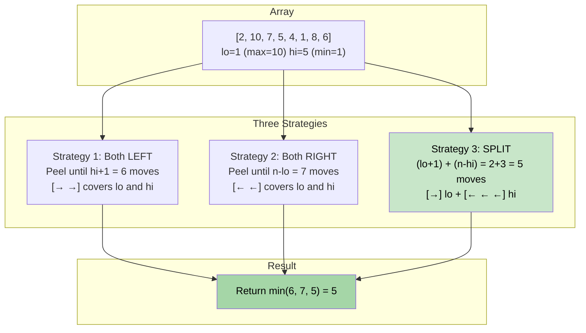

# 🚶‍♂️ Walkthrough: Removing Minimum and Maximum From Array

## 👶 Explain Like I'm 5
You have an array. Find the minimum and maximum values — you need to remove both of them. BUT you can only remove elements from the **FRONT** or **BACK** of the array (not the middle!). Find the minimum number of moves.

Think of it like a conveyor belt. You can only grab items from either end. You need to grab two specific items (min and max). What's the fastest strategy?

## 🎯 Core Strategy
This is a **Greedy — Enumerate All Strategies** problem. There are only **3 ways** to remove two items from the ends:

Let `lo = min(min_idx, max_idx)` and `hi = max(min_idx, max_idx)` (so `lo ≤ hi`).

1. **Strategy 1 — Both from LEFT**: We need to peel from the left until we reach the farther target. Moves = `hi + 1`.
2. **Strategy 2 — Both from RIGHT**: We need to peel from the right until we reach the closer target (by index). Moves = `n - lo`.
3. **Strategy 3 — SPLIT**: Take `lo` from the left, and `hi` from the right. Moves = `(lo + 1) + (n - hi)`.

Return the **minimum** of these three strategies.

**Why exactly 3?** If you peel `lo` from the left, `hi` must come from the right (strategy 3). If you peel `hi` from the left, both are taken from the left (strategy 1). If you peel `hi` from the right (meaning neither was hit from the left first), both come from the right (strategy 2). No other option exists.

## 🏃‍♂️ Step-by-Step Execution (Dry Run)
**Input**: `[2, 10, 7, 5, 4, 1, 8, 6]`, `n = 8`

- `min = 1` at index `5` (lo). `max = 10` at index `1` (hi).
- Normalize: `lo = 1` (index of max), `hi = 5` (index of min).

### Three Strategies:
| Strategy | Formula | Result |
|---|---|---|
| Both from LEFT | `hi + 1 = 5 + 1` | **6** |
| Both from RIGHT | `n - lo = 8 - 1` | **7** |
| SPLIT (lo from left, hi from right) | `(lo+1) + (n-hi) = 2 + 3` | **5** ✅ |

Return `min(6, 7, 5) = 5`.

## 📊 Visual Diagram

## 🛑 Edge Cases & Complexity

### Complexity
- **Time Complexity:** $O(N)$ — to find `min` and `max` indices.
- **Space Complexity:** $O(1)$.

### Edge Cases
- **Single element array:** `[101]`. `min_idx = max_idx = 0`. `lo = hi = 0`. Strategy 1: `0+1=1`. Strategy 2: `1-0=1`. Strategy 3: `1 + 1 = 2`. Return `1`. Correct!
- **Two elements:** `[1, 2]`. `lo=0, hi=1`. Strategy 1: `2`. Strategy 2: `2`. Strategy 3: `1+1=2`. All give `2`. Correct.
- **Min and Max are adjacent**: E.g., `lo = 3, hi = 4`. Strategy 3 = `4 + (n-4)`. This is just peeling from both sides efficiently.
