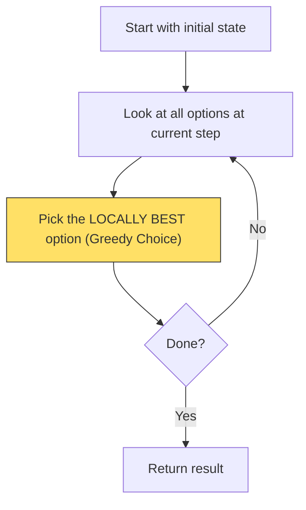
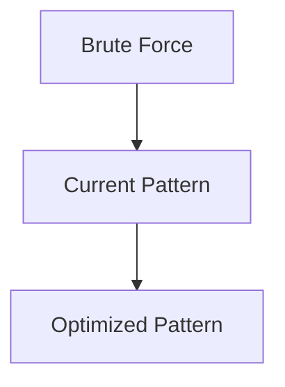

# Pattern 21: Greedy Algorithms

## 👶 Explain Like I'm 5

Imagine you're hiking a mountain and you want to reach the peak as fast as
possible. At every step, you look at all the nearby trails and pick the one
that goes **uphill the most right now** — without worrying about whether that
trail eventually hits a dead end.
That's Greedy: **always pick the locally best option at each step**, and trust
that these local best picks add up to the global best.
Sometimes this works perfectly (like in coin change with standard denominations).
Sometimes you need to PROVE it works first.

---

## 🧩 Core Idea & Pattern Detection

**Greedy = Make the locally optimal choice at each step.**

The hard part is proving the greedy choice is SAFE — that taking the best-looking
option now doesn't ruin you later. This is called the **Greedy Choice Property**.

### When to use it:
- The problem asks for a minimum/maximum of something.
- You can make decisions one step at a time.
- The optimal substructure holds: an optimal solution contains optimal solutions to subproblems.
- Keywords: "minimum number of", "maximize", "can you make it valid?", "arrange optimally".

### When NOT to use Greedy:
- When making a local choice invalidates future optimal choices (use DP instead).
- When you need to explore ALL possible paths (use Backtracking).

---

## 🔧 Algorithmic Anatomy



### Greedy Proof Technique: Exchange Argument
To prove a greedy algorithm correct, assume there is an optimal solution that
differs from greedy. Show that you can "exchange" the non-greedy choice for
the greedy one WITHOUT making the solution worse. This proves greedy is optimal.

---

## ⏱️ Complexity Analysis

| Problem | Time | Space | Greedy Choice |
|---------|------|-------|---------------|
| Valid Palindrome II | O(N) | O(1) | Skip at most one mismatch |
| Max Length Pair Chain | O(N log N) | O(1) | Pick pair with smallest end value |
| Min Add Parentheses Valid | O(N) | O(1) | Track open/close balance |
| Remove Duplicate Letters | O(N) | O(K) | Monotonic stack + last-occurrence check |
| Largest Palindromic Number | O(N) | O(K) | Pair digits, place odd in middle |
| Remove Min/Max From Array | O(N) | O(1) | Min of 3 removal strategies |

---

## ⚠️ Common Pitfalls

1. **Confusing Greedy with DP**: Greedy makes ONE pass of decisions;
   DP explores multiple subproblem options and memoizes.
2. **Forgetting edge cases**: Greedy proofs assume certain array conditions
   (sorted, etc.) — always sort first when the order matters.
3. **Remove Duplicate Letters**: Easy to miss that the stack must maintain
   LEXICOGRAPHIC ORDER and only remove a character if it appears again later.

---

## ✅ Problems in This Pattern

| # | Problem | Difficulty | LeetCode |
|---|---------|------------|----------|
| 1 | Valid Palindrome II | Easy | #680 |
| 2 | Maximum Length of Pair Chain | Medium | #646 |
| 3 | Minimum Add to Make Parentheses Valid | Medium | #921 |
| 4 | Remove Duplicate Letters | Medium | #316 |
| 5 | Largest Palindromic Number | Medium | #2384 |
| 6 | Removing Minimum and Maximum From Array | Medium | #2091 |


## 📦 Prerequisite Data Structures
- Basic understanding of Arrays, Hash Maps, and Greedy Algorithms fundamentals.


## 🔍 How to Spot This Pattern (Signal Detection)
- **Keywords**: "minimize", "maximize", "combinations", "shortest", "longest".
- **Problem Constraints**: Indicates whether O(N), O(N log N), or O(2^N) is acceptable.


## 🏗️ Template / Boilerplate Code
```python
def solve_greedy_algorithms(nums):
    # Initialize state
    result = 0
    for num in nums:
        # Process num
        pass
    return result
```


## 🔄 Brute Force → Optimal Evolution
- **Brute Force**: Try all possibilities (often O(N^2) or O(2^N)).
- **Optimal**: Use this pattern to reduce redundant work to O(N) or O(N log N).


## 🔗 Pattern Connections



## ⚠️ Common Mistakes & Pitfalls
- Off-by-one errors in loop boundaries.
- Not handling negative numbers or zero correctly.
- Forgetting to update the result variable inside the loop.


## 🎤 Interview Communication Guide
1. **Acknowledge**: "This looks like a variation of the classic problem..."
2. **Propose**: "I'll use this pattern because it optimizes the brute force O(N^2) to O(N)."
3. **Execute**: Write clean, modular code.
4. **Review**: Trace with the provided edge case.


## 🧪 Self-Test Questions
<details>
<summary>When should you use this pattern?</summary>
When the problem asks for optimal subarrays, combinations, or specific mathematical properties.
</details>
<details>
<summary>What is the typical time complexity?</summary>
Usually O(N) or O(N log N), depending on sorting or data structure overhead.
</details>
