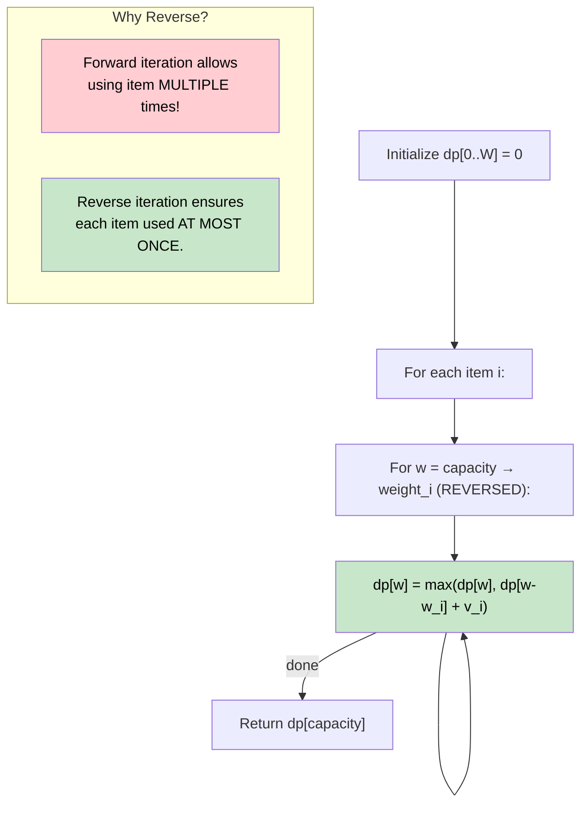

# 🚶‍♂️ Walkthrough: 0/1 Knapsack

## 👶 Explain Like I'm 5
You have a backpack that can carry at most `W` pounds. You have `N` items, each with a weight and a value. You can take each item AT MOST ONCE. Fill the backpack to maximize the total value without exceeding the weight limit.

"0/1" means each item is either taken (1) or not taken (0). You can't take half an item.

## 🎯 Core Strategy
Classic **0/1 Knapsack Dynamic Programming**.

Define `dp[w]` = the maximum value achievable using any subset of items with total weight exactly `w`.

**Key 1D Optimization**: Instead of a 2D table `dp[item][weight]`, we use a single 1D array.
- **Why reverse the inner loop?** If we iterate `w` from `0 → capacity`, we might use an item multiple times! By iterating `w` from `capacity → weights[i]` (reverse), we ensure each item's updates are based on values before that item was considered in this pass.

1. **Initialize**: `dp = [0] * (capacity + 1)`. All zeros — with 0 capacity, or before any item is considered, the value is 0.
2. **Outer Loop**: For each item `i`:
3. **Inner Loop (Reversed)**: For `w` from `capacity` down to `weights[i]`:
   - `dp[w] = max(dp[w], dp[w - weights[i]] + values[i])`
   - This says: "The best value at capacity `w` is either NOT taking item `i` (leave `dp[w]` as is), or TAKING item `i` (add its value to what we could do with the remaining capacity `w - weights[i]`)."
4. **Return** `dp[capacity]`.

## 🏃‍♂️ Step-by-Step Execution (Dry Run)
**Input**: `weights = [2, 3, 1]`, `values = [4, 5, 3]`, `capacity = 4`

### Initial DP
`dp = [0, 0, 0, 0, 0]`  (indices 0 through 4)

### Item 0 (weight=2, value=4) — Reverse from 4 to 2:
- `w=4`: `dp[4] = max(0, dp[2] + 4) = max(0, 0+4) = 4`
- `w=3`: `dp[3] = max(0, dp[1] + 4) = max(0, 0+4) = 4`
- `w=2`: `dp[2] = max(0, dp[0] + 4) = max(0, 0+4) = 4`
- `dp = [0, 0, 4, 4, 4]`

### Item 1 (weight=3, value=5) — Reverse from 4 to 3:
- `w=4`: `dp[4] = max(4, dp[1] + 5) = max(4, 0+5) = 5`
- `w=3`: `dp[3] = max(4, dp[0] + 5) = max(4, 0+5) = 5`
- `dp = [0, 0, 4, 5, 5]`

### Item 2 (weight=1, value=3) — Reverse from 4 to 1:
- `w=4`: `dp[4] = max(5, dp[3] + 3) = max(5, 5+3) = 8`
- `w=3`: `dp[3] = max(5, dp[2] + 3) = max(5, 4+3) = 7`
- `w=2`: `dp[2] = max(4, dp[1] + 3) = max(4, 0+3) = 4`
- `w=1`: `dp[1] = max(0, dp[0] + 3) = 3`
- `dp = [0, 3, 4, 7, 8]`

**Return `dp[4] = 8`** ✅ (Items 1+2: weight 3+1=4, value 5+3=8)

## 📊 Visual Diagram

## 🛑 Edge Cases & Complexity

### Complexity
- **Time Complexity:** $O(N \times W)$ where $N$ = number of items, $W$ = capacity.
- **Space Complexity:** $O(W)$ — the 1D optimized DP array.

### Edge Cases
- **No items:** `dp` stays all zeros. Returns `dp[capacity] = 0`.
- **Item too heavy:** The inner `range(capacity, weights[i]-1, -1)` evaluates to an empty range if `weights[i] > capacity`. Item is effectively skipped.
