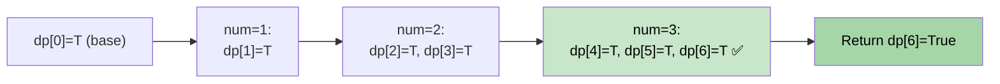

# 🚶‍♂️ Walkthrough: Subset Sum

## 👶 Explain Like I'm 5
Given an array of positive integers and a target `S`, can ANY subset of the array sum to exactly `S`?

This is the general form of the Equal Subset problem. Same algorithm, but now the target `S` is given directly instead of being derived from the total.

## 🎯 Core Strategy
Direct **0/1 Knapsack Boolean DP**.

`dp[w]` = `True` if any subset of numbers seen so far sums to exactly `w`.

1. **Initialize**: `dp = [False] * (target + 1)`. `dp[0] = True` (empty subset).
2. **Fill DP**: For each `num`, for `w` from `target` down to `num`:
   - `dp[w] = dp[w] or dp[w - num]`
3. **Return** `dp[target]`.

This is identical to the Equal Subset problem — the only difference is that the target comes from outside rather than being `sum // 2`.

## 🏃‍♂️ Step-by-Step Execution (Dry Run)
**Input**: `nums = [1, 2, 3, 7]`, `target = 6`

### Initial DP (size 7)
`dp = [T, F, F, F, F, F, F]`

### num = 1:
- `dp[1] |= dp[0]` → `True`
- `dp = [T, T, F, F, F, F, F]`

### num = 2:
- `dp[3] |= dp[1]` → `True`; `dp[2] |= dp[0]` → `True`
- `dp = [T, T, T, T, F, F, F]`

### num = 3:
- `dp[6] |= dp[3]` → **`True`!**; `dp[5] |= dp[2]` → `True`; etc.
- `dp = [T, T, T, T, T, T, T]`

**Return `dp[6] = True`** ✅ (1+2+3 = 6)

## 📊 Visual Diagram

## 🛑 Edge Cases & Complexity
- **Time:** $O(N \times T)$.
- **Space:** $O(T)$.
- **Empty array, target=0:** `dp[0] = True`. Returns `True` (empty subset).
- **Empty array, target=1:** `dp[1]` stays `False`. Returns `False`.
