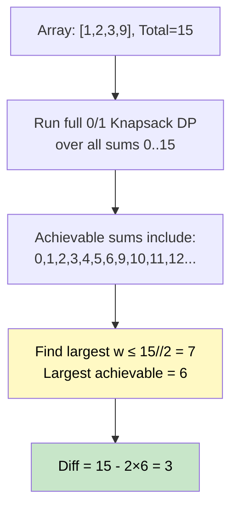

# 🚶‍♂️ Walkthrough: Minimum Subset Sum Difference

## 👶 Explain Like I'm 5
Split an array into **two groups** (any way you like), and minimize the **absolute difference** of their sums. Example: `[1, 2, 3, 9]` → groups `{1,2,3}` (sum 6) and `{9}` (sum 9) → diff = 3.

If the total sum is `S`, and we put subset with sum `w` in one group, the other group has sum `S - w`, and the difference is `|S - w - w| = S - 2w`.

To minimize this, we want `w` to be **as close to `S/2` as possible**.

## 🎯 Core Strategy
**0/1 Knapsack + Find Closest to S/2**.

1. **Run full subset sum DP** for all sums from `0` to `total = sum(nums)`.
2. **Scan backwards** from `total//2` to `0`, looking for the largest achievable `w` where `dp[w] = True`.
3. **Return** `total - 2 * w`.

## 🏃‍♂️ Step-by-Step Execution (Dry Run)
**Input**: `[1, 2, 3, 9]`, total = 15

### DP (subset sums reachable from 0 to 15)
After processing all numbers, the achievable subset sums include: `{0, 1, 2, 3, 4, 5, 6, 9, 10, 11, 12, 13, 14, 15}`.

### Find Largest w ≤ 15//2 = 7:
- `dp[7]`? No.
- `dp[6]`? Yes! (1+2+3 = 6).

### Calculate Difference
`total - 2 * 6 = 15 - 12 = 3`.

**Return `3`** ✅

## 📊 Visual Diagram

## 🛑 Edge Cases & Complexity
- **Time:** $O(N \times S)$.
- **Space:** $O(S)$.
- **Single element `[k]`:** Only achievable sums are 0 and k. `total//2` is `k/2`. Largest achievable ≤ k/2 is 0. Return `k - 0 = k`. Correct!
- **Equal pairs `[1, 1]`:** total = 2, target half = 1. `dp[1] = True`. Return `2 - 2*1 = 0`. Correct!
