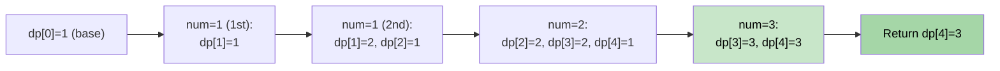

# 🚶‍♂️ Walkthrough: Count of Subset Sum

## 👶 Explain Like I'm 5
Given an array and a target, count how many **distinct subsets** sum to exactly the target.
Example: `[1, 1, 2, 3]`, target=4 → Subsets: `{1(first), 3}`, `{1(second), 3}`, `{1, 1, 2}` → 3 ways.

This is the counting cousin of the Boolean Subset Sum problem. Instead of `True/False`, we store **how many ways**.

## 🎯 Core Strategy
**0/1 Knapsack Counting DP**.

`dp[w]` = number of distinct subsets that sum to exactly `w`.

1. **Initialize**: `dp = [0] * (target + 1)`. `dp[0] = 1` (exactly 1 way to sum to 0: the empty subset).
2. **Fill DP**: For each `num`, for `w` from `target` down to `num`:
   - `dp[w] += dp[w - num]`
   - "The number of ways to make sum `w` including this `num` equals the number of ways to make `w - num` (and then add this `num`)."
3. **Return** `dp[target]`.

## 🏃‍♂️ Step-by-Step Execution (Dry Run)
**Input**: `[1, 1, 2, 3]`, `target = 4`

### Initial DP
`dp = [1, 0, 0, 0, 0]`

### num = 1 (first):
- `dp[1] += dp[0]` → 1; `dp[2]+=dp[1]` → 0; etc.
- `dp = [1, 1, 0, 0, 0]`

### num = 1 (second):
- `dp[2] += dp[1]` → 1; `dp[1] += dp[0]` → 2
- `dp = [1, 2, 1, 0, 0]`

### num = 2:
- `dp[4] += dp[2]` → 1; `dp[3] += dp[1]` → 2; `dp[2] += dp[0]` → 2
- `dp = [1, 2, 2, 2, 1]`

### num = 3:
- `dp[4] += dp[1]` → 3; `dp[3] += dp[0]` → 3
- `dp = [1, 2, 2, 3, 3]`

**Return `dp[4] = 3`** ✅

## 📊 Visual Diagram

## 🛑 Edge Cases & Complexity
- **Time:** $O(N \times T)$.
- **Space:** $O(T)$.
- **Empty array, target=0:** `dp[0] = 1`. Returns `1` (the empty subset is the one way).
- **Empty array, target>0:** All `dp[w]` stay 0. Returns `0`.
