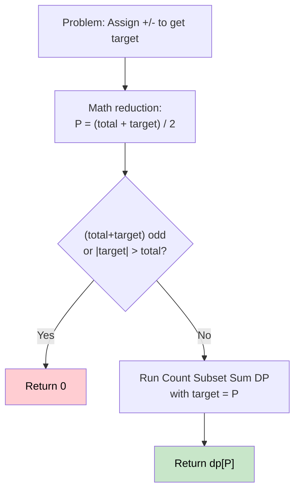

# 🚶‍♂️ Walkthrough: Target Sum

## 👶 Explain Like I'm 5
Given an array, assign a `+` or `-` sign to each number. How many ways can you make the total equal to `target`?
Example: `[1,1,1,1,1]`, target=3 → You can negate any 2 of the five 1s. That's `C(5,2) = 10/2 = 5` ways.

## 🎯 Core Strategy
**Mathematical Reduction → Count of Subset Sum**.

Let `P` = set of numbers with `+` signs, `N` = set with `-` signs.

We know:
- `P + N = total` (sum of all absolute values)
- `P - N = target`

Adding both equations: `2P = total + target` → **`P = (total + target) / 2`**.

So the problem reduces to: **count subsets summing to `(total + target) / 2`**.

**Guard conditions**:
- If `(total + target)` is **odd** → no integer solution for `P`. Return `0`.
- If `|target| > total` → impossible to reach target. Return `0`.

Once `P` (the `subset_target`) is computed, apply the Count of Subset Sum DP.

## 🏃‍♂️ Step-by-Step Execution (Dry Run)
**Input**: `nums = [1, 1, 1, 1, 1]`, `target = 3`

### Math Reduction
- `total = 5`
- `subset_target = (5 + 3) / 2 = 4`
- Count subsets of `[1,1,1,1,1]` that sum to `4`.

### DP on `[1,1,1,1,1]`, target = 4
- After processing each `1`, we're counting ways to choose subsets summing to 4.
- This is equivalent to choosing which 4 of the 5 ones are `+`. There are `C(5,4) = 5` ways.
- `dp[4] = 5`.

**Return `5`** ✅

## 📊 Visual Diagram



### Why the Reduction Works
```
nums = [1, 1, 1, 1, 1], target = 3
P - N = 3,  P + N = 5  →  P = 4
We need the subset of '+'s to sum to 4.
Which 4 ones are '+':
  +−+++ , ++−++ , +++−+, ++++−, −++++ 
5 ways ✅
```

## 🛑 Edge Cases & Complexity
- **Time:** $O(N \times P)$ where `P = (total + target) / 2`.
- **Space:** $O(P)$.
- **Odd sum:** `(total + target) % 2 != 0` → immediately return `0`.
- **Target out of range:** `abs(target) > total` → impossible, return `0`.
- **Zero in array:** Works naturally — using 0 adds zero to the sum, creating extra "duplicate" paths, which the DP counts correctly.
