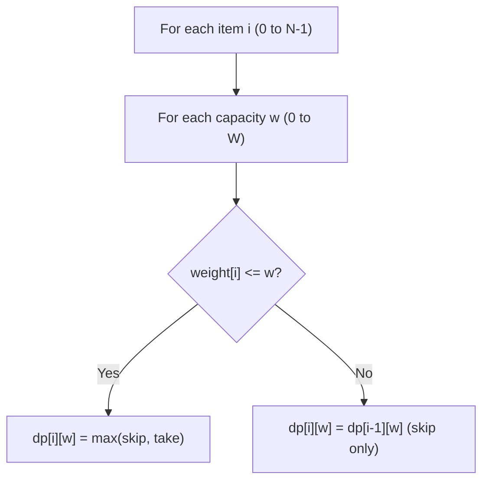
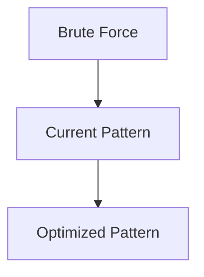

# Pattern 22: 0/1 Knapsack (Dynamic Programming)

## 👶 Explain Like I'm 5

Imagine you're going on a camping trip. Your backpack can hold at most **W pounds**.
You have a list of items, each with a weight and a value (how useful it is).
You can take each item AT MOST ONCE (0 copies or 1 copy — that's the "0/1" part).
You want to pack the MOST VALUABLE set of items without exceeding the weight limit.

The trick: for each item, you have EXACTLY TWO choices: **take it** or **leave it**.
You try BOTH choices for every item, remember the results, and pick the best.

That's Dynamic Programming: **break the problem into subproblems, solve each once,
remember the answer, and combine.**

---

## 🧩 Core Idea & Pattern Detection

**0/1 Knapsack = "Can I include this item or not?" DP**

### When to use it:
- You have a set of items, each with a weight/cost and value/profit.
- You have a capacity/budget constraint.
- Each item can be used AT MOST ONCE.
- Keywords: "maximum profit", "exactly sum to target", "subset sum", "partition".

### Key Insight: State Definition
`dp[i][w]` = maximum value using the first `i` items with weight capacity `w`.

**Recurrence:**
```
dp[i][w] = max(
    dp[i-1][w],                          # Skip item i
    dp[i-1][w - weight[i]] + value[i]    # Take item i (if weight[i] <= w)
)
```

---

## 🔧 Algorithmic Anatomy

### 2D DP Table (Classic)



### 1D Space Optimization
Iterate capacity in **REVERSE** when doing 1D optimization (prevents using an
item more than once):
```python
for i in range(N):
    for w in range(W, weight[i]-1, -1):   # RIGHT to LEFT
        dp[w] = max(dp[w], dp[w - weight[i]] + value[i])
```

---

## ⏱️ Complexity Analysis

| Aspect | Complexity | Why |
|--------|-----------|-----|
| **Time** | O(N * W) | N items × W capacity states |
| **Space** | O(N * W) 2D or O(W) 1D | 1D is always preferred |

---

## ⚠️ Common Pitfalls

1. **Iterate capacity RIGHT-TO-LEFT** in 1D DP — otherwise the same item might
   be counted multiple times (becomes "unbounded knapsack" instead of 0/1).
2. **Equal Subset**: The target sum must be EVEN — if it's odd, immediately return False.
3. **Count of Subsets**: Use `+` instead of `max()` — you're counting, not optimizing.

---

## ✅ Problems in This Pattern

| # | Problem | Difficulty | Key Variant |
|---|---------|------------|-------------|
| 1 | 0/1 Knapsack | Medium | Classic: maximize value under weight |
| 2 | Equal Subset Sum Partition | Medium | Can we partition into 2 equal sum halves? |
| 3 | Subset Sum | Medium | Does ANY subset sum to target? |
| 4 | Minimum Subset Sum Difference | Hard | Minimize abs difference of 2 partitions |
| 5 | Count of Subset Sum | Hard | Count subsets summing to target |
| 6 | Target Sum | Hard | Assign +/- to each number, count ways to reach target |


## 📦 Prerequisite Data Structures
- Basic understanding of Arrays, Hash Maps, and 0-1 Knapsack (DP) fundamentals.


## 🔍 How to Spot This Pattern (Signal Detection)
- **Keywords**: "minimize", "maximize", "combinations", "shortest", "longest".
- **Problem Constraints**: Indicates whether O(N), O(N log N), or O(2^N) is acceptable.


## 🏗️ Template / Boilerplate Code
```python
def solve_0-1_knapsack_dp(nums):
    # Initialize state
    result = 0
    for num in nums:
        # Process num
        pass
    return result
```


## 🔄 Brute Force → Optimal Evolution
- **Brute Force**: Try all possibilities (often O(N^2) or O(2^N)).
- **Optimal**: Use this pattern to reduce redundant work to O(N) or O(N log N).


## 🔗 Pattern Connections



## ⚠️ Common Mistakes & Pitfalls
- Off-by-one errors in loop boundaries.
- Not handling negative numbers or zero correctly.
- Forgetting to update the result variable inside the loop.


## 🎤 Interview Communication Guide
1. **Acknowledge**: "This looks like a variation of the classic problem..."
2. **Propose**: "I'll use this pattern because it optimizes the brute force O(N^2) to O(N)."
3. **Execute**: Write clean, modular code.
4. **Review**: Trace with the provided edge case.


## 🧪 Self-Test Questions
<details>
<summary>When should you use this pattern?</summary>
When the problem asks for optimal subarrays, combinations, or specific mathematical properties.
</details>
<details>
<summary>What is the typical time complexity?</summary>
Usually O(N) or O(N log N), depending on sorting or data structure overhead.
</details>
