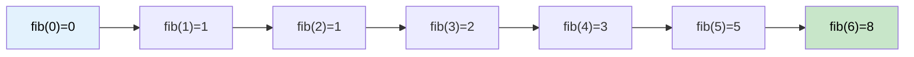

# 🚶‍♂️ Walkthrough: Fibonacci Numbers

## 👶 Explain Like I'm 5
The Fibonacci sequence: `0, 1, 1, 2, 3, 5, 8, 13, 21, ...`

Each number is the **sum of the previous two**. Simple! But the naive recursive approach recalculates the same values over and over. The smart approach uses DP — just remember the last two numbers.

## 🎯 Core Strategy
**Space-Optimized Iterative DP** using just two variables.

`fib(n) = fib(n-1) + fib(n-2)` with base cases `fib(0)=0, fib(1)=1`.

1. Handle base cases: `n <= 0 → 0`, `n == 1 → 1`.
2. Use `a, b = 0, 1` (representing `fib(n-2)` and `fib(n-1)`).
3. Loop from `2` to `n`: `a, b = b, a + b`.
4. Return `b`.

## 🏃‍♂️ Step-by-Step Execution (Dry Run)
**Input**: `n = 6`

| Step | a | b |
|---|---|---|
| Init | 0 | 1 |
| i=2 | 1 | 1 |
| i=3 | 1 | 2 |
| i=4 | 2 | 3 |
| i=5 | 3 | 5 |
| i=6 | 5 | 8 |

**Return `b = 8`** ✅ (`fib(6) = 8`)

## 📊 Visual Diagram

## 🛑 Complexity
- **Time:** $O(N)$.
- **Space:** $O(1)$ — only two variables tracked.
