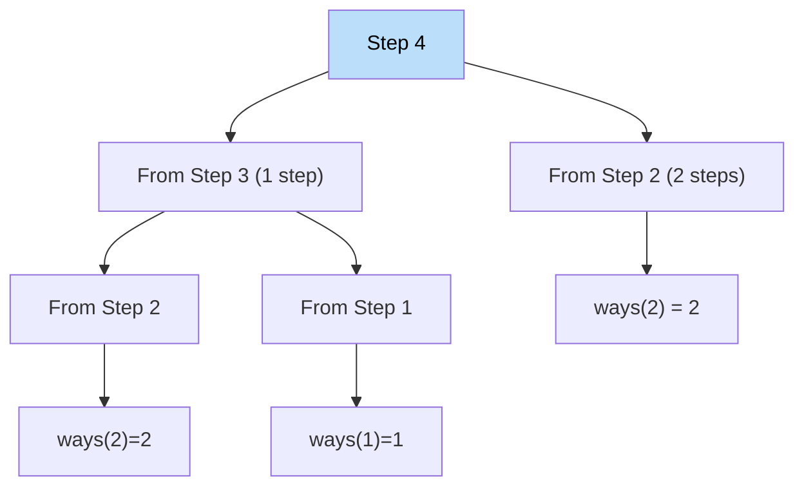

# 🚶‍♂️ Walkthrough: Staircase (Climbing Stairs)

## 👶 Explain Like I'm 5
You're climbing stairs. You can take **1 or 2 steps** at a time. How many different ways can you reach the top (step `n`)?

Think about it from the perspective of the last step:
- You could have arrived at step `n` by taking 1 step from step `n-1`.
- Or by taking 2 steps from step `n-2`.

So `ways(n) = ways(n-1) + ways(n-2)` — that's the **Fibonacci recurrence**!

## 🎯 Core Strategy
**Fibonacci DP** with two rolling variables.

- Base cases: `ways(0) = 1` (standing at bottom, 1 way to do nothing), `ways(1) = 1`.
- Recurrence: `ways(n) = ways(n-1) + ways(n-2)`.

## 🏃‍♂️ Step-by-Step Execution
**Input**: `n = 5`

| n | ways |
|---|---|
| 1 | 1 |
| 2 | 2 |
| 3 | 3 |
| 4 | 5 |
| 5 | 8 |

**Return `8`** ✅

## 📊 Visual Diagram (Decision Tree for n=4)

## 🛑 Complexity
- **Time:** $O(N)$.
- **Space:** $O(1)$ — two rolling variables.
