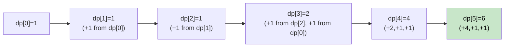

# 🚶‍♂️ Walkthrough: Number Factors

## 👶 Explain Like I'm 5
Given `N`, find the number of ways to express `N` as a sum of 1, 3, or 4.
Example: `N=4` → `{1+1+1+1}`, `{1+3}`, `{3+1}`, `{4}` → **4 ways**.

Think of it like a frog that can jump 1, 3, or 4 steps. How many paths to step `N`?

## 🎯 Core Strategy
**Extended Fibonacci DP** — a generalization where each state depends on up to 4 prior states.

`dp[i]` = number of ways to express `i` using 1, 3, and 4.

Recurrence:
- `dp[i] += dp[i-1]` (used a step of size 1)
- `dp[i] += dp[i-3]` if `i >= 3`
- `dp[i] += dp[i-4]` if `i >= 4`

Base: `dp[0] = 1` (empty sum).

## 🏃‍♂️ Step-by-Step Execution (Dry Run)
**Input**: `N = 5`

| i | dp[i-1] | dp[i-3] | dp[i-4] | dp[i] |
|---|---|---|---|---|
| 1 | dp[0]=1 | — | — | 1 |
| 2 | dp[1]=1 | — | — | 1 |
| 3 | dp[2]=1 | dp[0]=1 | — | 2 |
| 4 | dp[3]=2 | dp[1]=1 | dp[0]=1 | 4 |
| 5 | dp[4]=4 | dp[2]=1 | dp[1]=1 | **6** |

**Return `6`** ✅

## 📊 Visual Diagram

## 🛑 Complexity
- **Time:** $O(N)$.
- **Space:** $O(N)$ (or $O(4)$ with a rolling 4-element window).
